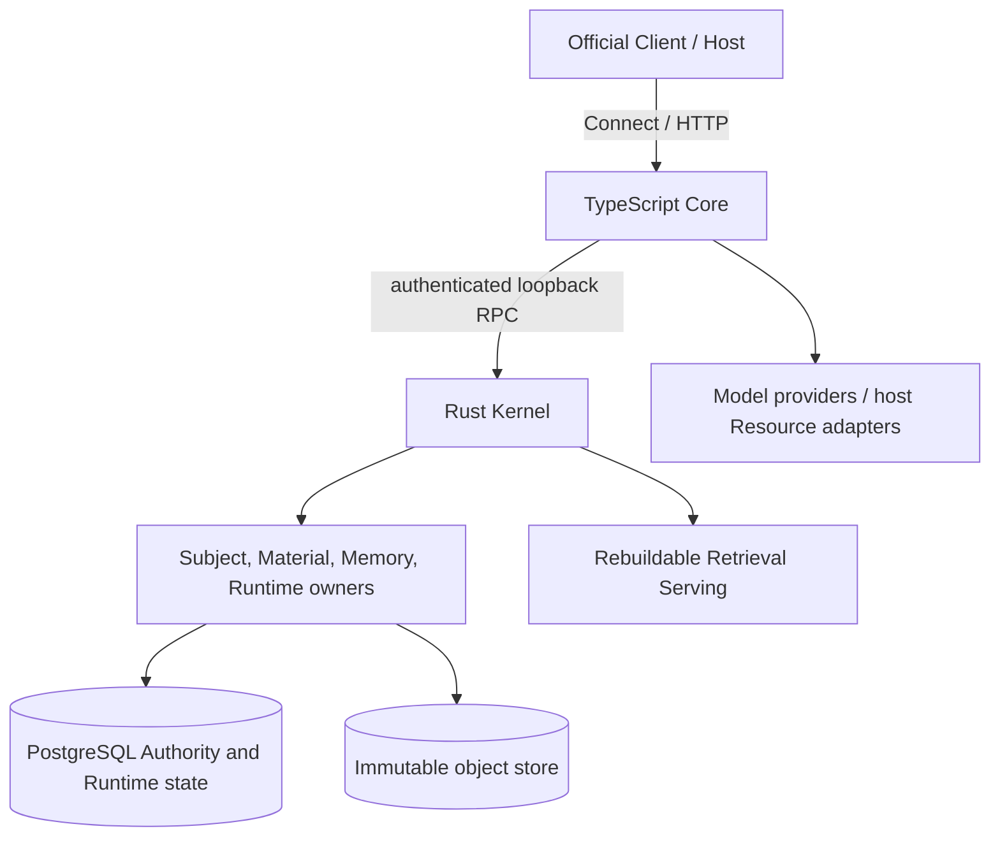

# Nous Wave 当前实现架构

[返回文档目录](../INDEX.md)

本文说明当前代码的进程边界、数据所有者与主数据流。长期认知语义见 [Architecture-Vault 目标设计](https://github.com/Heptalogos-Devs/Architecture-Vault/blob/main/docs/Nous-Wave/TARGET_DESIGN.md)；能力范围与未实现项见[当前状态](../current-state/CURRENT_STATE.md)，可执行产品合同见[Specs 入口](../specs/INDEX.md)。

## 进程与协议

官方 Client / Host 调用 TypeScript Core 的公开 Connect/HTTP 接口。Core 启动并管理私有 Rust Kernel，通过认证的 loopback RPC 调用它。跨语言 wire contract 的唯一源码是 `proto/`；Core、Kernel 和官方 Client 使用生成 bindings。Core 负责公开 API、调用方编排与外部能力，Kernel 承载 Rust 语义 owner 并组合其服务。Kernel 不拥有模型供应商凭据，也不直接执行宿主的外部资源访问。一个 Authority PostgreSQL database 与一个 Serving root 由一个 Kernel 实例独占；Kernel 启动时获取数据库与资产根锁。多个 Client 可并发调用同一 Core，当前没有多 Kernel 共享数据库或 Serving root 的分布式读者协调。

## 数据所有权

| 边界               | 拥有的数据或职责                                                                                                                                             |
| ------------------ | ------------------------------------------------------------------------------------------------------------------------------------------------------------ |
| Core（TypeScript） | 公共 hosting 与调用方编排；模型配置、Prompt 与 provider 调用；宿主供给的外部 Resource adapter；Query / Projection / Managed Context 的宿主侧工作流。 |
| Subject            | Subject identity、capability 与 Cognitive Seed adoption。                                                                                                    |
| Configuration      | 配置定义、校验、作用域、active/desired 解析与不可变快照；不承载领域状态。                                                                                    |
| Material           | Artifact、Observation、来源区域、派生表示及 materialization / lineage。                                                                                      |
| Memory             | Memory、CognitiveSchema、Episode、Journal、Tag、AssociationEvidence、provenance 与其修订和生命周期。                                                         |
| Runtime            | Session、ResidentSet、WorkContext、UseEvent，以及 Query 的绑定上下文、计划与运行时状态。                                                                     |
| Persistence        | PostgreSQL schema、连接与事务、authority sequencing、mutation receipt、投影水位等存储机制；不裁决领域语义。                                                  |
| Object Store       | 大型不可变材料的内容存储机制；Material owner 保有内容身份和来源意义。                                                                                        |
| Retrieval          | 从 owner 提供的 Authority 输入构建、安装、读取和回收可重建 Serving 代次；不持有认知 Authority。                                                              |
| Protocol           | `proto/` 是跨语言 RPC 合同来源；生成代码不手工编辑。                                                                                                         |

Authority mutation 由语义 owner 校验和提交。Core 以类型化输入执行模型或外部 Resource 调用，并将结果交给正式 owner 请求；owner 重新校验来源、对象状态、权限和预期修订后提交 Authority。

Mutation receipt 保存类型化的 owner 结果：每项携带 `CognitiveRef`，可附精确修订和对象 epoch；拆分、分区输出按提交顺序保留。receipt 与 Authority mutation 原子提交；相同 owner 请求可重放原结果，同一操作身份携带不同请求会冲突。创建、修订和拆分直接返回 `MutationResult`；完整响应按记录的精确修订读取。Serving 协调的认知 purge 仍使用带对象 epoch 的 owner checkpoint。

### 认知对象与修订

Memory、CognitiveSchema、Episode、Journal 共用 `CognitionHeader` 和 `CognitionRevisionHeader`。对象身份、当前 head、epoch、生命周期写入 `cognition_objects`；修订身份、所属对象、父修订、时间和 producer 写入 `cognition_revision_headers`。四类内容与其关系仍由各自的 typed payload 表保存。

读取、列表、历史和生命周期变更由 Memory owner 的共同入口执行，公开在 MemoryService；官方 Client 的入口是 `cognition.read/list/history/mutate`。对象引用和精确修订引用都返回完整的 typed family view：`revision` 是本次所选修订，`header.currentRevisionRef` 是对象当前 head，两者允许不同。CLI 的各类认知命令复用这些入口。

## 主要数据流

### 材料接纳与认知形成

1. Host / Client 通过 Core 提供材料或请求接纳外部资源结果。外部 Resource 访问由宿主注入的 adapter 提供；adapter 结果仍保留外部资源身份。
2. Material owner 建立 Artifact、Observation 与来源区域，并管理派生表示、精确来源和内容定位。
3. Memory owner 从被引用的观察与其他可核验来源形成或修订认知对象，记录 formation basis、provenance、revision 与生命周期。
4. Authority 提交改变相关 Serving 的有效输入；Retrieval 按需从 owner projection 重建所需代次。

模型能力属于执行机制，不是内容 Authority。Provider 输出先成为带来源和 producer 条件的提案，再由相应语义 owner 决定接受、修订或拒绝。

### 查询与结果物化

Core 解析调用方的 Query 请求并处理宿主侧模型 / Resource 往返。Runtime 在一次查询中持有一份 `BoundQuery`：`ReadContext` 保存冻结配置，`QueryPlan` 保存检索策略与预算；各执行阶段共用所属查询分支的绑定，持有至最终校验；该运行结束后释放，不供后续请求续用。Retrieval 产生有界候选，Memory 与 Material 分别负责自身认知和材料结果的读取、校验及最终物化，Runtime 组合 owner 结果。Serving 命中只是召回依据，返回前以 owner Authority 为准；历史、访问、抑制和清除约束不能由索引代替。

查询结束后的 Projection / Managed Context 是新的 Current owner read，不延用已经结束的查询或其 historical view。Projection 保留查询命中的精确修订（`hit.revision ?? hit.reference`），再由各 owner 提供当前可用内容；Kernel 负责按请求分发并组合 owner 结果，不自行重建其他领域的数据规则。

Context projection 使用单一 Kernel batch RPC，按 owner、输入顺序和最多 256 个引用分组。Memory（包括 Episode、Journal、Schema）与 Material 通过有界 grouped owner reads 物化所选引用，并由相应 owner 检查当前生命周期。完成历史 Query 后进行的 projection 仍是新的 Current read，并按 owner 当前可用性重新校验保留的精确修订。

Managed Context 的同步缓存只保存游标、配置身份和各内容段摘要，不保留内容副本。新 projection 与摘要前缀相同则返回追加部分，否则重置；Subject 清除会使已有缓存和进行中的 projection 失效。

### 模型调用与 owner 提交

Core 在一次请求中构造类型化输入、执行模型并校验输出，再直接调用 canonical owner mutation。owner 负责来源、身份、生命周期、权限和 revision/epoch 校验，并以普通 mutation receipt 原子提交结果。模型提案、输出和调用尝试不作为可恢复 workflow checkpoint 持久化；Material owner 正式提交的 DerivedRepresentation 与 embedding 等可重建缓存仍按各自数据合同保存。CLI 可用有界本地 request/result cache 和显式手动 retry；重试可能重新调用模型或读取外部资源，模型输出改变时同一 owner operation ID 可能冲突，不承诺崩溃后自动续接。Query 运行由单条双向 RPC 持有，流结束即释放。

### Serving 与生命周期

Retrieval Serving 是从 Authority 派生的可重建资产，按输入 Authority view、实际构建实现和构建所需配置确定兼容身份。查询 readout policy 属于当次 Runtime QueryPlan；它改变查询行为但不改变已构建资产的身份。Current 与 historical view 使用受保护的代次。Current 直接由代次的 ready 状态、view 与当前 purge epoch 确定，不另存一张当前代次指针表。

Memory、Schema、Episode 和 Journal 共用 Memory owner 的 purge checkpoint 与 Kernel 的 Serving 回收流程，移除目标 bindings 及受影响的 WorkContext 引用，并推进 Subject 的 Serving purge epoch。正在进行的 QueryRun 在最终返回前校验 epoch；基于更早视图的 build / publication / reuse 被拒绝。Core 同步使该 Subject 的 query-vector cache 与 context tracks 失效。Serving 回收受本进程 reader gate 限制；共享向量材料只有在 purge 范围外仍有有效来源引用时才保留。无来源归属的旧向量通过显式的离线数据库副本升级流程处理；独立 backup table 不属于普通 owner purge，范围见[当前状态](../current-state/CURRENT_STATE.md)。

## 阅读入口

- [Rust owner 索引](../../crates/INDEX.md)
- [官方 Client](../../packages/client/README.md)
- [产品合同目录](../specs/INDEX.md)
- [当前实现与限制](../current-state/CURRENT_STATE.md)
- [Architecture-Vault Nous Wave 文档](https://github.com/Heptalogos-Devs/Architecture-Vault/tree/main/docs/Nous-Wave)
