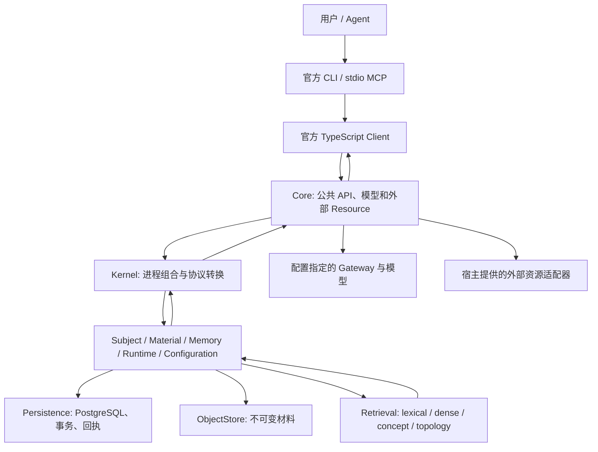

# 功能、数据流与内部能力地图

[返回文档目录](../INDEX.md)

本文记录全库整改目标和当前功能入口、数据流与责任归属，具体能力和已删除流程以下表为准。地图不是全库完成的证明：公开返回结构、分页、完整操作和批量读取必须由实际路径分别核实，不以某个 owner 已有批量方法推断其所有消费者都已迁移。公共场景用受控 provider 验证模型线路；用户给定 Ark Gateway 的真实文本形成、向量提交与查询也已通过隔离实例验证，模型 Rerank 暂不启用。模型输出与检索质量仍由实际研究评估，连通验证不能替代质量结论。长期认知语义仍由 Architecture-Vault 的 Target Design 和已接受决定拥有。

## 整改目标

1. 从真实任务出发，沿官方 CLI、MCP、Client、Core、Kernel、owner 到存储和返回结果核实功能；区分已贯通、后端已有但入口缺失、实际缺失。
2. 删除不能直接服务任务的登记、准备、核对、转换、重复读取、中间状态和收尾流程；改完整流程，不只消除代码克隆。
3. 按实际能力划分内部职责，各能力拥有自己的数据、规则和完整操作；调用方不接触其 SQL、文件布局和内部处理顺序。
4. 一个概念保留一个正式数据结构和操作合同；修正源头并迁移全部当前生产者和消费者，删除临时包装、旁路传参和重新推断。
5. 复用现有 owner、标准库和成熟依赖，收拢事务、引用、数据库、文件、配置与错误机制；不增设通用框架。
6. 删除无实际用途的版本核对、owner 标记、子租约、恢复链和状态流转。保留已产生的数据和模型结果，不承诺从任意中断点完美恢复。
7. 算法与策略先具备配置能力，再决定暴露层级；状态、错误和已有功能接通官方入口。
8. 删除无继续价值的脚手架、过时或被覆盖的测试和脚本；缓存、临时生成数据有明确位置和清理入口，不扩张验收矩阵。
9. 代码按职责集中，测试与生产代码分开，脚本按用途组织；当前文档直接解释实际功能、配置和错误，历史保留在 Git。
10. 保留算法研究、Hybrid/VCP、真实模型、打包发布、多系统和路径布局能力；明显降低生产代码量、机制数量、转换次数和修改牵涉面。没有兼容需求，统一后删除旧路径。
11. 优先使用真实功能端到端场景；仅为必要的脆弱算法、并发、解析或 Authority 边界保留独立测试，不新增解剖式脚手架测试。

## 完整能力与已替换流程

下表按一次实际操作记录责任与删除单位；入口接通和重新执行验证分别判断。尚未交付的功能继续列在功能边界，不能用占位接口补齐。

| 完整能力                           | 当前责任与数据流                                                                                                                                                                                                        | 已删除的调用方流程                                                                                                                               |
| ---------------------------------- | ----------------------------------------------------------------------------------------------------------------------------------------------------------------------------------------------------------------------- | ------------------------------------------------------------------------------------------------------------------------------------------------ |
| Query source admission             | Runtime binding 形成一份含 requested/exact/canonical reference 与真实 origin 的来源；representation、activation 和 Runtime lane 从它派生                                                                                | ref/source 平行维护、重复 situation 数组、无消费者的 context digest/version、WorkContext 再补种子、丢失来源后贴标签、旧 Tag 与 survivor 两份输入 |
| Cognition semantic read            | 完整 get/list/history 使用共同只读事务；descriptor 使用窄内容读取，Context 在同一读取范围组合内容和 exact support；Memory 不解释 Query origin                                                                           | 已删 Persistence 第二套 descriptor、分时 head/view 和消费者 canonical 修补；尚未删除 descriptor 无用关联读取                                     |
| Serving build                      | 一次准备共享同一捕获输入的来源、已物化文本和兼容向量；lexical、dense、VCP 使用本次产物                                                                                                                                  | VCP/dense 第二次共同正文与向量准备；无新增持久构建任务或缓存调度                                                                                 |
| Configuration / CLI / startup      | 连接为基础，selection/receipt 按需取得；Configuration 返回所需 view/pending 并只更新目标 scope/key；启动直接传递规范化 registry/values 和 upload limit                                                                  | 普通命令完整 consumer 初始化、单键写强制预读 revision、双完整 snapshot、全 Subject 状态克隆、重复配置解析与启动 RPC                              |
| Cognition lifecycle/read           | Memory 的完整 current/exact/page 读取共用同一读取范围；purge 清理四家族 exact revision 的支持关系；Runtime 统一 WorkContext→Session 锁序                                                                                | 分时读取后猜测 head、Episode/Journal purge 遗漏、相反锁序、逐个 Episode 维护加载与 split/merge 重复 provenance 校验                              |
| Material / Runtime facts / trace   | Material 拥有材料 DAG、来源对象和时间事实；Runtime 拥有使用事实、经验顺序和 draft reservation；Memory 解释认知与直接/递归支持；Kernel 组合有界 trace                                                                    | CLI 四家族读取与逐节点 RPC、Memory 的外域表/JSON 解释、accretion 每成员重复根遍历和第二套 family loader                                          |
| Model results / maintenance        | Core 共同结果操作读取既有成果；有结果才保存提案、必要输入/依赖与 telemetry；owner 提交后保存 outcome。确定性撤回直达 Memory；生成分支才检查角色和预算                                                                   | StartOperation、无成果恢复 snapshot、成功 telemetry/proposal 分开写、内层重复锁、过早整类筛选、Core 写 wall-clock due                            |
| Query execution / errors / context | Runtime 根据 Core 的正式可执行能力和实际任务决定 Host 工作；无模型任务连续执行，Kernel 不读模型 JSON；私有 query embedding 为可选单值。ManagedContext 根据有效内容判定 delta；完整 Connect/domain 错误与窄 receipt 判断 | 无 Host 的暂存取回、Set/数组虚假多 embedding、原始超 cap 预算导致 reset、不完整错误枚举、明确拒绝留下不可用 retry 请求                           |

Stock `StoredEmbeddingProvider` 从数据库读取向量。本次 Serving 合并减少重复读取、正文物化和装配；不能将它写成减少了两次付费 provider 调用。实际模型的网络成本与质量由相应 Research 运行判断。

## 系统数据流

模型和外部资源执行在 Authority 事务之外。模型输出是提案；所属 owner 决定持久提交。Serving 可重建，返回前由 owner 核验来源、生命周期、主体和精确修订。

## 实际功能地图

入口列说明当前完整执行路径；最后一列记录已拆除的多余步骤与仍存在的功能边界。没有独立公开操作的能力直接标明，不用局部测试替代系统可用性。

| 任务                        | 官方入口与实际路径                                                                                                                      | 数据与责任归属                                                                                                | 简化后的流程与功能边界                                                                                                                                                                                                                                                      |
| --------------------------- | --------------------------------------------------------------------------------------------------------------------------------------- | ------------------------------------------------------------------------------------------------------------- | --------------------------------------------------------------------------------------------------------------------------------------------------------------------------------------------------------------------------------------------------------------------------- |
| 开发启动、状态、停止        | dev / launcher serve → Core → private Kernel → PostgreSQL → discovery → Client status                                                   | Launcher/Core 拥有进程；RuntimeLocations 拥有路径；Kernel 组合 owner                                          | dev 与包共用启动；一个 JSON bootstrap；普通 serve 使用已安装 runtime；监督 Kernel 退出，收尾完整执行，最后释放实例锁                                                                                                                                                        |
| 配置与模型接入              | config describe/get/set/clear/check → Core normalizer → Configuration owner → active/desired snapshot → 模型角色                        | Schema 属于参数 owner；Configuration 拥有覆盖顺序、快照和作用域                                               | 入库时规范化，读快照不重复解析；删除人为 config revision；未配置角色直接报告 NOT_CONFIGURED；凭据在 SecretRoot                                                                                                                                                              |
| Subject、Seed               | subject create/use/list、seed/adopt-seed → Subject → Material Artifact admission                                                        | Subject 拥有身份、capability 和 adoption；Material 拥有登记、去重和完整元数据，ObjectStore 拥有不可变存储布局 | Seed、上传和 Observation 共用同一 Artifact 登记，可加入采用事务；创建按 operation-id 重放并拒绝同 ID 不同输入；主体删除/分支尚未实现                                                                                                                                        |
| Session                     | session open/show/list/close → Runtime Session → 返回选中会话                                                                           | Runtime 拥有会话、revision、活动时间、Resident 状态与 foreground WorkContext；CLI 只保存选择                  | 正式返回完整 Session/Resident metadata，以 closed_at 表达关闭；列表分页和 resident 批量读取，不在 transport 重读 foreground                                                                                                                                                 |
| 观察和材料上传              | observe text/file → Client streaming upload / RecordObservation → Material → Runtime admission                                          | Material 拥有 Artifact、Occurrence、SourceRegion、mentions、来源 lineage；Runtime 拥有实际接触                | read/list/producer/derived graph 由 Material 提供完整 view，共享解码与批量读取                                                                                                                                                                                              |
| 材料读取与来源核对          | read/show → Material read/materialize；trace → Memory 认知依赖 → Material DAG → 文本范围或二进制元数据；read --output → Client download | Material 拥有选择、范围和 lineage；ObjectStore 拥有流式字节                                                   | trace 返回有界认知/材料节点与 producers，CLI 只表达边界；preview 有界；Artifact 全量流式导出，Material 提供选区流和元数据；material clean 清理未被任何 Subject 接纳且不在写入中的 CAS/staging 对象                                                                          |
| 派生与媒体                  | derive → Core role/routes/预处理 → Material commit → representation/regions                                                             | Core 拥有 provider、FFmpeg；Material 拥有 immutable DAG 和 ProducerSignature                                  | 保留三策略、图像、音频直接/转写、视频直接/frames；已有 outcome 直接返回，缓存 proposal 再提交，不为 direct replay 下载原字节                                                                                                                                                |
| Memory 形成、修订与生命周期 | form、memory form/revise/history/lifecycle → Memory                                                                                     | Memory 拥有对象、不可变 revision、正式可写 content、basis、aboutness、tags、依赖和生命周期                    | 创建/修订使用同一内容，role 只由创建设置；历史返回完整 view，按 revision_no 分页；规范化、digest 与写入消费同一内容，purge 一次事务提交                                                                                                                                     |
| CognitiveSchema             | schema create/revise/evidence/split/merge/lifecycle、maintenance consolidation → Memory Schema                                          | Schema 能力拥有适用范围、边界、支持链和 lineage                                                               | 现有公共操作全部接 CLI；独立 list/history 共用完整批量读取与既有分页；保持独立语义模型                                                                                                                                                                                      |
| Tag 与 Association          | tag create/revise/merge/split/attach、association create/revoke/neighborhood → Memory concepts                                          | Tag 拥有语义资产和 canonical identity；Association 拥有 typed endpoints/basis/polarity                        | SQL 与完整 read/search 属于 owner；Tag history、Association get/list 已接官方协议与 CLI                                                                                                                                                                                     |
| WorkContext 与 ResidentSet  | context create/list/set/pin/unpin/clear/foreground/pause/resume/end → Runtime                                                           | Runtime 拥有任务文本、exact anchors、revision、生命周期和完整内容修改                                         | fields/pin/unpin/clear 是 typed owner 意图；锁内核验 expected revision、应用意图，未提供保持、空值清空；CLI 不回填整对象或改数组，列表真正分页                                                                                                                              |
| Episode 与 Journal          | episode create/revise/history/link/lifecycle、journal reads/lifecycle；maintenance 自动组织                                             | Memory 拥有 exact organization、成员/来源、修订与 lifecycle；Runtime 拥有实际 experience                      | exact/list/history 共享完整批量读取；对象按稳定 ID 分页、修订按 revision_no 分页且游标验证所属对象；四家族共用 Runtime exact-ref 清理                                                                                                                                       |
| 有意义使用与维护            | use → Runtime receipt/feedback → MaintenanceNeed；maintenance grant → Core → owner actions                                              | Runtime 拥有使用事件和待做事项；Core 拥有有限 host 预算；Memory 拥有提交                                      | grant 按 Subject 串行，选择 pending need，完成核对 trigger revision；没有数据库运行租约/token；保留调用与时间预算                                                                                                                                                           |
| Query 与历史切面            | query/prepare/inspect → NousQL → Runtime preparation/context → lanes/fusion/rerank → owner final validation → result:N                  | Runtime 拥有意图、时间切面、prepared context；Retrieval 拥有投影；各 owner 拥有 materialization               | 一个显式 embedding，复用 binding 与打开的 family；stale exact binding 被拒绝；显式 serving clean、refresh 或 maintenance 回收，普通 query 不扫描资产目录                                                                                                                    |
| Hybrid、native、VCP         | 同一 prepared query → 显式配置的检索 profile → lexical/dense/shared concept/topology                                                    | Retrieval mechanisms/reference/vcp 拥有数值算法；owner 提供可重建输入                                         | 四类 profile、数值 reference、真实 read pin/grace 保留；死的 shadow policy/rank、旧 family 兼容与源码哈希升级核对删除，制品结构、参数、向量空间和实际内容校验保留                                                                                                           |
| 外部 Resource               | resource put/get/list/remove/materialize；query Resource continuation → adapter → Material Observation                                  | Runtime 拥有 Registry 的完整读写、过滤与有界分页，宿主 adapter 拥有外部访问；Material 拥有已接触来源          | 单对象和 query bounded descriptors 直接由 owner 读取，不全量拉取再筛；描述符与目录名称同事务写入。stock Core 无 provider adapter，明确报告未接入；初次接纳复用 version/access，恢复未接纳 proposal 才重查                                                                   |
| Context projection          | projection build/managed → Runtime capture/owner contribution → Core steward                                                            | Memory 拥有生命周期、accessibility 和 basis 解释；Runtime 拥有接纳；Material 拥有自身 context source          | Runtime 读取一次 Session/foreground，按 consumer policy 与预算选择来源；WorkContext 提供捕获的任务文本，四类 cognition、Tag、Material 与 Resource 提供实际内容和证据，Entity 复用目录名称/别名；Core 仅做 steward 表达，无正文或仅引用的投影不调用模型；拒绝 closed Session |
| Windows Portable 与多布局   | build/runtime pack/notices → assemble → installed launcher → verify/restart/relocate                                                    | Release 拥有 payload；RuntimePack 拥有 acquisition/inventory；Locations 拥有共置/分离 roots                   | 只加载目标平台 catalog，不重复 acquisition 已完成的校验；保留显式 release verify；Linux source-less 尚未交付                                                                                                                                                                |
| 研究和本地数据维护          | research gateway/media/longitudinal/contracts/trace；clean:local → data/temp、data/cache                                                | Research 拥有真实语料、数值 oracle、模型观察；开发工具拥有本地生成路径                                        | 真实研究保留；跨系统显式清理，受控停止临时 PostgreSQL；longitudinal 公共场景运行一次；删长度 gate 与重复脚手架                                                                                                                                                              |

Self、Social、Motivation 和 Heptalogos integration 是长期方向，当前未实现。本轮保持既有功能边界，不用占位 API 表示完成。

## 完整路径的整改与边界

下表记录再次逐项追踪后采用的 owner 操作与删除的流程。源码接通与功能验证分别判断；检索质量、媒体理解质量和未实现能力不能由结构改动推断。

| 路径                               | 正式数据流与责任归属                                                                                                                                                                                            | 删除的重复机制及保留边界                                                                                                                                                                                                                                                                                 |
| ---------------------------------- | --------------------------------------------------------------------------------------------------------------------------------------------------------------------------------------------------------------- | -------------------------------------------------------------------------------------------------------------------------------------------------------------------------------------------------------------------------------------------------------------------------------------------------------- |
| Projection / Managed Context       | Runtime 捕获 Session/foreground 并按 consumer policy、去重和预算选来源，再按剩余名额每批最多 16 项读取；Core steward 表达                                                                                       | 删除未使用 working_set 算法、复制用的 Memory context DTO、薄 contribution DTO、重复完整 Session 读取、未消费 provenance/media 字段和空 optional paid call；保留 source assembly 后真实 revision/foreground fence；Tag 归 memory policy，未绑定 Entity 仅保留引用                                         |
| Cognition mutation / planning      | Episode、Tag 创建/修订消费同一正式 content；Schema/Tag 区分选中 revision 与当前 head；Memory 统一 exact support 批量读取，在同一读取事务内遍历 cognition；一次 focus 投影与批量邻居读取；partition 批量完整返回 | 删除字段摘要抄写、mutation 薄结果再读、逐成员 support 读取、重复依据解码、basis-only 全对象加载、focus 多次读取和无消费者的正式结构；保留认知语义、独立根和不同用途的循环检查                                                                                                                            |
| Serving / algorithms               | Lexical/Dense 共用实际文本输入；native current/history 共用结构读取；VCP 保留自身文本、图和 provenance 一致快照；batch 读取/提交文本与 Tag 向量                                                                 | 删除历史各 family 全量 bundle、native 读取 Material 正文、双候选目录、失败后重复构建 raw Concept、逐 Tag 向量 lookup、VCP/dense 重复正文/向量准备、未消费 Dense EPA 持久化链、空机制接口、synopsis ghost 水印和逐向量重复 metadata；研究 EPA/Residual 数值算法保留，required residual 尚未接通时明确拒绝 |
| Material / source lineage / media  | Material 批量解释来源根、locator、分段与 DAG inputs，提供有界 selected stream；维护输入一次捕获来源、表示和 payload metadata；ObjectStore 拥有 CAS 与清理；Core 直接消费正式流头                                | 删除逐 ref/segment 重验 parent、维护逐项重新解析引用和读取 metadata、纵向 Query 的逐片段重复读取、Memory 旁路 Material SQL、Core source→artifact→坐标重建、第二文件写路径与无用 resource 字段；清理必须保护已接纳与写入中对象                                                                            |
| Runtime residency / Query          | Observation 与 ReportUse 共用 Resident 接纳/容量/hold/state；WorkContext page 批量完整读取；Query 只在实际 Host 工作时保留 continuation/ticket 与执行期限                                                       | 删除平行 admission、逐对象 page read、WorkContext 文字修改时的全锚点重写、逐锚点写入和逐 Session 解绑、死 Session/Use/WorkingSet/WorkCycle 类型和伪成功 ticket fallback；容量不足明确失败，保留 purge、frozen query 和最终 owner 核验                                                                    |
| Core models / Resource / embedding | 直接消费 provider 已验证结果与 generated Resource 合同；唯一 derive strategy；Embedding owner 批量提交                                                                                                          | 删除重复 Zod.parse、derive target 交叉轴、平行 Resource DTO/null 转换、未消费 Resource 字段、重复 opportunity 预算适配和逐条 embedding commit；只保存实际结果、必要输入和调用 telemetry，不增加任意中断恢复链                                                                                            |
| CLI / maintenance / tests          | CLI 直接消费正式 Tag/Association 请求，编译 typed mutation，传并发条件/status/page/operation-id；Context projection 使用实际 Session foreground；复用公共功能场景                                               | 删除本地选择推断 foreground、重复开发入口、Tag/Association 平行 Zod、basis DSL 和逐 Tag 预读、被公共路径覆盖的默认值测试与低层 receipt wrapper；保留模型证据通道、取消、并发、Authority 与研究数值边界                                                                                                   |

## 模型能力

| 能力               | Role                                                                                          | 输出提交 owner                                             |
| ------------------ | --------------------------------------------------------------------------------------------- | ---------------------------------------------------------- |
| 形成与上下文表达   | memory_formation、projection_steward                                                          | Memory、Runtime                                            |
| 纵向组织与认知演化 | episode_segmentation、journal_synthesis、memory_consolidation、concept_maintenance            | Memory 的 Episode、Journal、Memory/Schema、Tag/Association |
| 材料理解与结构化   | material_description、material_structuring、material_direct_structuring、speech_transcription | Material                                                   |
| 查询模型工作       | query_embedding、query_concept_enrichment、query_rerank                                       | 查询临时结果或可重建 Serving，不写为认知事实               |

ModelRole、ExecutionProfile、ModelProfile 和 Gateway 分别表达工作、调用控制、模型资源与连接。保留明确配置的有限 route fallback 和实际成功 ProducerSignature；删除重复解析和另一套流程租约。未配置或缺少凭据时状态必须直接说明。

## 内部能力与数据合同

| 内部能力                | 单一责任 owner                                                                              | 调用方获得的操作                                                                                                                        | 已移除的泄漏或重复                                                                                                                                      |
| ----------------------- | ------------------------------------------------------------------------------------------- | --------------------------------------------------------------------------------------------------------------------------------------- | ------------------------------------------------------------------------------------------------------------------------------------------------------- |
| 身份和正式 DTO          | canonical Proto、core typed IDs/refs；Identity Directory 解析地址                           | exact typed ref、明确歧义候选、公开 DTO                                                                                                 | Client 的平行 Data/WeakMap 结构、重复 schema 恢复、CLI 再次查已装饰的地址                                                                               |
| 领域读取、列表和修改    | Subject / Material / Memory / Runtime 的能力子模块                                          | Memory/Episode/Journal 的完整 read/history/page，Session/WorkContext/Resource 的正式视图和有界列表；Schema/Tag split 的完整 child views | 上述路径删除 ID 列表再逐项读取和 transport 重建字段；WorkContext 复用现有事务/回执 envelope，文字意图不重写锚点；未声明的历史/list API 不用占位包装补齐 |
| 事务与幂等              | Persistence 提供同一事务和 receipt；语义 owner 提供规则                                     | Owner mutation；同请求不重复写，保存 exact 结果的操作重放原修订，mutable overlay 和 evidence 增补返回当前对象                           | 无需求的多阶段数据库 checkpoint、临时 owner 状态；不删除真实并发和同 ID 不同输入冲突                                                                    |
| 模型操作保存            | Core 序列化同一 operation；Persistence 保存实际 proposal/outcome/telemetry 与必要结果上下文 | 读取或执行同一正式 operation，已有提案直接提交；没有成果不登记恢复状态                                                                  | child lease/token/busy/release、父任务数据库租约、逐项 progress、重复 prepare/reserve、任意位置完美恢复链                                               |
| 来源和 purge            | Material 拥有来源；Memory 各能力拥有 cognition；Runtime 拥有 runtime 清理                   | 修改和读取复用当前事务完成认知依据、证据定位和使用事实；synthesized 复用首次 summary；purge 清除 exact refs 并保留无正文回执                                       | 重复遍历 synthesized provenance、四家族重复 Runtime 清理、调用方推断 JSON 引用；真实循环和事务内直接引用检查保留                                        |
| 配置                    | 参数 owner 提供类型/默认值/校验；Configuration 保存解析结果                                 | 已规范化的 immutable typed snapshot 与清楚 apply mode                                                                                   | 每次读取再 normalize、重复 protobuf/JSON/domain 包装；不增加第二套配置服务                                                                              |
| Serving 资产            | Retrieval assets 拥有 build/open/install/reclaim；Persistence 统一实际依赖 watermark        | 准备后直接返回当前请求打开的 family assets，状态/准备/发布同源 freshness                                                                | 发布后重查 DB/reopen/重建 snapshot、每次查询全目录扫回收；保留历史身份、Arc reader 和 purge fences                                                      |
| 文件和进程              | ObjectStore、RuntimePack、Locations、Core lifecycle                                         | 流式字节、已安装 runtime、统一 serve/stop                                                                                               | 普通启动重复摘要检查、dev 另起一套启动、首个收尾错误阻断其他资源关闭                                                                                    |
| CLI 消费者状态          | CLI 只保存选择、exact query results 和原 mutation 请求                                      | 同一命令的固定输入、官方 owner 返回结果                                                                                                 | 本地 terminal outcome Authority、手写 RPC 重试名单、多层 protobuf→Data→恢复→显示转换；重试资格使用正式 RPC 声明，不再解释领域状态                       |
| Material 批量正文与片段 | Material 拥有请求内已解析引用/metadata 与有界字节；Retrieval 消费选中正文                   | 最多 256 refs 一批 metadata，同引用和已有正文复用，fragment 按剩余预算读取                                                              | selection 后逐项重新验证/加载 metadata、再次解析 UUID、旁路单项 payload SQL；不新增持久缓存或调度框架                                                   |
| 测试与生成数据          | 公共功能场景；owner 独特脆弱逻辑；workspacePaths                                            | 单次真实公共路径检查，显式清理本地临时/缓存                                                                                             | 重叠脚手架测试、重复运行、过时目录扫描；不删数值 oracle、真实语料和独特并发/解析风险                                                                    |

## 当前能力与剩余边界

| 能力                  | 当前实现与边界                                                                                                                        | 责任与简化结果                                                                               |
| --------------------- | ------------------------------------------------------------------------------------------------------------------------------------- | -------------------------------------------------------------------------------------------- |
| 认知内容与 Projection | Memory/Material 已批量读取；accretion 复用同次读取的内容与 support，保持 kind/value 顺序；Projection 每批最多 16 项，其他 Runtime 来源仍按项读取               | 窄内容和 exact support 各归 Memory；Runtime 有界批量消费；按输入顺序比较，不伪造 QuerySource |
| 维护 grant            | 已替换：按选取时的排序位置继续翻页；operationsConsumed 贯通 grant/scheduler；无生成机会跳过，required 失败返回正式详情                | 复用排序有界翻页；正式 operationsConsumed；生成前统一角色要求；无状态变化不写确认            |
| Query Host            | 已替换：Core 传已解析的模型可执行能力与 requirement，Runtime 结合绑定计划选择直达或 Host continuation                                 | Core 传实际可执行能力，Runtime 结合查询计划决定直达或 continuation                           |
| formation             | 已替换：Material 在同一读取范围选择 exact 来源、取得 mentions 与 payload metadata，事务结束后消费有界字节；Core 一次 RPC 获取形成输入 | Material 完成选择、metadata、mentions 和有界内容准备；Core 仅决定模型与媒体策略              |
| CLI                   | 已替换：连接后按使用取得 Subject、Session、WorkContext、result:N 和本地状态；只按 owner 声明的提交前拒绝删除 receipt                  | 连接为基础，操作按需取得 selection、result 和 receipt；明确拒绝由正式提交阶段表达            |
| 正式管理与读取        | 已接：serving clean、Schema list/history、Tag history、Association get/list；复用正式分页与既有 owner 解码                            | 复用 owner 能力接最短入口；缺少领域实现的标明未实现，不造占位业务                            |
| 生成数据              | Serving 已接独立回收，receipt、Query 缓存和临时目录有边界；embedding_material 尚无独立淘汰策略，随新内容与向量空间增长                                                                                                  | 分别说明所属能力、位置和增长边界；清理保护已接纳材料、付费成果、研究与活跃数据               |

这张表区分已经接通的能力与仍未交付的边界，公共路径验证见下文。已有 Query 单一来源、共享 Serving 构建输入、四家族 purge、完整读取事务、WorkContext 锁序和真实模型结果保存继续作为基础。

## 实际功能验证与边界

`just check` 使用现有格式、协议、类型、lint、Rust 和 TypeScript 测试，以及五条公共 smoke。公共场景启动真实 Core、Kernel 和 PostgreSQL，通过官方 Client 完成提交与返回；算法 reference 和独特 Authority、时间、取消、并发风险继续保留。

已有隔离实例实际跑通 Ark 文本形成、已保存成果重放、向量提交与自有检索；未启用模型 Rerank。这不证明模型输出和算法质量。编译包的 Launcher、Client、CLI、MCP、独立 cwd、分离布局和重启已有运行验证。Windows fast CI 已通过，原生 Windows 正式发布装配未验证。

本轮收尾以 Association 事务、Material 逐项失败及引用模式、维护能力恢复、ExternalObject 描述和配置拒绝的公共行为为范围。新增代码按明确职责、调用方是否更简单、规则是否仍重复解释审查；行数比例要求已撤销。Runtime 其他来源的批量优化、embedding 淘汰、stock Resource adapter 和原生 Windows 发布装配保留现有边界，不在这轮扩建。

相关入口：[当前实现架构](current-implementation.md)、[配置](../reference/CONFIGURATION.md)、[官方 CLI](../../apps/nous-cli/README.md)、[Client operations](../reference/CLIENT.md)、[检索合同](../specs/active/memory-reference-profile/03-query-serving.md)、[脚本](../../scripts/INDEX.md)。
