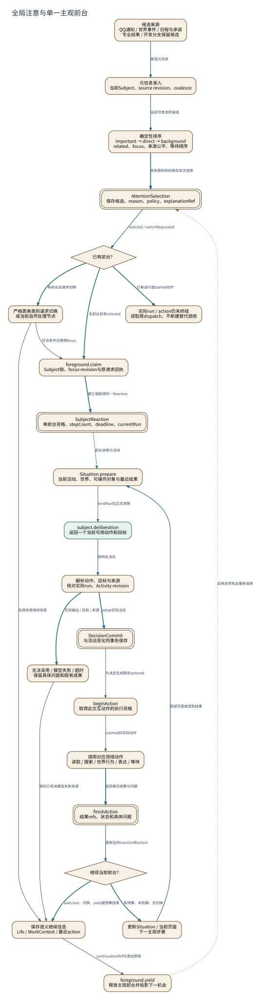

# 全局注意与单一主观前台

**图型**：调度与状态转换图。**对应实现**：Hept默认分支；开发分支增加保留草稿与运行恢复候选。

元信息排序选择前台机会，模型只在实际SituationFrame内决定下一项行动。

[打开可缩放 SVG](./01-attention-reactor.svg) · [PNG](./01-attention-reactor.png) · [DOT 源码](./01-attention-reactor.dot) · [节点与边 JSON](./01-attention-reactor.json)

## 图例与严格方向

每一条有向边以 **源节点 → 目标节点** 表示，其标签写明具体的调用、读写、转移或依赖。边的线型与颜色对应以下固定语义。

| 边类型 | 实际含义 |
|---|---|
| `call` | 运行时调用或请求 |
| `data` | 将材料、候选或结果送往后续节点 |
| `event` | 提交事实之后产生的通知或触发 |
| `read` | 从对象或服务读取数据 |
| `transition` | 同一对象/活动的生命周期状态变迁 |
| `write` | 写入所属权威状态/持久记录 |

节点按所属系统区分：Nous Wave、Heptalogos、原生执行环境和外部系统。双边框表示持久对象或持久状态，椭圆表示外部参与者或事件；其余方框表示实际操作或模块。节点与箭头均带有可跳转的源码依据。

## 箭头清单

| 来源 → 去向 | 关系 | 精确含义 | 代码依据 |
|---|---|---|---|
| 候选来源 → 元信息准入 | `data` | 候选元信息 | [全局通知选择与前台竞争](../源码与实现索引.md#attention)、[单一前台 Reactor](../源码与实现索引.md#reactor)、[局部情境与可操作对象](../源码与实现索引.md#situation) |
| 元信息准入 → 确定性排序 | `data` | 当前可考虑的候选 | [全局通知选择与前台竞争](../源码与实现索引.md#attention)、[单一前台 Reactor](../源码与实现索引.md#reactor)、[局部情境与可操作对象](../源码与实现索引.md#situation) |
| 确定性排序 → AttentionSelection | `write` | 按来源轮转后保存本次选择 | [全局通知选择与前台竞争](../源码与实现索引.md#attention)、[单一前台 Reactor](../源码与实现索引.md#reactor)、[局部情境与可操作对象](../源码与实现索引.md#situation) |
| AttentionSelection → 已有前台？ | `data` | selected / switchRequested | [全局通知选择与前台竞争](../源码与实现索引.md#attention)、[单一前台 Reactor](../源码与实现索引.md#reactor)、[局部情境与可操作对象](../源码与实现索引.md#situation) |
| 已有前台？ → 实际run / action仍未终结 | `transition` | 已有运行或started动作 | [全局通知选择与前台竞争](../源码与实现索引.md#attention)、[单一前台 Reactor](../源码与实现索引.md#reactor)、[局部情境与可操作对象](../源码与实现索引.md#situation) |
| 已有前台？ → foreground.claim | `transition` | 无前台且有selected | [全局通知选择与前台竞争](../源码与实现索引.md#attention)、[单一前台 Reactor](../源码与实现索引.md#reactor)、[局部情境与可操作对象](../源码与实现索引.md#situation) |
| 已有前台？ → 严格更高类别请求切换 | `transition` | 有前台且请求切换 | [全局通知选择与前台竞争](../源码与实现索引.md#attention)、[单一前台 Reactor](../源码与实现索引.md#reactor)、[局部情境与可操作对象](../源码与实现索引.md#situation) |
| 严格更高类别请求切换 → 保存语义继续信息 | `call` | 先保存原继续信息 | [全局通知选择与前台竞争](../源码与实现索引.md#attention)、[单一前台 Reactor](../源码与实现索引.md#reactor)、[局部情境与可操作对象](../源码与实现索引.md#situation) |
| 严格更高类别请求切换 → foreground.claim | `call` | 符合条件后替换focus | [全局通知选择与前台竞争](../源码与实现索引.md#attention)、[单一前台 Reactor](../源码与实现索引.md#reactor)、[局部情境与可操作对象](../源码与实现索引.md#situation) |
| foreground.claim → SubjectReaction | `write` | 建立或取得同一Reaction | [全局通知选择与前台竞争](../源码与实现索引.md#attention)、[单一前台 Reactor](../源码与实现索引.md#reactor)、[局部情境与可操作对象](../源码与实现索引.md#situation) |
| SubjectReaction → Situation.prepare | `read` | 前台资格与活动 | [全局通知选择与前台竞争](../源码与实现索引.md#attention)、[单一前台 Reactor](../源码与实现索引.md#reactor)、[局部情境与可操作对象](../源码与实现索引.md#situation) |
| Situation.prepare → subject.deliberation | `call` | bindRun后正式调用 | [全局通知选择与前台竞争](../源码与实现索引.md#attention)、[单一前台 Reactor](../源码与实现索引.md#reactor)、[局部情境与可操作对象](../源码与实现索引.md#situation) |
| subject.deliberation → 解析动作、目标与来源 | `data` | 结构化决定 | [全局通知选择与前台竞争](../源码与实现索引.md#attention)、[单一前台 Reactor](../源码与实现索引.md#reactor)、[局部情境与可操作对象](../源码与实现索引.md#situation) |
| 解析动作、目标与来源 → DecisionCommit | `write` | adopt实际决定 | [全局通知选择与前台竞争](../源码与实现索引.md#attention)、[单一前台 Reactor](../源码与实现索引.md#reactor)、[局部情境与可操作对象](../源码与实现索引.md#situation) |
| 解析动作、目标与来源 → 无法采用 / 模型失败 / 超时 | `transition` | 无效输出 / 目标 / 来源 | [全局通知选择与前台竞争](../源码与实现索引.md#attention)、[单一前台 Reactor](../源码与实现索引.md#reactor)、[局部情境与可操作对象](../源码与实现索引.md#situation) |
| DecisionCommit → beginAction | `call` | 为决定生成稳定actionId | [全局通知选择与前台竞争](../源码与实现索引.md#attention)、[单一前台 Reactor](../源码与实现索引.md#reactor)、[局部情境与可操作对象](../源码与实现索引.md#situation) |
| beginAction → 调用对应领域动作 | `call` | claimed的实际动作 | [全局通知选择与前台竞争](../源码与实现索引.md#attention)、[单一前台 Reactor](../源码与实现索引.md#reactor)、[局部情境与可操作对象](../源码与实现索引.md#situation) |
| 调用对应领域动作 → finishAction | `write` | 返回真实结果与问题 | [全局通知选择与前台竞争](../源码与实现索引.md#attention)、[单一前台 Reactor](../源码与实现索引.md#reactor)、[局部情境与可操作对象](../源码与实现索引.md#situation) |
| finishAction → 继续当前前台？ | `data` | 更新后的reaction和action | [全局通知选择与前台竞争](../源码与实现索引.md#attention)、[单一前台 Reactor](../源码与实现索引.md#reactor)、[局部情境与可操作对象](../源码与实现索引.md#situation) |
| 继续当前前台？ → 更新Situation / 当前页面 | `transition` | 有预算、未到期、无切换 | [全局通知选择与前台竞争](../源码与实现索引.md#attention)、[单一前台 Reactor](../源码与实现索引.md#reactor)、[局部情境与可操作对象](../源码与实现索引.md#situation) |
| 更新Situation / 当前页面 → Situation.prepare | `data` | 局部页面或读取结果 | [全局通知选择与前台竞争](../源码与实现索引.md#attention)、[单一前台 Reactor](../源码与实现索引.md#reactor)、[局部情境与可操作对象](../源码与实现索引.md#situation) |
| 继续当前前台？ → 保存语义继续信息 | `transition` | wait/rest、切换、yield或预算结束 | [全局通知选择与前台竞争](../源码与实现索引.md#attention)、[单一前台 Reactor](../源码与实现索引.md#reactor)、[局部情境与可操作对象](../源码与实现索引.md#situation) |
| 无法采用 / 模型失败 / 超时 → 保存语义继续信息 | `call` | 保存已有进展及失败来源 | [全局通知选择与前台竞争](../源码与实现索引.md#attention)、[单一前台 Reactor](../源码与实现索引.md#reactor)、[局部情境与可操作对象](../源码与实现索引.md#situation) |
| 保存语义继续信息 → foreground.yield | `call` | continuationRef与退出原因 | [全局通知选择与前台竞争](../源码与实现索引.md#attention)、[单一前台 Reactor](../源码与实现索引.md#reactor)、[局部情境与可操作对象](../源码与实现索引.md#situation) |
| foreground.yield → AttentionSelection | `event` | 后续自然机会重新选择 | [全局通知选择与前台竞争](../源码与实现索引.md#attention)、[单一前台 Reactor](../源码与实现索引.md#reactor)、[局部情境与可操作对象](../源码与实现索引.md#situation) |

## 运行条件与未完成边界

- 当前排序中的类别和related是明确程序字段。兴趣、关系亲近、动机和中断代价尚未成为完整候选效用模型。
- 世界规划与专业执行可以在后台进行；前台资格限制主观决定、自然表达和相关采用。
