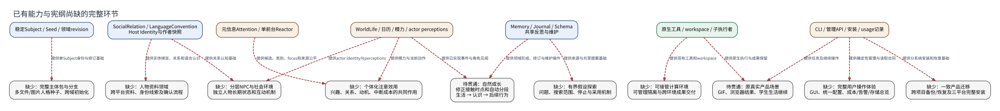

# 已有能力与宪纲尚缺的完整环节

**图型**：能力覆盖关系图。**对应实现**：以当前代码和逐句批注为依据。

虚线框表示待建设或待贯通的能力；连线表示现有机制能提供的基础，全部属于需求覆盖关系。

[打开可缩放 SVG](./02-capability-gaps.svg) · [PNG](./02-capability-gaps.png) · [DOT 源码](./02-capability-gaps.dot) · [节点与边 JSON](./02-capability-gaps.json)

## 图例与严格方向

每一条有向边以 **源节点 → 目标节点** 表示，其标签写明具体的调用、读写、转移或依赖。边的线型与颜色对应以下固定语义。

| 边类型 | 实际含义 |
|---|---|
| `requirement` | 宪纲所需但尚未完成的能力依赖 |

节点按所属系统区分：Nous Wave、Heptalogos、原生执行环境和外部系统。双边框表示持久对象或持久状态，椭圆表示外部参与者或事件；其余方框表示实际操作或模块。节点与箭头均带有可跳转的源码依据。

## 箭头清单

| 来源 → 去向 | 关系 | 精确含义 | 代码依据 |
|---|---|---|---|
| 稳定Subject / Seed / 领域revision → 缺少：完整主体包与分支 | `requirement` | 提供单Subject身份与修订基础 | [同一主体与能力供给](../源码与实现索引.md#subject)、[认知种子来源](../源码与实现索引.md#seed) |
| SocialRelation / LanguageConvention → 缺少：人物资料领域 | `requirement` | 提供实体绑定、关系和语言认识 | [人物身份与跨平台资料](../源码与实现索引.md#people) |
| 元信息Attention / 单前台Reactor → 缺少：个体化注意效用 | `requirement` | 提供候选、类别、focus和来源公平 | [全局通知选择与前台竞争](../源码与实现索引.md#attention) |
| WorldLife / 日历 / 精力 / actor perceptions → 缺少：个体化注意效用 | `requirement` | 提供精力与当前动作 | [精力、当前动作与设备视图](../源码与实现索引.md#living) |
| WorldLife / 日历 / 精力 / actor perceptions → 缺少：分层NPC与社会环境 | `requirement` | 提供actor identity与perceptions | [世界定义、事件与局部见闻](../源码与实现索引.md#world) |
| SocialRelation / LanguageConvention → 缺少：分层NPC与社会环境 | `requirement` | 提供关系认知基础 | [关系认知与语言惯例](../源码与实现索引.md#social) |
| Memory / Journal / Schema → 待贯通：自然成长 | `requirement` | 提供领域形成、修订与维护操作 | [共享反思与维护机会](../源码与实现索引.md#reflection) |
| WorldLife / 日历 / 精力 / actor perceptions → 待贯通：自然成长 | `requirement` | 提供已实现事件与角色见闻 | [世界定义、事件与局部见闻](../源码与实现索引.md#world) |
| Memory / Journal / Schema → 缺少：有界假设探索 | `requirement` | 提供来源与共享提案基础 | [共享反思与维护机会](../源码与实现索引.md#reflection) |
| 原生工具 / workspace / 子执行者 → 缺少：可接管计算环境 | `requirement` | 提供现有工具和workspace | [原生执行环境与工具范围](../源码与实现索引.md#sandbox) |
| 原生工具 / workspace / 子执行者 → 待贯通：原真实产品场景 | `requirement` | 提供原生执行与成果保留 | [专业执行、成果保留与显式查看](../源码与实现索引.md#worker) |
| CLI / 管理API / 安装 / usage记录 → 待贯通：原真实产品场景 | `requirement` | 提供任务及继续操作 | [可读文档、日历和任务管理](../源码与实现索引.md#operator) |
| CLI / 管理API / 安装 / usage记录 → 缺少：完整用户操作体验 | `requirement` | 提供确定性管理与读取合同 | [管理员与确定性管理](../源码与实现索引.md#management) |
| CLI / 管理API / 安装 / usage记录 → 缺少：一致产品迁移 | `requirement` | 提供分系统安装和恢复基础 | [安装、平台与目录](../源码与实现索引.md#deployment) |

## 运行条件与未完成边界

- 本图不规定未来模块布局或接口设计，缺少的能力仍保留在宪纲对应批注中。
