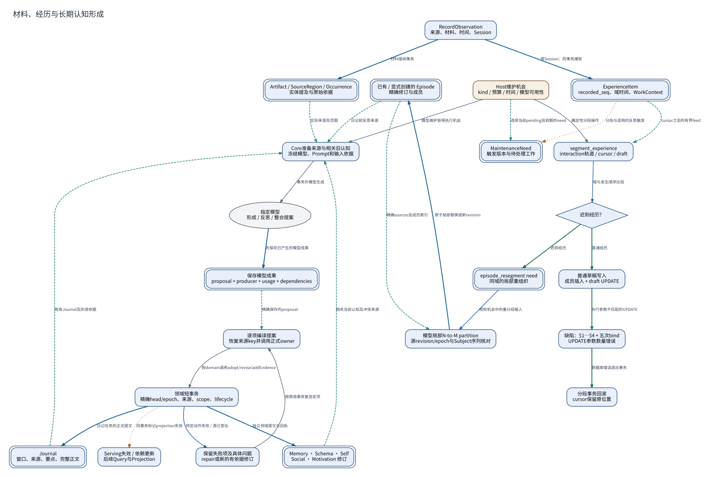

# 材料、经历与长期认知形成

**图型**：数据形成与事务流程图。**对应实现**：默认分支；前置接触时点详见原生输入图。

区分材料写入、Runtime分段、已存经历和模型形成。当前分段错误在真实执行位置展开。

[打开可缩放 SVG](./03-cognition-growth.svg) · [PNG](./03-cognition-growth.png) · [DOT 源码](./03-cognition-growth.dot) · [节点与边 JSON](./03-cognition-growth.json)

## 图例与严格方向

每一条有向边以 **源节点 → 目标节点** 表示，其标签写明具体的调用、读写、转移或依赖。边的线型与颜色对应以下固定语义。

| 边类型 | 实际含义 |
|---|---|
| `call` | 运行时调用或请求 |
| `data` | 将材料、候选或结果送往后续节点 |
| `event` | 提交事实之后产生的通知或触发 |
| `read` | 从对象或服务读取数据 |
| `transition` | 同一对象/活动的生命周期状态变迁 |
| `write` | 写入所属权威状态/持久记录 |

节点按所属系统区分：Nous Wave、Heptalogos、原生执行环境和外部系统。双边框表示持久对象或持久状态，椭圆表示外部参与者或事件；其余方框表示实际操作或模块。节点与箭头均带有可跳转的源码依据。

## 箭头清单

| 来源 → 去向 | 关系 | 精确含义 | 代码依据 |
|---|---|---|---|
| RecordObservation → Artifact / SourceRegion / Occurrence | `write` | 材料接纳事务 | [材料接纳与真实接触](../源码与实现索引.md#material) |
| RecordObservation → ExperienceItem | `write` | 带Session：同事务捕获 | [经历捕获、分段与重分段](../源码与实现索引.md#episode) |
| ExperienceItem → MaintenanceNeed | `event` | 分段与适用的反思触发 | [共享反思与维护机会](../源码与实现索引.md#reflection)、[经历捕获、分段与重分段](../源码与实现索引.md#episode) |
| Host维护机会 → MaintenanceNeed | `read` | 选择当前pending且到期的need | [共享反思与维护机会](../源码与实现索引.md#reflection) |
| Host维护机会 → segment_experience | `call` | 确定性分段操作 | [经历捕获、分段与重分段](../源码与实现索引.md#episode) |
| ExperienceItem → segment_experience | `read` | cursor之后的有界feed | [经历捕获、分段与重分段](../源码与实现索引.md#episode) |
| segment_experience → 迟到经历？ | `data` | 域与发生顺序比较 | [经历捕获、分段与重分段](../源码与实现索引.md#episode) |
| 迟到经历？ → 普通草稿写入 | `transition` | 普通经历 | [经历捕获、分段与重分段](../源码与实现索引.md#episode) |
| 普通草稿写入 → 缺陷：$1…$4 + 五次bind | `transition` | 执行参数不匹配的UPDATE | [经历捕获、分段与重分段](../源码与实现索引.md#episode) |
| 缺陷：$1…$4 + 五次bind → 分段事务回滚 | `transition` | 数据库错误退出事务 | [经历捕获、分段与重分段](../源码与实现索引.md#episode) |
| 迟到经历？ → episode_resegment need | `transition` | 迟到经历 | [经历捕获、分段与重分段](../源码与实现索引.md#episode) |
| episode_resegment need → 模型局部N-to-M partition | `data` | 授权机会中的重分段输入 | [经历捕获、分段与重分段](../源码与实现索引.md#episode)、[共享反思与维护机会](../源码与实现索引.md#reflection) |
| 已有 / 显式创建的 Episode → 模型局部N-to-M partition | `read` | 精确sources及成员索引 | [经历捕获、分段与重分段](../源码与实现索引.md#episode) |
| 模型局部N-to-M partition → 已有 / 显式创建的 Episode | `write` | 原子局部替换或新revision | [经历捕获、分段与重分段](../源码与实现索引.md#episode) |
| 已有 / 显式创建的 Episode → Core准备来源与相关旧认知 | `read` | 日记和反思来源 | [日记与图式](../源码与实现索引.md#journal)、[共享反思与维护机会](../源码与实现索引.md#reflection) |
| Artifact / SourceRegion / Occurrence → Core准备来源与相关旧认知 | `read` | 实际来源及范围 | [形成依据、认知指向与证据关系](../源码与实现索引.md#provenance)、[共享反思与维护机会](../源码与实现索引.md#reflection) |
| Journal → Core准备来源与相关旧认知 | `read` | 既有Journal及形成依据 | [日记与图式](../源码与实现索引.md#journal) |
| Memory · Schema · Self → Core准备来源与相关旧认知 | `read` | 相关当前认知及冲突来源 | [共享反思与维护机会](../源码与实现索引.md#reflection) |
| Host维护机会 → Core准备来源与相关旧认知 | `call` | 模型维护获得执行机会 | [共享反思与维护机会](../源码与实现索引.md#reflection) |
| Core准备来源与相关旧认知 → 指定模型 | `call` | 事务外模型生成 | [模型角色、资源与执行参数](../源码与实现索引.md#models) |
| 指定模型 → 保存模型成果 | `write` | 先保存已产生的模型成果 | [共享反思与维护机会](../源码与实现索引.md#reflection) |
| 保存模型成果 → 逐项编译提案 | `read` | 精确保存的proposal | [共享反思与维护机会](../源码与实现索引.md#reflection) |
| 逐项编译提案 → 领域短事务 | `call` | 按domain调用adopt/revise/addEvidence | [共享反思与维护机会](../源码与实现索引.md#reflection) |
| 领域短事务 → Memory · Schema · Self | `write` | 独立领域提交与回执 | [长期记忆与修订](../源码与实现索引.md#memory)、[自我认知与知识视角](../源码与实现索引.md#self)、[关系认知与语言惯例](../源码与实现索引.md#social) |
| 领域短事务 → Journal | `write` | 日记任务的正式提交 | [日记与图式](../源码与实现索引.md#journal) |
| 领域短事务 → 保留失败项及具体问题 | `data` | 特定动作失败 / 源已变化 | [共享反思与维护机会](../源码与实现索引.md#reflection) |
| 保留失败项及具体问题 → 逐项编译提案 | `call` | 按原成果修复选定项 | [共享反思与维护机会](../源码与实现索引.md#reflection) |
| 领域短事务 → Serving失效 / 依赖更新 | `event` | 同事务标记projection失效 | [索引代次与历史资产](../源码与实现索引.md#serving) |

## 运行条件与未完成边界

- 分段参数错误阻断普通自动draft写入。已有Episode、手工Episode与其他形成入口仍有独立路径。
- 维护结果逐项提交，源变化和个别动作失败在相应项记录；不会将整份跨域proposal视作跨领域数据库事务。
