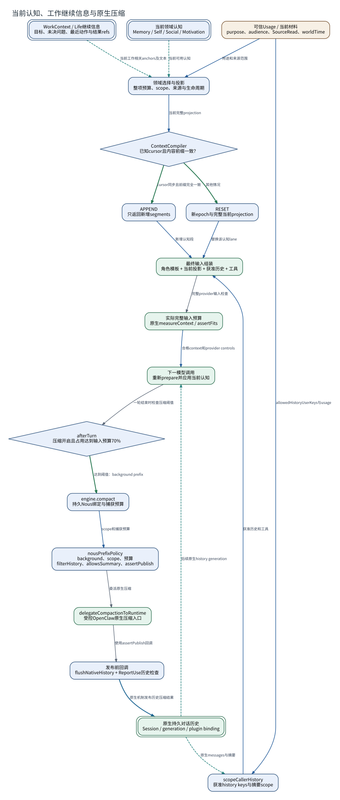

# 当前认知、工作继续信息与原生压缩

**图型**：上下文组成与压缩调用图。**对应实现**：Nous开发分支；WorkContext和ContextCompiler来自默认分支。

当前认知、持久工作状态与原生对话历史使用不同来源和更新方法。

[打开可缩放 SVG](./04-context-history.svg) · [PNG](./04-context-history.png) · [DOT 源码](./04-context-history.dot) · [节点与边 JSON](./04-context-history.json)

## 图例与严格方向

每一条有向边以 **源节点 → 目标节点** 表示，其标签写明具体的调用、读写、转移或依赖。边的线型与颜色对应以下固定语义。

| 边类型 | 实际含义 |
|---|---|
| `call` | 运行时调用或请求 |
| `data` | 将材料、候选或结果送往后续节点 |
| `read` | 从对象或服务读取数据 |
| `transition` | 同一对象/活动的生命周期状态变迁 |
| `write` | 写入所属权威状态/持久记录 |

节点按所属系统区分：Nous Wave、Heptalogos、原生执行环境和外部系统。双边框表示持久对象或持久状态，椭圆表示外部参与者或事件；其余方框表示实际操作或模块。节点与箭头均带有可跳转的源码依据。

## 箭头清单

| 来源 → 去向 | 关系 | 精确含义 | 代码依据 |
|---|---|---|---|
| WorkContext / Life继续信息 → 领域选择与投影 | `read` | 当前工作相关anchors及文本 | [当前认知与跨会话工作上下文](../源码与实现索引.md#workcontext) |
| 当前领域认知 → 领域选择与投影 | `read` | 当前可用认知 | [自动上下文与原生历史](../源码与实现索引.md#projection) |
| 可信Usage / 当前材料 → 领域选择与投影 | `data` | 用途和来源范围 | [自动上下文与原生历史](../源码与实现索引.md#projection) |
| 领域选择与投影 → ContextCompiler | `data` | 当前完整projection | [自动上下文与原生历史](../源码与实现索引.md#projection) |
| ContextCompiler → APPEND | `transition` | cursor同步且前缀完全一致 | [自动上下文与原生历史](../源码与实现索引.md#projection) |
| ContextCompiler → RESET | `transition` | 其他情况 | [自动上下文与原生历史](../源码与实现索引.md#projection) |
| 原生持久对话历史 → scopeCallerHistory | `read` | 原生messages与摘要 | [自动上下文与原生历史](../源码与实现索引.md#projection) |
| 可信Usage / 当前材料 → scopeCallerHistory | `data` | allowedHistoryUserKeys与usage | [自动上下文与原生历史](../源码与实现索引.md#projection) |
| APPEND → 最终输入组装 | `data` | 新增认知段 | [自动上下文与原生历史](../源码与实现索引.md#projection) |
| RESET → 最终输入组装 | `data` | 替换该认知lane | [自动上下文与原生历史](../源码与实现索引.md#projection) |
| scopeCallerHistory → 最终输入组装 | `data` | 获准历史和工具 | [自动上下文与原生历史](../源码与实现索引.md#projection) |
| 最终输入组装 → 实际完整输入预算 | `call` | 完整provider输入检查 | [自动上下文与原生历史](../源码与实现索引.md#projection) |
| 实际完整输入预算 → 下一模型调用 | `data` | 合格context和provider controls | [自动上下文与原生历史](../源码与实现索引.md#projection) |
| 下一模型调用 → afterTurn | `call` | 一轮结束时检查压缩阈值 | [自动上下文与原生历史](../源码与实现索引.md#projection) |
| afterTurn → engine.compact | `transition` | 达到阈值：background prefix | [自动上下文与原生历史](../源码与实现索引.md#projection) |
| engine.compact → nousPrefixPolicy | `data` | scope和捕获预算 | [自动上下文与原生历史](../源码与实现索引.md#projection) |
| nousPrefixPolicy → delegateCompactionToRuntime | `call` | 委派原生压缩 | [自动上下文与原生历史](../源码与实现索引.md#projection) |
| delegateCompactionToRuntime → 发布前回调 | `call` | 使用assertPublish回调 | [自动上下文与原生历史](../源码与实现索引.md#projection) |
| 发布前回调 → 原生持久对话历史 | `write` | 原生机制发布历史压缩结果 | [自动上下文与原生历史](../源码与实现索引.md#projection) |
| 原生持久对话历史 → 下一模型调用 | `read` | 后续原生history generation | [自动上下文与原生历史](../源码与实现索引.md#projection) |

## 运行条件与未完成边界

- 70%触发来自当前afterTurn代码；完整输入不足的失败也会要求原生prefix压缩。压缩策略和实际替换由受控原生runtime执行。
- ContextCompiler的tracks为进程内有界Map，丢失后使用RESET；长期认知和WorkContext继续保存在各自领域。
- 开发分支Self/Social统一contextText由领域renderer生成，Core投影保留这些当前语义单元。
