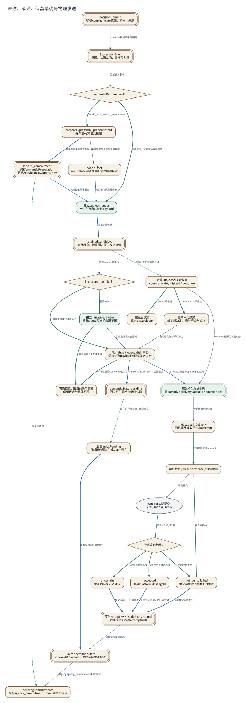

# 表达、承诺、保留草稿与物理发送

**图型**：分支流程与发送状态图。**对应实现**：Hept开发分支 f855c686；此图采用当前Draft逻辑。

普通交流后置Claim索引；新世界事实、严肃承诺、重要冲突分别走明确路径。

[打开可缩放 SVG](./05-expression.svg) · [PNG](./05-expression.png) · [DOT 源码](./05-expression.dot) · [节点与边 JSON](./05-expression.json)

## 图例与严格方向

每一条有向边以 **源节点 → 目标节点** 表示，其标签写明具体的调用、读写、转移或依赖。边的线型与颜色对应以下固定语义。

| 边类型 | 实际含义 |
|---|---|
| `call` | 运行时调用或请求 |
| `data` | 将材料、候选或结果送往后续节点 |
| `read` | 从对象或服务读取数据 |
| `reference` | 一对象保存对另一对象的稳定引用 |
| `transition` | 同一对象/活动的生命周期状态变迁 |
| `write` | 写入所属权威状态/持久记录 |

节点按所属系统区分：Nous Wave、Heptalogos、原生执行环境和外部系统。双边框表示持久对象或持久状态，椭圆表示外部参与者或事件；其余方框表示实际操作或模块。节点与箭头均带有可跳转的源码依据。

## 箭头清单

| 来源 → 去向 | 关系 | 精确含义 | 代码依据 |
|---|---|---|---|
| DecisionCommit → ExpressionBrief | `write` | saveBrief核对原采用意图 | [表达、世界细节、承诺与后置索引](../源码与实现索引.md#narrative) |
| ExpressionBrief → semanticRequirement？ | `read` | 显式语义要求 | [表达、世界细节、承诺与后置索引](../源码与实现索引.md#narrative) |
| semanticRequirement？ → 独立subject.render | `transition` | 普通交流；或重要冲突待后读 | [表达、世界细节、承诺与后置索引](../源码与实现索引.md#narrative) |
| semanticRequirement？ → prepareExpression / prepareIntent | `transition` | world_fact / serious_commitment | [表达、世界细节、承诺与后置索引](../源码与实现索引.md#narrative) |
| prepareExpression / prepareIntent → world_fact | `call` | 采用限于原场景的世界提案 | [表达、世界细节、承诺与后置索引](../源码与实现索引.md#narrative)、[世界定义、事件与局部见闻](../源码与实现索引.md#world) |
| prepareExpression / prepareIntent → serious_commitment | `write` | 采用真实未来处理条件 | [表达、世界细节、承诺与后置索引](../源码与实现索引.md#narrative) |
| world_fact → 独立subject.render | `data` | 已经采用的场景细节 | [表达、世界细节、承诺与后置索引](../源码与实现索引.md#narrative) |
| serious_commitment → 独立subject.render | `data` | 已准备的承诺语义 | [表达、世界细节、承诺与后置索引](../源码与实现索引.md#narrative) |
| 独立subject.render → retainedCandidate | `write` | 保留完整候选 | [表达、世界细节、承诺与后置索引](../源码与实现索引.md#narrative) |
| retainedCandidate → important_conflict？ | `data` | 原始payload与brief | [表达、世界细节、承诺与后置索引](../源码与实现索引.md#narrative) |
| important_conflict？ → 独立narrative.review | `transition` | 重要冲突 | [表达、世界细节、承诺与后置索引](../源码与实现索引.md#narrative) |
| important_conflict？ → Narrative + Agency采用事务 | `transition` | 普通交流或已准备语义 | [表达、世界细节、承诺与后置索引](../源码与实现索引.md#narrative) |
| 独立narrative.review → Narrative + Agency采用事务 | `data` | 引用及冲突检查通过 | [表达、世界细节、承诺与后置索引](../源码与实现索引.md#narrative) |
| 独立narrative.review → 明确拒绝 / 无当前采用资格 | `transition` | 具体冲突 / 未获准来源 | [表达、世界细节、承诺与后置索引](../源码与实现索引.md#narrative) |
| Narrative + Agency采用事务 → 明确拒绝 / 无当前采用资格 | `transition` | 时限或当前Activity资格变化 | [表达、世界细节、承诺与后置索引](../源码与实现索引.md#narrative) |
| retainedCandidate → 后续Subject选择原候选 | `read` | 原稿可供后续前台选择 | [表达、世界细节、承诺与后置索引](../源码与实现索引.md#narrative) |
| 后续Subject选择原候选 → 重新采用原文 | `transition` | communicate原候选 | [表达、世界细节、承诺与后置索引](../源码与实现索引.md#narrative) |
| 后续Subject选择原候选 → 候选已放弃 | `transition` | discard原候选 | [表达、世界细节、承诺与后置索引](../源码与实现索引.md#narrative) |
| 重新采用原文 → Narrative + Agency采用事务 | `call` | 复用原文与新采用决定 | [表达、世界细节、承诺与后置索引](../源码与实现索引.md#narrative) |
| 后续Subject选择原候选 → 原生持久发送队列 | `call` | continue已采用发送义务 | [表达、世界细节、承诺与后置索引](../源码与实现索引.md#narrative)、[发送接纳、物理提交与回执](../源码与实现索引.md#sending) |
| Narrative + Agency采用事务 → 原生持久发送队列 | `data` | custody及原生prepared payload | [发送接纳、物理提交与回执](../源码与实现索引.md#sending) |
| 原生持久发送队列 → Host.beginDelivery | `call` | 开始精确物理part | [发送接纳、物理提交与回执](../源码与实现索引.md#sending) |
| Host.beginDelivery → 最终权限 / 账号 / presence / 媒体检查 | `transition` | 取得实际发送attempt | [发送接纳、物理提交与回执](../源码与实现索引.md#sending) |
| 最终权限 / 账号 / presence / 媒体检查 → OneBot实际提交 | `call` | 平台提交 | [发送接纳、物理提交与回执](../源码与实现索引.md#sending) |
| 最终权限 / 账号 / presence / 媒体检查 → not_sent / failed | `transition` | 提交前拒绝 | [发送接纳、物理提交与回执](../源码与实现索引.md#sending) |
| OneBot实际提交 → 物理发送结果？ | `data` | 回复 / 异常 / 取消 | [发送接纳、物理提交与回执](../源码与实现索引.md#sending) |
| 物理发送结果？ → accepted | `transition` | 收到可用平台消息ID | [发送接纳、物理提交与回执](../源码与实现索引.md#sending) |
| 物理发送结果？ → not_sent / failed | `transition` | 明确平台拒绝 | [发送接纳、物理提交与回执](../源码与实现索引.md#sending) |
| 物理发送结果？ → uncertain | `transition` | 已提交且结果未知 | [发送接纳、物理提交与回执](../源码与实现索引.md#sending) |
| accepted → 原生receipt → Host delivery record | `write` | 先原生receipt，后Host反馈 | [发送接纳、物理提交与回执](../源码与实现索引.md#sending) |
| not_sent / failed → 原生receipt → Host delivery record | `write` | 记录真实失败类别 | [发送接纳、物理提交与回执](../源码与实现索引.md#sending) |
| uncertain → 原生receipt → Host delivery record | `write` | 保留未知，不自动新发 | [发送接纳、物理提交与回执](../源码与实现索引.md#sending) |
| Narrative + Agency采用事务 → semanticState: pending | `write` | 非important_conflict：后置索引 | [表达、世界细节、承诺与后置索引](../源码与实现索引.md#narrative) |
| semanticState: pending → 后台indexPending | `read` | 原生后台机会选中既有原文 | [表达、世界细节、承诺与后置索引](../源码与实现索引.md#narrative) |
| 后台indexPending → Claim / semanticState | `write` | 精确quote和出处索引 | [表达、世界细节、承诺与后置索引](../源码与实现索引.md#narrative) |
| 原生receipt → Host delivery record → Claim / semanticState | `reference` | 读取实际发送状态 | [表达、世界细节、承诺与后置索引](../源码与实现索引.md#narrative) |
| serious_commitment → pendingCommitments | `read` | 准备态承诺 | [表达、世界细节、承诺与后置索引](../源码与实现索引.md#narrative) |
| Claim / semanticState → pendingCommitments | `reference` | legacy agency_commitment关联claim | [表达、世界细节、承诺与后置索引](../源码与实现索引.md#narrative) |

## 运行条件与未完成边界

- 普通交流的发送不等待后台Claim索引。后台索引提出的新世界事实或新承诺留作显式后续处理。
- 严肃承诺当前同时存在准备态brief和agency_commitment两种来源，pendingCommitments会合并读取；逐承诺完成与撤销仍需更清晰的生命周期。
- 图中accepted是平台确认的发送结果；subject.render返回rendered只表示表达角色结束。
