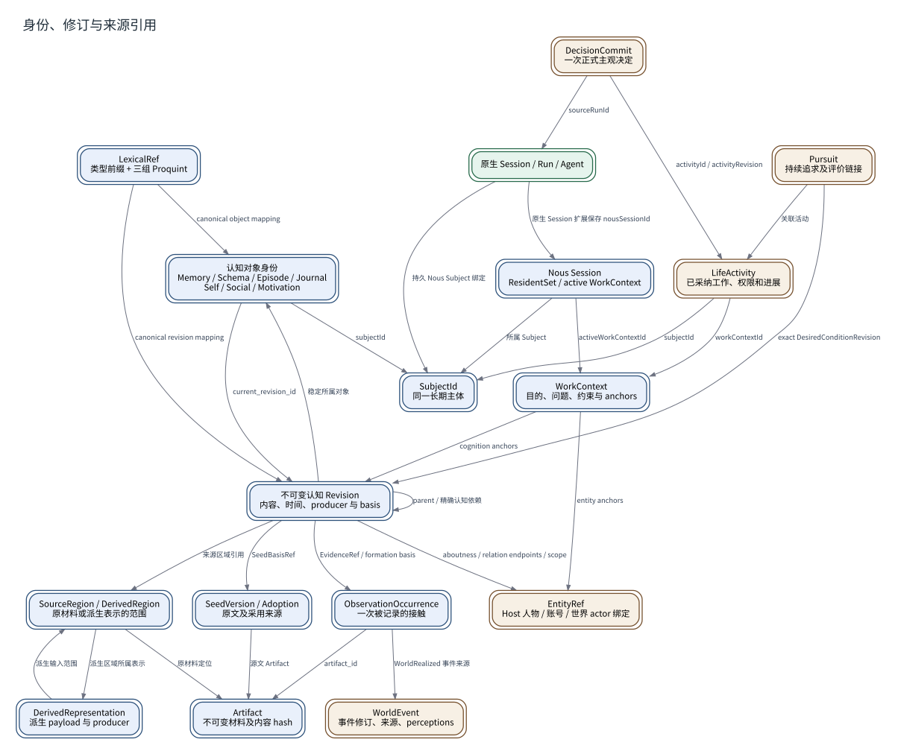

# 身份、修订与来源引用

**图型**：对象关系图。**对应实现**：默认分支。

箭头方向为“引用方 → 被引用方”；这里只画代码中的身份或来源关联，不推定未核实的数量关系。

[打开可缩放 SVG](./06-identity.svg) · [PNG](./06-identity.png) · [DOT 源码](./06-identity.dot) · [节点与边 JSON](./06-identity.json)

## 图例与严格方向

每一条有向边以 **源节点 → 目标节点** 表示，其标签写明具体的调用、读写、转移或依赖。边的线型与颜色对应以下固定语义。

| 边类型 | 实际含义 |
|---|---|
| `reference` | 一对象保存对另一对象的稳定引用 |

节点按所属系统区分：Nous Wave、Heptalogos、原生执行环境和外部系统。双边框表示持久对象或持久状态，椭圆表示外部参与者或事件；其余方框表示实际操作或模块。节点与箭头均带有可跳转的源码依据。

## 箭头清单

| 来源 → 去向 | 关系 | 精确含义 | 代码依据 |
|---|---|---|---|
| 原生 Session / Run / Agent → SubjectId | `reference` | 持久 Nous Subject 绑定 | [正式接触、认知应用与反馈](../源码与实现索引.md#bridge) |
| 原生 Session / Run / Agent → Nous Session | `reference` | 原生 Session 扩展保存 nousSessionId | [正式接触、认知应用与反馈](../源码与实现索引.md#bridge) |
| Nous Session → SubjectId | `reference` | 所属 Subject | [当前认知与跨会话工作上下文](../源码与实现索引.md#workcontext) |
| Nous Session → WorkContext | `reference` | activeWorkContextId | [当前认知与跨会话工作上下文](../源码与实现索引.md#workcontext) |
| LifeActivity → SubjectId | `reference` | subjectId | [活动与持续工作](../源码与实现索引.md#life) |
| LifeActivity → WorkContext | `reference` | workContextId | [活动与持续工作](../源码与实现索引.md#life) |
| DecisionCommit → LifeActivity | `reference` | activityId / activityRevision | [主体决定与活动采用](../源码与实现索引.md#deliberation) |
| DecisionCommit → 原生 Session / Run / Agent | `reference` | sourceRunId | [主体决定与活动采用](../源码与实现索引.md#deliberation) |
| Pursuit → LifeActivity | `reference` | 关联活动 | [持续追求与条件评价](../源码与实现索引.md#pursuit) |
| Pursuit → 不可变认知 Revision | `reference` | exact DesiredConditionRevision | [持续追求与条件评价](../源码与实现索引.md#pursuit) |
| 认知对象身份 → SubjectId | `reference` | subjectId | [长期记忆与修订](../源码与实现索引.md#memory) |
| 认知对象身份 → 不可变认知 Revision | `reference` | current_revision_id | [长期记忆与修订](../源码与实现索引.md#memory) |
| 不可变认知 Revision → 认知对象身份 | `reference` | 稳定所属对象 | [长期记忆与修订](../源码与实现索引.md#memory) |
| 不可变认知 Revision → 不可变认知 Revision | `reference` | parent / 精确认知依赖 | [形成依据、认知指向与证据关系](../源码与实现索引.md#provenance) |
| 不可变认知 Revision → EntityRef | `reference` | aboutness / relation endpoints / scope | [形成依据、认知指向与证据关系](../源码与实现索引.md#provenance)、[关系认知与语言惯例](../源码与实现索引.md#social) |
| 不可变认知 Revision → ObservationOccurrence | `reference` | EvidenceRef / formation basis | [形成依据、认知指向与证据关系](../源码与实现索引.md#provenance) |
| 不可变认知 Revision → SeedVersion / Adoption | `reference` | SeedBasisRef | [自我认知与知识视角](../源码与实现索引.md#self)、[认知种子来源](../源码与实现索引.md#seed) |
| 不可变认知 Revision → SourceRegion / DerivedRegion | `reference` | 来源区域引用 | [形成依据、认知指向与证据关系](../源码与实现索引.md#provenance) |
| SeedVersion / Adoption → Artifact | `reference` | 源文 Artifact | [认知种子来源](../源码与实现索引.md#seed) |
| ObservationOccurrence → Artifact | `reference` | artifact_id | [材料接纳与真实接触](../源码与实现索引.md#material) |
| ObservationOccurrence → WorldEvent | `reference` | WorldRealized 事件来源 | [世界定义、事件与局部见闻](../源码与实现索引.md#world)、[材料接纳与真实接触](../源码与实现索引.md#material) |
| SourceRegion / DerivedRegion → Artifact | `reference` | 原材料定位 | [材料接纳与真实接触](../源码与实现索引.md#material) |
| DerivedRepresentation → SourceRegion / DerivedRegion | `reference` | 派生输入范围 | [多模态材料派生](../源码与实现索引.md#media) |
| SourceRegion / DerivedRegion → DerivedRepresentation | `reference` | 派生区域所属表示 | [多模态材料派生](../源码与实现索引.md#media) |
| LexicalRef → 认知对象身份 | `reference` | canonical object mapping | [可读引用与权威身份](../源码与实现索引.md#address) |
| LexicalRef → 不可变认知 Revision | `reference` | canonical revision mapping | [可读引用与权威身份](../源码与实现索引.md#address) |
| WorkContext → 不可变认知 Revision | `reference` | cognition anchors | [当前认知与跨会话工作上下文](../源码与实现索引.md#workcontext) |
| WorkContext → EntityRef | `reference` | entity anchors | [当前认知与跨会话工作上下文](../源码与实现索引.md#workcontext) |

## 运行条件与未完成边界

- 认知对象和认知修订各有精确地址。实际Proquint正文为三组CVCVC，48位；旧四英文词示例已经退出当前实现。
- Occurrence在当前模型准备前半段写入；对应“实际获得内容”的时间缺口详见原生输入时序图。
