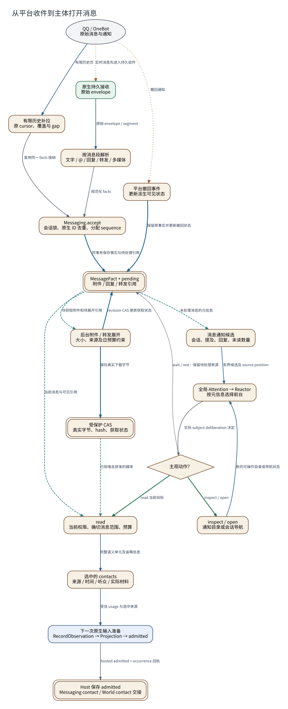

# 从平台收件到主体打开消息

**图型**：跨系统数据流。**对应实现**：Hept默认分支；Nous开发分支的原生输入实现。

收件保全、通知选择、正文读取和模型输入分别展开。

[打开可缩放 SVG](./07-message-contact.svg) · [PNG](./07-message-contact.png) · [DOT 源码](./07-message-contact.dot) · [节点与边 JSON](./07-message-contact.json)

## 图例与严格方向

每一条有向边以 **源节点 → 目标节点** 表示，其标签写明具体的调用、读写、转移或依赖。边的线型与颜色对应以下固定语义。

| 边类型 | 实际含义 |
|---|---|
| `call` | 运行时调用或请求 |
| `data` | 将材料、候选或结果送往后续节点 |
| `event` | 提交事实之后产生的通知或触发 |
| `read` | 从对象或服务读取数据 |
| `reference` | 一对象保存对另一对象的稳定引用 |
| `transition` | 同一对象/活动的生命周期状态变迁 |
| `write` | 写入所属权威状态/持久记录 |

节点按所属系统区分：Nous Wave、Heptalogos、原生执行环境和外部系统。双边框表示持久对象或持久状态，椭圆表示外部参与者或事件；其余方框表示实际操作或模块。节点与箭头均带有可跳转的源码依据。

## 箭头清单

| 来源 → 去向 | 关系 | 精确含义 | 代码依据 |
|---|---|---|---|
| QQ / OneBot → 原生持久接收 | `event` | 实时消息先进入持久收件 | [消息接纳与平台事实](../源码与实现索引.md#qq) |
| 原生持久接收 → 按消息段解析 | `data` | 原始 envelope / segment | [消息接纳与平台事实](../源码与实现索引.md#qq) |
| 按消息段解析 → Messaging.accept | `call` | 规范化 facts | [消息接纳与平台事实](../源码与实现索引.md#qq) |
| Messaging.accept → MessageFact + pending | `write` | 同事务保存事实与待处理引用 | [消息接纳与平台事实](../源码与实现索引.md#qq) |
| MessageFact + pending → 后台附件 / 转发展开 | `read` | 待获取附件和待展开引用 | [附件、转发与历史补拉](../源码与实现索引.md#attachments) |
| 后台附件 / 转发展开 → 受保护 CAS | `write` | 保存真实下载字节 | [附件、转发与历史补拉](../源码与实现索引.md#attachments) |
| 后台附件 / 转发展开 → MessageFact + pending | `write` | revision-CAS 更新获取状态 | [附件、转发与历史补拉](../源码与实现索引.md#attachments) |
| MessageFact + pending → 消息通知候选 | `read` | 未处理消息的元信息 | [全局通知选择与前台竞争](../源码与实现索引.md#attention) |
| 消息通知候选 → 全局 Attention → Reactor | `data` | 有界候选及 source position | [全局通知选择与前台竞争](../源码与实现索引.md#attention) |
| 全局 Attention → Reactor → 主观动作？ | `call` | 实际 subject.deliberation 决定 | [单一前台 Reactor](../源码与实现索引.md#reactor)、[主体决定与活动采用](../源码与实现索引.md#deliberation) |
| 主观动作？ → inspect / open | `transition` | inspect / open | [局部情境与可操作对象](../源码与实现索引.md#situation) |
| 主观动作？ → read | `transition` | read 当前目标 | [局部情境与可操作对象](../源码与实现索引.md#situation) |
| 主观动作？ → MessageFact + pending | `reference` | wait / rest：保留待处理来源 | [活动与持续工作](../源码与实现索引.md#life)、[局部情境与可操作对象](../源码与实现索引.md#situation) |
| inspect / open → 全局 Attention → Reactor | `data` | 新的可操作目录或导航状态 | [局部情境与可操作对象](../源码与实现索引.md#situation) |
| MessageFact + pending → read | `read` | 当前消息与可见引用 | [附件、转发与历史补拉](../源码与实现索引.md#attachments) |
| 受保护 CAS → read | `read` | 已就绪且获准的媒体 | [附件、转发与历史补拉](../源码与实现索引.md#attachments) |
| read → 选中的 contacts | `data` | 完整语义单元及省略信息 | [局部情境与可操作对象](../源码与实现索引.md#situation)、[正式接触、认知应用与反馈](../源码与实现索引.md#bridge) |
| 选中的 contacts → 下一次原生输入准备 | `data` | 受信 usage 与选中来源 | [正式接触、认知应用与反馈](../源码与实现索引.md#bridge) |
| 下一次原生输入准备 → Host 保存 admitted | `call` | hosted.admitted + occurrence 回执 | [正式接触、认知应用与反馈](../源码与实现索引.md#bridge) |
| QQ / OneBot → 有限历史补拉 | `data` | 有限历史页 | [附件、转发与历史补拉](../源码与实现索引.md#attachments) |
| 有限历史补拉 → Messaging.accept | `call` | 复用同一 facts 接纳 | [附件、转发与历史补拉](../源码与实现索引.md#attachments)、[消息接纳与平台事实](../源码与实现索引.md#qq) |
| QQ / OneBot → 平台撤回事件 | `event` | 撤回通知 | [消息接纳与平台事实](../源码与实现索引.md#qq) |
| 平台撤回事件 → MessageFact + pending | `write` | 保留原事实并更新撤回状态 | [消息接纳与平台事实](../源码与实现索引.md#qq) |

## 运行条件与未完成边界

- 通知被考虑推进attention source位置；具体接触另有admitted及contact记录。
- 模型输入准备会提前保存Occurrence/Experience，之后仍可能失败。图中的“admitted”不提前合并到收件步骤。
