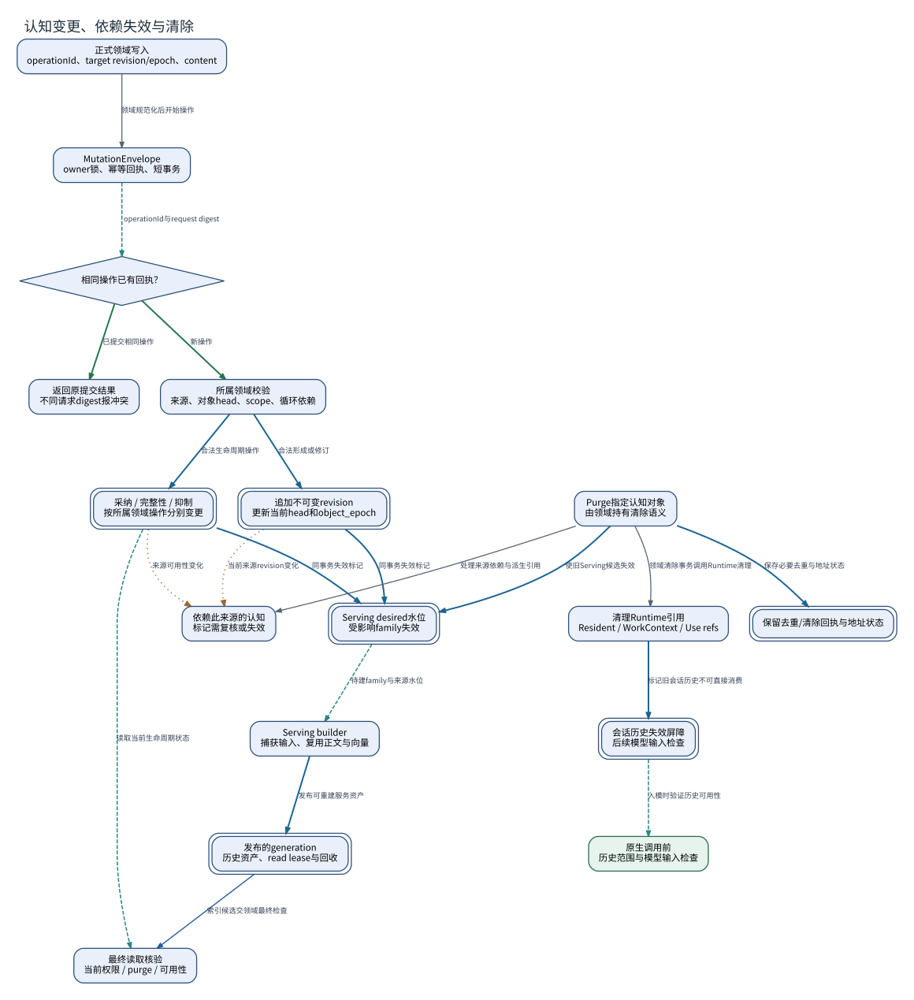

# 认知变更、依赖失效与清除

**图型**：事务与生命周期图。**对应实现**：Nous默认分支。

把对象修订、撤回/抑制、purge及派生层失效分别表示。

[打开可缩放 SVG](./08-mutation-lifecycle.svg) · [PNG](./08-mutation-lifecycle.png) · [DOT 源码](./08-mutation-lifecycle.dot) · [节点与边 JSON](./08-mutation-lifecycle.json)

## 图例与严格方向

每一条有向边以 **源节点 → 目标节点** 表示，其标签写明具体的调用、读写、转移或依赖。边的线型与颜色对应以下固定语义。

| 边类型 | 实际含义 |
|---|---|
| `call` | 运行时调用或请求 |
| `data` | 将材料、候选或结果送往后续节点 |
| `event` | 提交事实之后产生的通知或触发 |
| `read` | 从对象或服务读取数据 |
| `transition` | 同一对象/活动的生命周期状态变迁 |
| `write` | 写入所属权威状态/持久记录 |

节点按所属系统区分：Nous Wave、Heptalogos、原生执行环境和外部系统。双边框表示持久对象或持久状态，椭圆表示外部参与者或事件；其余方框表示实际操作或模块。节点与箭头均带有可跳转的源码依据。

## 箭头清单

| 来源 → 去向 | 关系 | 精确含义 | 代码依据 |
|---|---|---|---|
| 正式领域写入 → MutationEnvelope | `call` | 领域规范化后开始操作 | [长期记忆与修订](../源码与实现索引.md#memory) |
| MutationEnvelope → 相同操作已有回执？ | `read` | operationId与request digest | [长期记忆与修订](../源码与实现索引.md#memory) |
| 相同操作已有回执？ → 返回原提交结果 | `transition` | 已提交相同操作 | [长期记忆与修订](../源码与实现索引.md#memory) |
| 相同操作已有回执？ → 所属领域校验 | `transition` | 新操作 | [长期记忆与修订](../源码与实现索引.md#memory) |
| 所属领域校验 → 追加不可变revision | `write` | 合法形成或修订 | [长期记忆与修订](../源码与实现索引.md#memory) |
| 所属领域校验 → 采纳 / 完整性 / 抑制 | `write` | 合法生命周期操作 | [认知生命周期与清除](../源码与实现索引.md#lifecycle) |
| 追加不可变revision → 依赖此来源的认知 | `event` | 当前来源revision变化 | [认知生命周期与清除](../源码与实现索引.md#lifecycle) |
| 采纳 / 完整性 / 抑制 → 依赖此来源的认知 | `event` | 来源可用性变化 | [认知生命周期与清除](../源码与实现索引.md#lifecycle) |
| 追加不可变revision → Serving desired水位 | `write` | 同事务失效标记 | [索引代次与历史资产](../源码与实现索引.md#serving) |
| 采纳 / 完整性 / 抑制 → Serving desired水位 | `write` | 同事务失效标记 | [索引代次与历史资产](../源码与实现索引.md#serving) |
| Serving desired水位 → Serving builder | `read` | 待建family与来源水位 | [索引代次与历史资产](../源码与实现索引.md#serving) |
| Serving builder → 发布的generation | `write` | 发布可重建服务资产 | [索引代次与历史资产](../源码与实现索引.md#serving) |
| 发布的generation → 最终读取核验 | `data` | 索引候选交领域最终检查 | [冻结查询、共享通道与最终读取](../源码与实现索引.md#query) |
| Purge指定认知对象 → 依赖此来源的认知 | `call` | 处理来源依赖与派生引用 | [认知生命周期与清除](../源码与实现索引.md#lifecycle) |
| Purge指定认知对象 → 清理Runtime引用 | `call` | 领域清除事务调用Runtime清理 | [认知生命周期与清除](../源码与实现索引.md#lifecycle) |
| 清理Runtime引用 → 会话历史失效屏障 | `write` | 标记旧会话历史不可直接消费 | [认知生命周期与清除](../源码与实现索引.md#lifecycle) |
| Purge指定认知对象 → 保留去重/清除回执与地址状态 | `write` | 保存必要去重与地址状态 | [认知生命周期与清除](../源码与实现索引.md#lifecycle)、[可读引用与权威身份](../源码与实现索引.md#address) |
| Purge指定认知对象 → Serving desired水位 | `write` | 使旧Serving候选失效 | [索引代次与历史资产](../源码与实现索引.md#serving) |
| 会话历史失效屏障 → 原生调用前 | `read` | 入模时验证历史可用性 | [自动上下文与原生历史](../源码与实现索引.md#projection) |
| 采纳 / 完整性 / 抑制 → 最终读取核验 | `read` | 读取当前生命周期状态 | [冻结查询、共享通道与最终读取](../源码与实现索引.md#query) |

## 运行条件与未完成边界

- revision、撤回、抑制和物理清除各有正式操作。跨安装备份和外部原生存储的整体删除，需要各自数据所有者配合。
