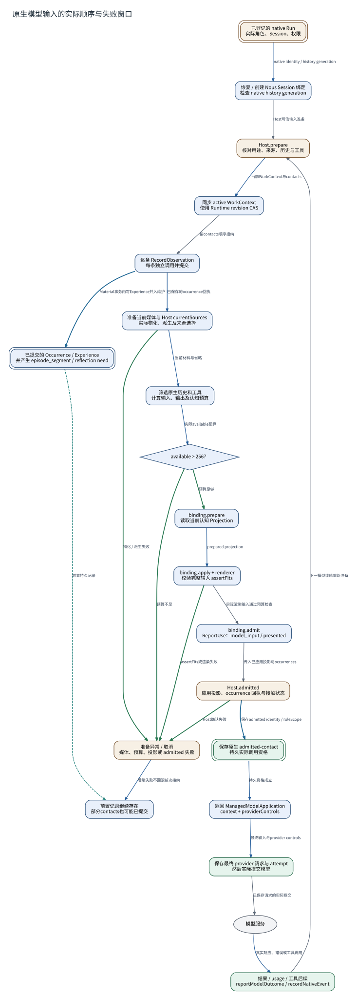

# 原生模型输入的实际顺序与失败窗口

**图型**：时序展开图。**对应实现**：Nous开发分支 aa93ede；核心Observation路径与默认分支相同。

按prepareModelInput中的await顺序排列。左侧为持续准备，右侧展开已经发生持久写入后的失败分支。

[打开可缩放 SVG](./09-native-input.svg) · [PNG](./09-native-input.png) · [DOT 源码](./09-native-input.dot) · [节点与边 JSON](./09-native-input.json)

## 图例与严格方向

每一条有向边以 **源节点 → 目标节点** 表示，其标签写明具体的调用、读写、转移或依赖。边的线型与颜色对应以下固定语义。

| 边类型 | 实际含义 |
|---|---|
| `call` | 运行时调用或请求 |
| `data` | 将材料、候选或结果送往后续节点 |
| `read` | 从对象或服务读取数据 |
| `transition` | 同一对象/活动的生命周期状态变迁 |
| `write` | 写入所属权威状态/持久记录 |

节点按所属系统区分：Nous Wave、Heptalogos、原生执行环境和外部系统。双边框表示持久对象或持久状态，椭圆表示外部参与者或事件；其余方框表示实际操作或模块。节点与箭头均带有可跳转的源码依据。

## 箭头清单

| 来源 → 去向 | 关系 | 精确含义 | 代码依据 |
|---|---|---|---|
| 已登记的 native Run → 恢复 / 创建 Nous Session 绑定 | `data` | native identity / history generation | [正式接触、认知应用与反馈](../源码与实现索引.md#bridge)、[自动上下文与原生历史](../源码与实现索引.md#projection)、[原生模型尝试与费用记录](../源码与实现索引.md#custody) |
| 恢复 / 创建 Nous Session 绑定 → Host.prepare | `call` | Host可信输入准备 | [正式接触、认知应用与反馈](../源码与实现索引.md#bridge)、[自动上下文与原生历史](../源码与实现索引.md#projection)、[原生模型尝试与费用记录](../源码与实现索引.md#custody) |
| Host.prepare → 同步 active WorkContext | `data` | 当前WorkContext与contacts | [正式接触、认知应用与反馈](../源码与实现索引.md#bridge)、[自动上下文与原生历史](../源码与实现索引.md#projection)、[原生模型尝试与费用记录](../源码与实现索引.md#custody) |
| 同步 active WorkContext → 逐条 RecordObservation | `call` | 按contacts顺序接纳 | [正式接触、认知应用与反馈](../源码与实现索引.md#bridge)、[自动上下文与原生历史](../源码与实现索引.md#projection)、[原生模型尝试与费用记录](../源码与实现索引.md#custody) |
| 逐条 RecordObservation → 准备当前媒体与 Host currentSources | `data` | 已保存的occurrence回执 | [正式接触、认知应用与反馈](../源码与实现索引.md#bridge)、[自动上下文与原生历史](../源码与实现索引.md#projection)、[原生模型尝试与费用记录](../源码与实现索引.md#custody) |
| 准备当前媒体与 Host currentSources → 筛选原生历史和工具 | `data` | 当前材料与省略 | [正式接触、认知应用与反馈](../源码与实现索引.md#bridge)、[自动上下文与原生历史](../源码与实现索引.md#projection)、[原生模型尝试与费用记录](../源码与实现索引.md#custody) |
| 筛选原生历史和工具 → available > 256？ | `data` | 实际available预算 | [正式接触、认知应用与反馈](../源码与实现索引.md#bridge)、[自动上下文与原生历史](../源码与实现索引.md#projection)、[原生模型尝试与费用记录](../源码与实现索引.md#custody) |
| available > 256？ → binding.prepare | `transition` | 预算足够 | [正式接触、认知应用与反馈](../源码与实现索引.md#bridge)、[自动上下文与原生历史](../源码与实现索引.md#projection)、[原生模型尝试与费用记录](../源码与实现索引.md#custody) |
| binding.prepare → binding.apply + renderer | `data` | prepared projection | [正式接触、认知应用与反馈](../源码与实现索引.md#bridge)、[自动上下文与原生历史](../源码与实现索引.md#projection)、[原生模型尝试与费用记录](../源码与实现索引.md#custody) |
| binding.apply + renderer → binding.admit | `call` | 实际渲染输入通过预算检查 | [正式接触、认知应用与反馈](../源码与实现索引.md#bridge)、[自动上下文与原生历史](../源码与实现索引.md#projection)、[原生模型尝试与费用记录](../源码与实现索引.md#custody) |
| binding.admit → Host.admitted | `call` | 传入已应用投影与occurrences | [正式接触、认知应用与反馈](../源码与实现索引.md#bridge)、[自动上下文与原生历史](../源码与实现索引.md#projection)、[原生模型尝试与费用记录](../源码与实现索引.md#custody) |
| Host.admitted → 保存原生 admitted-contact | `write` | 保存admitted identity / roleScope | [正式接触、认知应用与反馈](../源码与实现索引.md#bridge)、[自动上下文与原生历史](../源码与实现索引.md#projection)、[原生模型尝试与费用记录](../源码与实现索引.md#custody) |
| 保存原生 admitted-contact → 返回 ManagedModelApplication | `data` | 持久资格成立 | [正式接触、认知应用与反馈](../源码与实现索引.md#bridge)、[自动上下文与原生历史](../源码与实现索引.md#projection)、[原生模型尝试与费用记录](../源码与实现索引.md#custody) |
| 返回 ManagedModelApplication → 保存最终 provider 请求与 attempt | `data` | 最终输入与provider controls | [正式接触、认知应用与反馈](../源码与实现索引.md#bridge)、[自动上下文与原生历史](../源码与实现索引.md#projection)、[原生模型尝试与费用记录](../源码与实现索引.md#custody) |
| 保存最终 provider 请求与 attempt → 模型服务 | `call` | 已保存请求的实际提交 | [正式接触、认知应用与反馈](../源码与实现索引.md#bridge)、[自动上下文与原生历史](../源码与实现索引.md#projection)、[原生模型尝试与费用记录](../源码与实现索引.md#custody) |
| 模型服务 → 结果 / usage / 工具后续 | `data` | 真实响应、错误或工具调用 | [正式接触、认知应用与反馈](../源码与实现索引.md#bridge)、[自动上下文与原生历史](../源码与实现索引.md#projection)、[原生模型尝试与费用记录](../源码与实现索引.md#custody) |
| 逐条 RecordObservation → 已提交的 Occurrence / Experience | `write` | Material事务内写Experience并入维护 | [材料接纳与真实接触](../源码与实现索引.md#material)、[经历捕获、分段与重分段](../源码与实现索引.md#episode) |
| available > 256？ → 准备异常 / 取消 | `transition` | 预算不足 | [自动上下文与原生历史](../源码与实现索引.md#projection) |
| 准备当前媒体与 Host currentSources → 准备异常 / 取消 | `transition` | 物化 / 派生失败 | [多模态材料派生](../源码与实现索引.md#media)、[正式接触、认知应用与反馈](../源码与实现索引.md#bridge) |
| binding.apply + renderer → 准备异常 / 取消 | `transition` | assertFits或渲染失败 | [自动上下文与原生历史](../源码与实现索引.md#projection) |
| Host.admitted → 准备异常 / 取消 | `transition` | Host确认失败 | [正式接触、认知应用与反馈](../源码与实现索引.md#bridge) |
| 准备异常 / 取消 → 前置记录继续存在 | `data` | 后续失败不回滚前次接纳 | [正式接触、认知应用与反馈](../源码与实现索引.md#bridge) |
| 已提交的 Occurrence / Experience → 前置记录继续存在 | `read` | 前置持久记录 | [正式接触、认知应用与反馈](../源码与实现索引.md#bridge)、[经历捕获、分段与重分段](../源码与实现索引.md#episode) |
| 结果 / usage / 工具后续 → Host.prepare | `call` | 下一模型续轮重新准备 | [正式接触、认知应用与反馈](../源码与实现索引.md#bridge) |

## 运行条件与未完成边界

- 代码层面的缺口：Observation/Experience先提交，后续输入准备仍可失败。这里把“前置已存接触”和“admitted成功”画成两个节点。
- 实际provider提交发生在prepareModelInput返回之后；即使admitted成功，模型请求仍可能失败。主体经历的产品语义需要明确采用哪一个时点。
