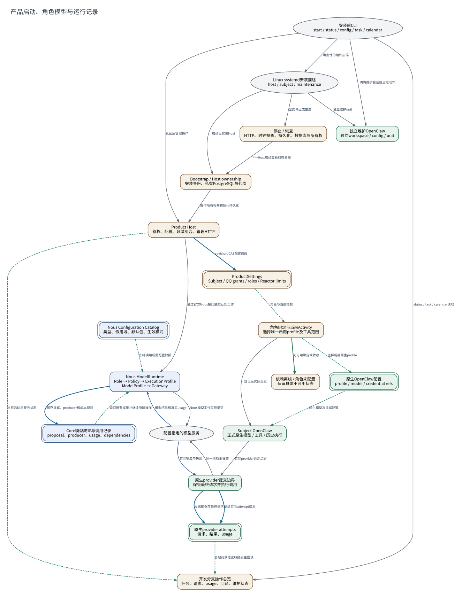

# 产品启动、角色模型与运行记录

**图型**：部署控制与调用链图。**对应实现**：默认分支；操作总览和provider attempt保管采用开发分支。

管理、主体原生运行、独立维护助手和认知模型设置分开表示。

[打开可缩放 SVG](./10-operations-models.svg) · [PNG](./10-operations-models.png) · [DOT 源码](./10-operations-models.dot) · [节点与边 JSON](./10-operations-models.json)

## 图例与严格方向

每一条有向边以 **源节点 → 目标节点** 表示，其标签写明具体的调用、读写、转移或依赖。边的线型与颜色对应以下固定语义。

| 边类型 | 实际含义 |
|---|---|
| `call` | 运行时调用或请求 |
| `data` | 将材料、候选或结果送往后续节点 |
| `read` | 从对象或服务读取数据 |
| `transition` | 同一对象/活动的生命周期状态变迁 |
| `write` | 写入所属权威状态/持久记录 |

节点按所属系统区分：Nous Wave、Heptalogos、原生执行环境和外部系统。双边框表示持久对象或持久状态，椭圆表示外部参与者或事件；其余方框表示实际操作或模块。节点与箭头均带有可跳转的源码依据。

## 箭头清单

| 来源 → 去向 | 关系 | 精确含义 | 代码依据 |
|---|---|---|---|
| 安装后CLI → Linux systemd安装描述 | `call` | 确定性的组件启停 | [安装、平台与目录](../源码与实现索引.md#deployment) |
| Linux systemd安装描述 → Bootstrap / Host ownership | `call` | 启动已安装Host | [产品宿主与生命周期](../源码与实现索引.md#host) |
| Bootstrap / Host ownership → Product Host | `call` | 取得所有权并初始化持久化 | [产品宿主与生命周期](../源码与实现索引.md#host) |
| 安装后CLI → Product Host | `call` | 认证后管理操作 | [管理员与确定性管理](../源码与实现索引.md#management) |
| Product Host → ProductSettings | `write` | revision/CAS配置修改 | [配置描述、作用域与生效](../源码与实现索引.md#configuration) |
| ProductSettings → 角色绑定与当前Activity | `read` | 角色与当前授权 | [同一主体的不同执行职责](../源码与实现索引.md#roles) |
| 角色绑定与当前Activity → 原生OpenClaw配置 | `read` | 选择明确原生profile | [模型角色、资源与执行参数](../源码与实现索引.md#models) |
| 角色绑定与当前Activity → Subject OpenClaw | `call` | 登记后实际派发 | [同一主体的不同执行职责](../源码与实现索引.md#roles) |
| 原生OpenClaw配置 → Subject OpenClaw | `read` | 原生模型及凭据配置 | [配置描述、作用域与生效](../源码与实现索引.md#configuration) |
| Nous Configuration Catalog → Nous ModelRuntime | `read` | 冻结调用所需配置快照 | [模型角色、资源与执行参数](../源码与实现索引.md#models) |
| Product Host → Nous ModelRuntime | `call` | 通过官方Nous接口触发认知工作 | [模型角色、资源与执行参数](../源码与实现索引.md#models)、[正式接触、认知应用与反馈](../源码与实现索引.md#bridge) |
| Product Host → 开发分支操作总览 | `read` | 当前活动与服务状态 | [可读文档、日历和任务管理](../源码与实现索引.md#operator) |
| 安装后CLI → 开发分支操作总览 | `call` | status / task / calendar读取 | [可读文档、日历和任务管理](../源码与实现索引.md#operator) |
| Linux systemd安装描述 → 独立维护OpenClaw | `call` | 独立维护unit | [独立机器维护助手](../源码与实现索引.md#maintenance) |
| 安装后CLI → 独立维护OpenClaw | `call` | 明确维护会话或运维动作 | [独立机器维护助手](../源码与实现索引.md#maintenance) |
| 角色绑定与当前Activity → 依赖离线 / 角色未配置 | `transition` | 无可用绑定或依赖 | [模型角色、资源与执行参数](../源码与实现索引.md#models) |
| Linux systemd安装描述 → 停止 / 恢复 | `call` | 显式停止或重启 | [安装、平台与目录](../源码与实现索引.md#deployment) |
| 停止 / 恢复 → Bootstrap / Host ownership | `call` | 下一Host启动重新取得资格 | [运行、备份与跨安装迁移](../源码与实现索引.md#recovery) |
| Subject OpenClaw → 原生provider提交边界 | `call` | 实际provider调用边界 | [原生模型尝试与费用记录](../源码与实现索引.md#custody) |
| 原生provider提交边界 → 原生provider attempts | `write` | 发送前保存最终请求 | [原生模型尝试与费用记录](../源码与实现索引.md#custody) |
| 原生provider提交边界 → 配置指定的模型服务 | `call` | 同一次原生提交 | [原生模型尝试与费用记录](../源码与实现索引.md#custody) |
| 配置指定的模型服务 → 原生provider提交边界 | `data` | 实际响应与失败 | [原生模型尝试与费用记录](../源码与实现索引.md#custody) |
| 原生provider提交边界 → 原生provider attempts | `write` | 记录实际attempt结果 | [原生模型尝试与费用记录](../源码与实现索引.md#custody) |
| 原生provider attempts → 开发分支操作总览 | `read` | 管理员获准读取的原生尝试 | [可读文档、日历和任务管理](../源码与实现索引.md#operator)、[原生模型尝试与费用记录](../源码与实现索引.md#custody) |
| Nous ModelRuntime → 配置指定的模型服务 | `call` | Nous模型工作实际提交 | [模型角色、资源与执行参数](../源码与实现索引.md#models) |
| 配置指定的模型服务 → Nous ModelRuntime | `data` | 模型结果和真实usage | [模型角色、资源与执行参数](../源码与实现索引.md#models) |
| Nous ModelRuntime → Core模型成果与调用记录 | `write` | 保存提案、producer和成本观测 | [模型角色、资源与执行参数](../源码与实现索引.md#models)、[共享反思与维护机会](../源码与实现索引.md#reflection) |
| Core模型成果与调用记录 → Nous ModelRuntime | `read` | 读取既有成果并继续所属操作 | [共享反思与维护机会](../源码与实现索引.md#reflection) |

## 运行条件与未完成边界

- Nous Core模型成果与OpenClaw原生provider attempts分别持久化；开发分支操作总览读取原生尝试，当前没有跨两套记录的完整统一费用账本。
- 操作总览的cost当前为null，统一费用账本和资源压力策略仍缺。
- Linux/systemd是当前Hept安装路径；Nous另有Windows portable。三个操作系统的同等完整产品交付尚未完成。
