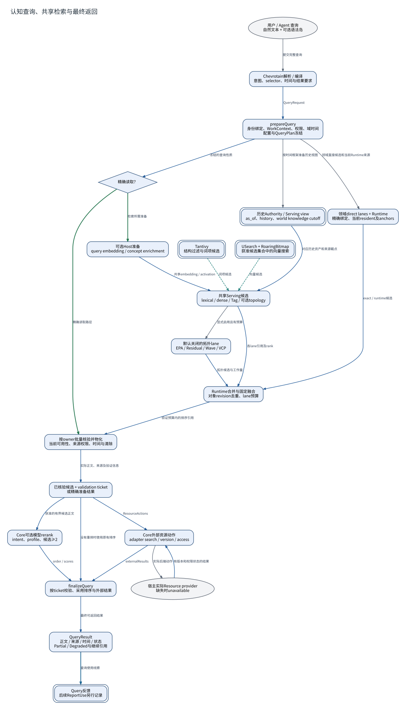

# 认知查询、共享检索与最终返回

**图型**：查询执行数据流。**对应实现**：Nous默认分支。

按Core QueryOrchestrator、Runtime共享融合和领域最终读取展开。

[打开可缩放 SVG](./11-query.svg) · [PNG](./11-query.png) · [DOT 源码](./11-query.dot) · [节点与边 JSON](./11-query.json)

## 图例与严格方向

每一条有向边以 **源节点 → 目标节点** 表示，其标签写明具体的调用、读写、转移或依赖。边的线型与颜色对应以下固定语义。

| 边类型 | 实际含义 |
|---|---|
| `call` | 运行时调用或请求 |
| `data` | 将材料、候选或结果送往后续节点 |
| `read` | 从对象或服务读取数据 |
| `transition` | 同一对象/活动的生命周期状态变迁 |
| `write` | 写入所属权威状态/持久记录 |

节点按所属系统区分：Nous Wave、Heptalogos、原生执行环境和外部系统。双边框表示持久对象或持久状态，椭圆表示外部参与者或事件；其余方框表示实际操作或模块。节点与箭头均带有可跳转的源码依据。

## 箭头清单

| 来源 → 去向 | 关系 | 精确含义 | 代码依据 |
|---|---|---|---|
| 用户 / Agent 查询 → Chevrotain解析 / 编译 | `call` | 提交完整查询 | [自然语言查询与语法岛](../源码与实现索引.md#nql) |
| Chevrotain解析 / 编译 → prepareQuery | `data` | QueryRequest | [自然语言查询与语法岛](../源码与实现索引.md#nql)、[冻结查询、共享通道与最终读取](../源码与实现索引.md#query) |
| prepareQuery → 精确读取？ | `data` | 冻结的查询性质 | [冻结查询、共享通道与最终读取](../源码与实现索引.md#query) |
| 精确读取？ → 按owner批量核验并物化 | `transition` | 精确读取路径 | [冻结查询、共享通道与最终读取](../源码与实现索引.md#query) |
| 精确读取？ → 可选Host准备 | `transition` | 检索所需准备 | [冻结查询、共享通道与最终读取](../源码与实现索引.md#query) |
| 可选Host准备 → 共享Serving候选 | `data` | 共享embedding / activation | [冻结查询、共享通道与最终读取](../源码与实现索引.md#query) |
| Tantivy → 共享Serving候选 | `read` | 词项候选 | [词项与向量服务](../源码与实现索引.md#indexes) |
| USearch + RoaringBitmap → 共享Serving候选 | `read` | 向量候选 | [词项与向量服务](../源码与实现索引.md#indexes) |
| 共享Serving候选 → 默认关闭的拓扑lane | `call` | 显式启用且有预算 | [VCP 与可替换拓扑检索](../源码与实现索引.md#topology) |
| 默认关闭的拓扑lane → Runtime合并与固定融合 | `data` | 拓扑候选与工作量 | [VCP 与可替换拓扑检索](../源码与实现索引.md#topology) |
| 共享Serving候选 → Runtime合并与固定融合 | `data` | 各lane引用及rank | [冻结查询、共享通道与最终读取](../源码与实现索引.md#query) |
| prepareQuery → 领域direct lanes + Runtime | `call` | 领域直接候选和当前Runtime来源 | [冻结查询、共享通道与最终读取](../源码与实现索引.md#query) |
| 领域direct lanes + Runtime → Runtime合并与固定融合 | `data` | exact / runtime候选 | [冻结查询、共享通道与最终读取](../源码与实现索引.md#query) |
| Runtime合并与固定融合 → 按owner批量核验并物化 | `data` | 验证预算内的排序引用 | [冻结查询、共享通道与最终读取](../源码与实现索引.md#query) |
| 按owner批量核验并物化 → 已核验候选 + validation ticket | `data` | 实际正文、来源及验证信息 | [冻结查询、共享通道与最终读取](../源码与实现索引.md#query) |
| 已核验候选 + validation ticket → Core可选模型rerank | `data` | 获准的有界候选正文 | [内置排序与可选模型重排](../源码与实现索引.md#rerank) |
| 已核验候选 + validation ticket → Core外部资源动作 | `data` | ResourceActions | [外部资源接入](../源码与实现索引.md#resource) |
| Core外部资源动作 → 宿主实际Resource provider | `call` | 实际后端动作 | [外部资源接入](../源码与实现索引.md#resource) |
| 宿主实际Resource provider → Core外部资源动作 | `data` | 有版本和权限状态的结果 | [外部资源接入](../源码与实现索引.md#resource) |
| Core可选模型rerank → finalizeQuery | `data` | order / scores | [内置排序与可选模型重排](../源码与实现索引.md#rerank) |
| Core外部资源动作 → finalizeQuery | `data` | externalResults | [外部资源接入](../源码与实现索引.md#resource) |
| 已核验候选 + validation ticket → finalizeQuery | `data` | 没有重排时使用原有排序 | [冻结查询、共享通道与最终读取](../源码与实现索引.md#query) |
| finalizeQuery → QueryResult | `data` | 最终可返回结果 | [冻结查询、共享通道与最终读取](../源码与实现索引.md#query) |
| QueryResult → Query反馈 | `write` | 查询使用线索 | [可访问性与有意义使用](../源码与实现索引.md#accessibility) |
| prepareQuery → 历史Authority / Serving view | `call` | 按时间框架准备历史视图 | [多时间域与历史理解](../源码与实现索引.md#time)、[索引代次与历史资产](../源码与实现索引.md#serving) |
| 历史Authority / Serving view → 共享Serving候选 | `data` | 对应历史资产和来源截点 | [多时间域与历史理解](../源码与实现索引.md#time)、[索引代次与历史资产](../源码与实现索引.md#serving) |

## 运行条件与未完成边界

- Core先取得Kernel的已核验候选；可选重排和外部Resource动作完成后，以validationTicket调用finalizeQuery。
- 预算耗尽具体返回Partial；模型或资源能力按required/preferred/forbidden处理。默认ResourceRegistry没有预装适配器。
