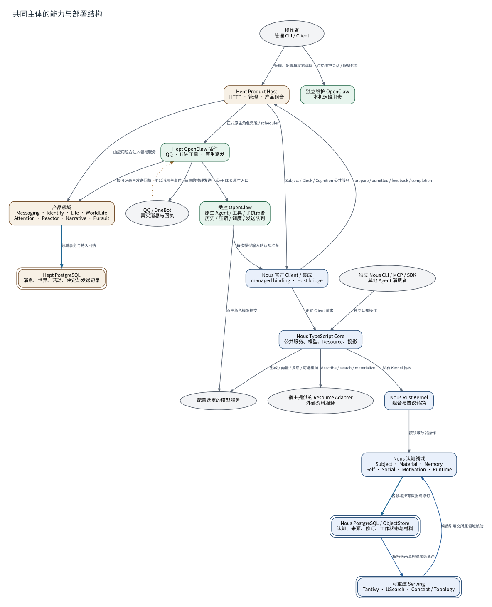

# 共同主体的能力与部署结构

**图型**：系统组件与功能地图。**对应实现**：默认分支；开发分支扩展在对应节点说明。

沿实际软件依赖、服务调用和持久状态串联两个项目与原生执行环境。

[打开可缩放 SVG](./12-system.svg) · [PNG](./12-system.png) · [DOT 源码](./12-system.dot) · [节点与边 JSON](./12-system.json)

## 图例与严格方向

每一条有向边以 **源节点 → 目标节点** 表示，其标签写明具体的调用、读写、转移或依赖。边的线型与颜色对应以下固定语义。

| 边类型 | 实际含义 |
|---|---|
| `call` | 运行时调用或请求 |
| `data` | 将材料、候选或结果送往后续节点 |
| `event` | 提交事实之后产生的通知或触发 |
| `write` | 写入所属权威状态/持久记录 |

节点按所属系统区分：Nous Wave、Heptalogos、原生执行环境和外部系统。双边框表示持久对象或持久状态，椭圆表示外部参与者或事件；其余方框表示实际操作或模块。节点与箭头均带有可跳转的源码依据。

## 箭头清单

| 来源 → 去向 | 关系 | 精确含义 | 代码依据 |
|---|---|---|---|
| 操作者 → Hept Product Host | `call` | 管理、配置与状态读取 | [管理员与确定性管理](../源码与实现索引.md#management) |
| Hept Product Host → 产品领域 | `call` | 由应用组合注入领域服务 | [产品宿主与生命周期](../源码与实现索引.md#host) |
| 产品领域 → Hept PostgreSQL | `write` | 领域事务与持久回执 | [消息接纳与平台事实](../源码与实现索引.md#qq)、[世界定义、事件与局部见闻](../源码与实现索引.md#world)、[表达、世界细节、承诺与后置索引](../源码与实现索引.md#narrative) |
| Hept Product Host → Nous 官方 Client / 集成 | `call` | Subject / Clock / Cognition 公共服务 | [正式接触、认知应用与反馈](../源码与实现索引.md#bridge) |
| Hept Product Host → Hept OpenClaw 插件 | `call` | 正式原生角色派发 / scheduler | [同一主体的不同执行职责](../源码与实现索引.md#roles)、[世界时间映射与按节点推进](../源码与实现索引.md#worldtime) |
| Hept OpenClaw 插件 → 受控 OpenClaw | `call` | 公开 SDK 原生入口 | [同一主体的不同执行职责](../源码与实现索引.md#roles) |
| 受控 OpenClaw → Nous 官方 Client / 集成 | `call` | 每次模型输入的认知准备 | [自动上下文与原生历史](../源码与实现索引.md#projection) |
| Nous 官方 Client / 集成 → Hept Product Host | `call` | prepare / admitted / feedback / completion | [正式接触、认知应用与反馈](../源码与实现索引.md#bridge) |
| Nous 官方 Client / 集成 → Nous TypeScript Core | `call` | 正式 Client 请求 | [正式接触、认知应用与反馈](../源码与实现索引.md#bridge) |
| 独立 Nous CLI / MCP / SDK → Nous TypeScript Core | `call` | 独立认知操作 | [同一主体与能力供给](../源码与实现索引.md#subject)、[冻结查询、共享通道与最终读取](../源码与实现索引.md#query) |
| Nous TypeScript Core → Nous Rust Kernel | `call` | 私有 Kernel 协议 | [模型角色、资源与执行参数](../源码与实现索引.md#models)、[材料接纳与真实接触](../源码与实现索引.md#material) |
| Nous Rust Kernel → Nous 认知领域 | `call` | 按领域分发操作 | [同一主体与能力供给](../源码与实现索引.md#subject)、[长期记忆与修订](../源码与实现索引.md#memory) |
| Nous 认知领域 → Nous PostgreSQL / ObjectStore | `write` | 各领域持有数据与修订 | [长期记忆与修订](../源码与实现索引.md#memory)、[自我认知与知识视角](../源码与实现索引.md#self)、[关系认知与语言惯例](../源码与实现索引.md#social) |
| Nous PostgreSQL / ObjectStore → 可重建 Serving | `data` | 按捕获来源构建服务资产 | [索引代次与历史资产](../源码与实现索引.md#serving) |
| 可重建 Serving → Nous 认知领域 | `data` | 候选引用交所属领域核验 | [冻结查询、共享通道与最终读取](../源码与实现索引.md#query) |
| Nous TypeScript Core → 配置选定的模型服务 | `call` | 形成 / 向量 / 反思 / 可选重排 | [模型角色、资源与执行参数](../源码与实现索引.md#models) |
| 受控 OpenClaw → 配置选定的模型服务 | `call` | 原生角色模型提交 | [同一主体的不同执行职责](../源码与实现索引.md#roles)、[原生模型尝试与费用记录](../源码与实现索引.md#custody) |
| Nous TypeScript Core → 宿主提供的 Resource Adapter | `call` | describe / search / materialize | [外部资源接入](../源码与实现索引.md#resource) |
| QQ / OneBot → Hept OpenClaw 插件 | `event` | 平台消息与事件 | [消息接纳与平台事实](../源码与实现索引.md#qq) |
| Hept OpenClaw 插件 → QQ / OneBot | `call` | 获准的物理发送 | [发送接纳、物理提交与回执](../源码与实现索引.md#sending) |
| Hept OpenClaw 插件 → 产品领域 | `call` | 接收记录与发送回执 | [消息接纳与平台事实](../源码与实现索引.md#qq)、[发送接纳、物理提交与回执](../源码与实现索引.md#sending) |
| 操作者 → 独立维护 OpenClaw | `call` | 独立维护会话 / 服务控制 | [独立机器维护助手](../源码与实现索引.md#maintenance) |

## 运行条件与未完成边界

- 图中的数据存储按所属系统划分；两个PostgreSQL没有跨库事务。跨项目操作经过官方Client和原事件回执。
- 图示职责存在于代码；正式安装后的GIF、浏览器结果交付与学生生活继续仍见PR56未完记录。
