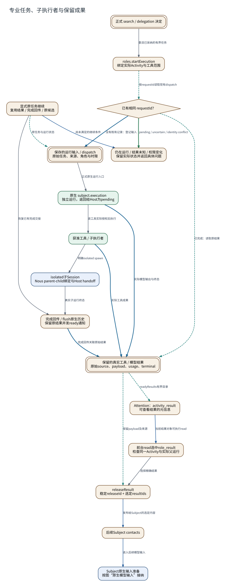

# 专业任务、子执行者与保留成果

**图型**：执行与恢复流程图。**对应实现**：Hept与Nous开发分支；主要执行职责已在默认分支存在。

任务委派、原生执行、结果保留和主体查看构成不同步骤。

[打开可缩放 SVG](./13-worker.svg) · [PNG](./13-worker.png) · [DOT 源码](./13-worker.dot) · [节点与边 JSON](./13-worker.json)

## 图例与严格方向

每一条有向边以 **源节点 → 目标节点** 表示，其标签写明具体的调用、读写、转移或依赖。边的线型与颜色对应以下固定语义。

| 边类型 | 实际含义 |
|---|---|
| `call` | 运行时调用或请求 |
| `data` | 将材料、候选或结果送往后续节点 |
| `read` | 从对象或服务读取数据 |
| `transition` | 同一对象/活动的生命周期状态变迁 |
| `write` | 写入所属权威状态/持久记录 |

节点按所属系统区分：Nous Wave、Heptalogos、原生执行环境和外部系统。双边框表示持久对象或持久状态，椭圆表示外部参与者或事件；其余方框表示实际操作或模块。节点与箭头均带有可跳转的源码依据。

## 箭头清单

| 来源 → 去向 | 关系 | 精确含义 | 代码依据 |
|---|---|---|---|
| 正式 search / delegation 决定 → roles.startExecution | `call` | 委派已采纳的有界任务 | [专业执行、成果保留与显式查看](../源码与实现索引.md#worker) |
| roles.startExecution → 已有相同 requestId？ | `read` | 按requestId读取现有dispatch | [专业执行、成果保留与显式查看](../源码与实现索引.md#worker) |
| 已有相同 requestId？ → 保存的运行输入 / dispatch | `write` | 没有既有记录：登记输入 | [正式接触、认知应用与反馈](../源码与实现索引.md#bridge) |
| 保存的运行输入 / dispatch → 原生 subject.execution | `call` | 正式原生运行入口 | [专业执行、成果保留与显式查看](../源码与实现索引.md#worker) |
| 已有相同 requestId？ → 保留的真实工具 / 模型结果 | `read` | 已完成：读取原结果 | [专业执行、成果保留与显式查看](../源码与实现索引.md#worker) |
| 已有相同 requestId？ → 仍在运行 / 结果未知 / 权限变化 | `transition` | pending / uncertain / identity conflict | [专业执行、成果保留与显式查看](../源码与实现索引.md#worker) |
| 原生 subject.execution → 获准工具 / 子执行者 | `call` | 逐工具实际授权后执行 | [接纳、工具与发送权限](../源码与实现索引.md#permissions) |
| 获准工具 / 子执行者 → isolated子Session | `call` | 明确isolated spawn | [专业执行、成果保留与显式查看](../源码与实现索引.md#worker)、[自动上下文与原生历史](../源码与实现索引.md#projection) |
| isolated子Session → 完成回传 / flush原生历史 | `call` | 真实子运行终态 | [专业执行、成果保留与显式查看](../源码与实现索引.md#worker) |
| 获准工具 / 子执行者 → 保留的真实工具 / 模型结果 | `write` | 实际工具成果 | [正式接触、认知应用与反馈](../源码与实现索引.md#bridge)、[专业执行、成果保留与显式查看](../源码与实现索引.md#worker) |
| 原生 subject.execution → 保留的真实工具 / 模型结果 | `write` | 实际模型输出与终态 | [专业执行、成果保留与显式查看](../源码与实现索引.md#worker) |
| 完成回传 / flush原生历史 → 保留的真实工具 / 模型结果 | `write` | 完成回传关联原始结果 | [专业执行、成果保留与显式查看](../源码与实现索引.md#worker) |
| 保留的真实工具 / 模型结果 → Attention：activity_result | `read` | readyResults有界目录 | [全局通知选择与前台竞争](../源码与实现索引.md#attention) |
| Attention：activity_result → 前台read选中role_result | `data` | 当前结果对象可执行read | [局部情境与可操作对象](../源码与实现索引.md#situation) |
| 前台read选中role_result → releaseResult | `call` | 选择精确结果 | [专业执行、成果保留与显式查看](../源码与实现索引.md#worker) |
| 保留的真实工具 / 模型结果 → releaseResult | `read` | 保留payload及来源 | [专业执行、成果保留与显式查看](../源码与实现索引.md#worker) |
| releaseResult → 后续Subject contacts | `data` | 发布给Subject的选定内容 | [专业执行、成果保留与显式查看](../源码与实现索引.md#worker) |
| 后续Subject contacts → Subject原生输入准备 | `data` | 进入后续模型输入 | [正式接触、认知应用与反馈](../源码与实现索引.md#bridge) |
| 显式原任务继续 → 保存的运行输入 / dispatch | `read` | 原任务与运行状态 | [可读文档、日历和任务管理](../源码与实现索引.md#operator) |
| 显式原任务继续 → 完成回传 / flush原生历史 | `call` | 恢复已有完成交接 | [可读文档、日历和任务管理](../源码与实现索引.md#operator)、[专业执行、成果保留与显式查看](../源码与实现索引.md#worker) |
| 显式原任务继续 → 仍在运行 / 结果未知 / 权限变化 | `data` | 尚未满足的继续条件 | [可读文档、日历和任务管理](../源码与实现索引.md#operator) |

## 运行条件与未完成边界

- ready只建立待看候选，release选择供后续输入使用的结果。Occurrence的实际写入顺序见原生模型输入图。
- PR56仍记录原浏览器结果交付和现有学生生活继续未完成，图中的恢复为现有操作流程。
