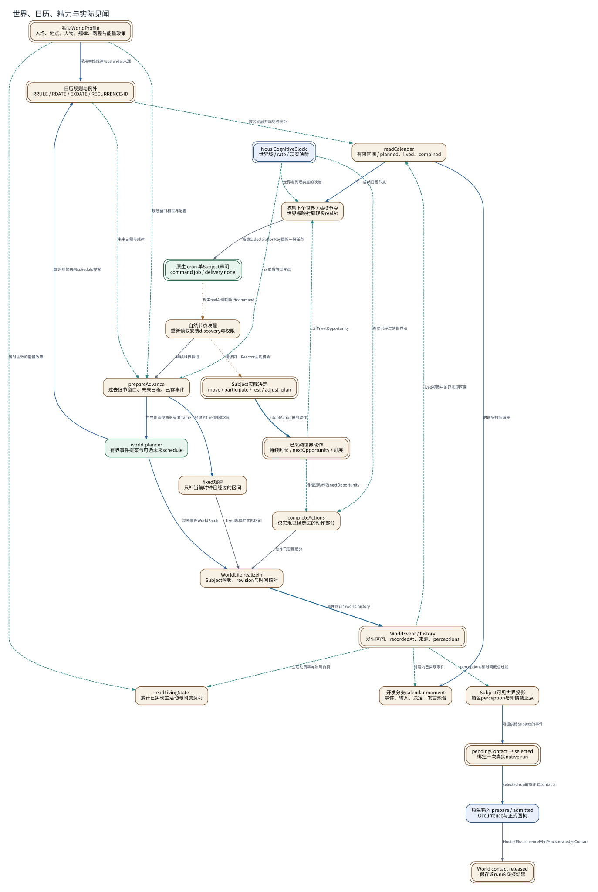

# 世界、日历、精力与实际见闻

**图型**：世界推进与双时间数据流。**对应实现**：默认分支；calendar moment为开发分支扩展。

世界规律和主体动作分别产生已实现区间，时间读取、日历查询和世界创作保持独立。

[打开可缩放 SVG](./14-world-time.svg) · [PNG](./14-world-time.png) · [DOT 源码](./14-world-time.dot) · [节点与边 JSON](./14-world-time.json)

## 图例与严格方向

每一条有向边以 **源节点 → 目标节点** 表示，其标签写明具体的调用、读写、转移或依赖。边的线型与颜色对应以下固定语义。

| 边类型 | 实际含义 |
|---|---|
| `call` | 运行时调用或请求 |
| `data` | 将材料、候选或结果送往后续节点 |
| `event` | 提交事实之后产生的通知或触发 |
| `read` | 从对象或服务读取数据 |
| `write` | 写入所属权威状态/持久记录 |

节点按所属系统区分：Nous Wave、Heptalogos、原生执行环境和外部系统。双边框表示持久对象或持久状态，椭圆表示外部参与者或事件；其余方框表示实际操作或模块。节点与箭头均带有可跳转的源码依据。

## 箭头清单

| 来源 → 去向 | 关系 | 精确含义 | 代码依据 |
|---|---|---|---|
| 独立WorldProfile → 日历规则与例外 | `data` | 采用初始规律与calendar来源 | [世界入场、地点与默认设定](../源码与实现索引.md#profile)、[可修订日历与实际生活](../源码与实现索引.md#calendar) |
| 独立WorldProfile → prepareAdvance | `read` | 规划窗口和世界配置 | [世界入场、地点与默认设定](../源码与实现索引.md#profile)、[世界定义、事件与局部见闻](../源码与实现索引.md#world) |
| 日历规则与例外 → readCalendar | `read` | 按区间展开规则与例外 | [可修订日历与实际生活](../源码与实现索引.md#calendar) |
| 日历规则与例外 → prepareAdvance | `read` | 未来日程与规律 | [世界定义、事件与局部见闻](../源码与实现索引.md#world) |
| Nous CognitiveClock → prepareAdvance | `read` | 正式当前世界点 | [世界时间映射与按节点推进](../源码与实现索引.md#worldtime) |
| prepareAdvance → fixed规律 | `data` | 经过的fixed规律区间 | [世界时间映射与按节点推进](../源码与实现索引.md#worldtime) |
| prepareAdvance → world.planner | `data` | 世界作者视角的有限frame | [世界定义、事件与局部见闻](../源码与实现索引.md#world)、[同一主体的不同执行职责](../源码与实现索引.md#roles) |
| world.planner → WorldLife.realizeIn | `data` | 过去事件WorldPatch | [世界定义、事件与局部见闻](../源码与实现索引.md#world) |
| world.planner → 日历规则与例外 | `data` | 需采用的未来schedule提案 | [世界定义、事件与局部见闻](../源码与实现索引.md#world) |
| Subject实际决定 → 已采纳世界动作 | `write` | adoptAction采用动作 | [精力、当前动作与设备视图](../源码与实现索引.md#living) |
| 已采纳世界动作 → completeActions | `read` | 待推进动作及nextOpportunity | [精力、当前动作与设备视图](../源码与实现索引.md#living) |
| Nous CognitiveClock → completeActions | `read` | 真实已经过的世界点 | [世界时间映射与按节点推进](../源码与实现索引.md#worldtime) |
| completeActions → WorldLife.realizeIn | `call` | 动作已实现部分 | [精力、当前动作与设备视图](../源码与实现索引.md#living) |
| fixed规律 → WorldLife.realizeIn | `call` | fixed规律的实际区间 | [世界时间映射与按节点推进](../源码与实现索引.md#worldtime) |
| WorldLife.realizeIn → WorldEvent / history | `write` | 事件修订与world history | [世界定义、事件与局部见闻](../源码与实现索引.md#world) |
| WorldEvent / history → readCalendar | `read` | lived视图中的已实现区间 | [可修订日历与实际生活](../源码与实现索引.md#calendar) |
| WorldEvent / history → readLivingState | `read` | 主活动费率与附属负荷 | [精力、当前动作与设备视图](../源码与实现索引.md#living) |
| 独立WorldProfile → readLivingState | `read` | 当时生效的能量政策 | [精力、当前动作与设备视图](../源码与实现索引.md#living) |
| WorldEvent / history → Subject可见世界投影 | `read` | perceptions和时间截点过滤 | [世界定义、事件与局部见闻](../源码与实现索引.md#world)、[多时间域与历史理解](../源码与实现索引.md#time) |
| Subject可见世界投影 → pendingContact → selected | `data` | 可提供给Subject的事件 | [世界定义、事件与局部见闻](../源码与实现索引.md#world) |
| pendingContact → selected → 原生输入 prepare / admitted | `data` | selected run取得正式contacts | [正式接触、认知应用与反馈](../源码与实现索引.md#bridge)、[世界定义、事件与局部见闻](../源码与实现索引.md#world) |
| 原生输入 prepare / admitted → World contact released | `call` | Host收到occurrence回执后acknowledgeContact | [正式接触、认知应用与反馈](../源码与实现索引.md#bridge)、[世界定义、事件与局部见闻](../源码与实现索引.md#world) |
| readCalendar → 收集下个世界 / 活动节点 | `data` | 下一自然日程节点 | [世界时间映射与按节点推进](../源码与实现索引.md#worldtime) |
| 已采纳世界动作 → 收集下个世界 / 活动节点 | `read` | 动作nextOpportunity | [世界时间映射与按节点推进](../源码与实现索引.md#worldtime) |
| Nous CognitiveClock → 收集下个世界 / 活动节点 | `read` | 世界点到现实点的映射 | [世界时间映射与按节点推进](../源码与实现索引.md#worldtime) |
| 收集下个世界 / 活动节点 → 原生 cron 单Subject声明 | `call` | 按稳定declarationKey更新一份任务 | [世界时间映射与按节点推进](../源码与实现索引.md#worldtime) |
| 原生 cron 单Subject声明 → 自然节点唤醒 | `event` | 现实realAt到期执行command | [世界时间映射与按节点推进](../源码与实现索引.md#worldtime) |
| 自然节点唤醒 → prepareAdvance | `call` | 继续世界推进 | [世界时间映射与按节点推进](../源码与实现索引.md#worldtime) |
| 自然节点唤醒 → Subject实际决定 | `event` | 请求同一Reactor主观机会 | [单一前台 Reactor](../源码与实现索引.md#reactor) |
| WorldEvent / history → 开发分支calendar moment | `read` | 时段内已实现事件 | [可修订日历与实际生活](../源码与实现索引.md#calendar) |
| readCalendar → 开发分支calendar moment | `data` | 时段安排与偏差 | [可修订日历与实际生活](../源码与实现索引.md#calendar) |

## 运行条件与未完成边界

- 日历read操作只读取和展开；realize才写入世界历史。未来安排仍留在schedule中。
- 角色感知截止点与现实recordedAt分别查询。calendar moment的semanticAdoptedAt、semanticSentAt当前为空，具体缺口在逐句批注中保留。
- World contact的released晚于Nous前置Observation；二者之间的失败窗口见原生输入图。
