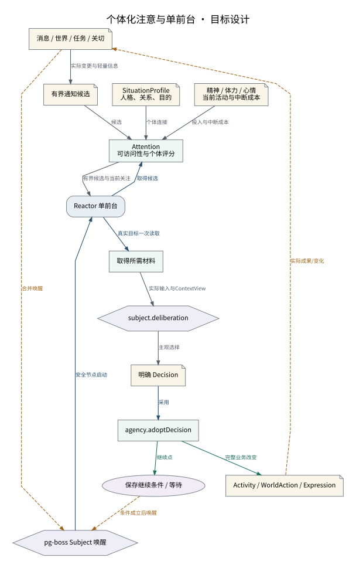

# 个体化注意与单前台

评分组织候选，主观模型保留继续、等待与略过的选择。

设计来源：[注意Reactor与生活状态](../设计/注意Reactor与生活状态.md#个体化注意)。

## 关系说明

| 来源 | 目标 | 关系 | 实际含义 |
|---|---|---|---|
| 消息 / 世界 / 任务 / 关切 | 有界通知候选 | 数据 | 实际变更与轻量信息 |
| 有界通知候选 | Attention / 可访问性与个体评分 | 数据 | 候选 |
| SituationProfile / 人格、关系、目的 | Attention / 可访问性与个体评分 | 数据 | 个体连接 |
| 精神 / 体力 / 心情 / 当前活动与中断成本 | Attention / 可访问性与个体评分 | 数据 | 投入与中断成本 |
| 消息 / 世界 / 任务 / 关切 | pg-boss Subject 唤醒 | 交接 | 合并唤醒 |
| pg-boss Subject 唤醒 | Reactor 单前台 | 调用 | 安全节点启动 |
| Reactor 单前台 | Attention / 可访问性与个体评分 | 调用 | 取得候选 |
| Attention / 可访问性与个体评分 | Reactor 单前台 | 数据 | 有界候选与当前关注 |
| Reactor 单前台 | 取得所需材料 | 调用 | 真实目标一次读取 |
| 取得所需材料 | subject.deliberation | 数据 | 实际输入与ContextView |
| subject.deliberation | 明确 Decision | 数据 | 主观选择 |
| 明确 Decision | agency.adoptDecision | 调用 | 采用 |
| agency.adoptDecision | Activity / WorldAction / Expression | 提交 | 完整业务改变 |
| agency.adoptDecision | 保存继续条件 / 等待 | 提交 | 继续点 |
| Activity / WorldAction / Expression | 消息 / 世界 / 任务 / 关切 | 交接 | 实际成果/变化 |
| 保存继续条件 / 等待 | pg-boss Subject 唤醒 | 交接 | 条件成立后唤醒 |

图中节点和箭头按本包目标设计定义。相应旧实现见来源归档，实际施工状态由代码仓库维护。
