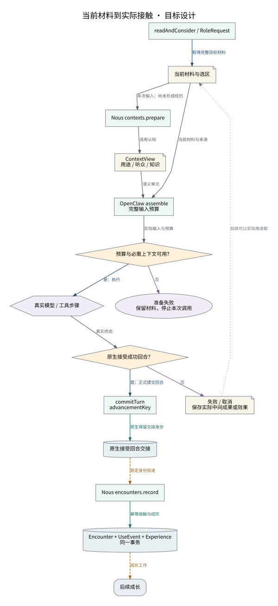

# 当前材料到实际接触

prepare只组织输入；正式接受回合才推进长期接触。

设计来源：[上下文执行与实际接触](../设计/上下文执行与实际接触.md#一个角色调用的正常路径)。

## 关系说明

| 来源 | 目标 | 关系 | 实际含义 |
|---|---|---|---|
| readAndConsider / RoleRequest | 当前材料与选区 | 调用 | 取得完整目标材料 |
| 当前材料与选区 | Nous contexts.prepare | 数据 | 本次输入；尚未形成经历 |
| Nous contexts.prepare | ContextView / 用途 / 听众 / 知识 | 数据 | 适用认知 |
| ContextView / 用途 / 听众 / 知识 | OpenClaw assemble / 完整输入预算 | 数据 | 语义单元 |
| 当前材料与选区 | OpenClaw assemble / 完整输入预算 | 数据 | 当前材料与来源 |
| OpenClaw assemble / 完整输入预算 | 预算与必需上下文可用？ | 数据 | 实际输入与预算 |
| 预算与必需上下文可用？ | 准备失败 / 保留材料，停止本次调用 | 状态 | 否 |
| 预算与必需上下文可用？ | 真实模型 / 工具步骤 | 调用 | 是：执行 |
| 真实模型 / 工具步骤 | 原生接受成功回合？ | 数据 | 真实终态 |
| 原生接受成功回合？ | 失败 / 取消 / 保存实际中间成果或效果 | 状态 | 否 |
| 原生接受成功回合？ | commitTurn / advancementKey | 调用 | 是：正式提交回合 |
| commitTurn / advancementKey | 原生接受回合交接 | 提交 | 原生保留交接身份 |
| 原生接受回合交接 | Nous encounters.record | 交接 | 稳定身份投递 |
| Nous encounters.record | Encounter + UseEvent + Experience / 同一事务 | 提交 | 幂等接触与经历 |
| Encounter + UseEvent + Experience / 同一事务 | 后续成长 | 交接 | 成长工作 |
| 失败 / 取消 / 保存实际中间成果或效果 | 当前材料与选区 | 引用 | 后续可以实际再读取 |

图中节点和箭头按本包目标设计定义。相应旧实现见来源归档，实际施工状态由代码仓库维护。
