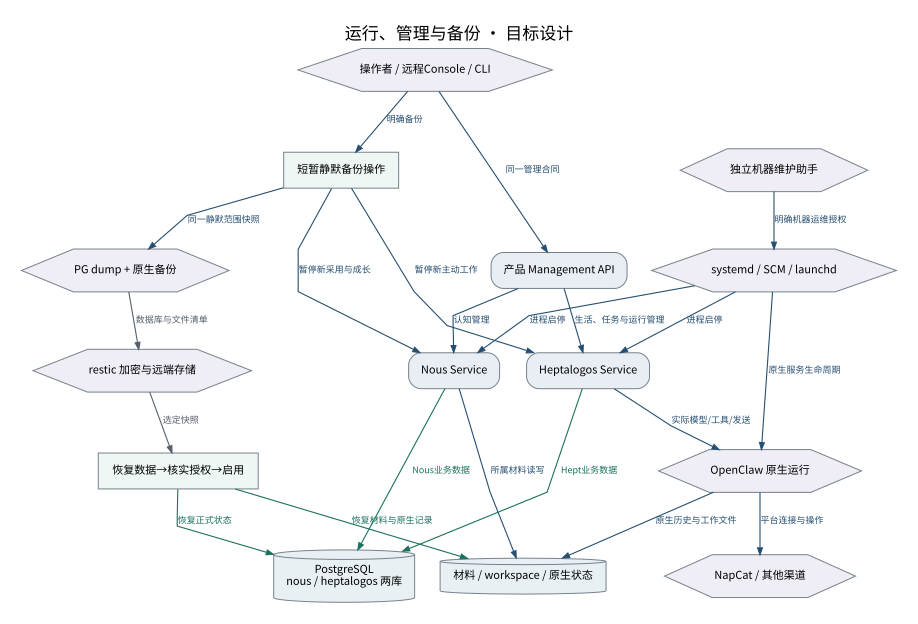

# 运行、管理与备份

操作系统、原生运行和产品各自管理所属状态，界面关闭不停止服务。

设计来源：[部署可移植性与清除](../设计/部署可移植性与清除.md#运行单元)。

## 关系说明

| 来源 | 目标 | 关系 | 实际含义 |
|---|---|---|---|
| 操作者 / 远程Console / CLI | 产品 Management API | 调用 | 同一管理合同 |
| 产品 Management API | Nous Service | 调用 | 认知管理 |
| 产品 Management API | Heptalogos Service | 调用 | 生活、任务与运行管理 |
| Nous Service | PostgreSQL / nous / heptalogos 两库 | 提交 | Nous业务数据 |
| Heptalogos Service | PostgreSQL / nous / heptalogos 两库 | 提交 | Hept业务数据 |
| Heptalogos Service | OpenClaw 原生运行 | 调用 | 实际模型/工具/发送 |
| OpenClaw 原生运行 | NapCat / 其他渠道 | 调用 | 平台连接与操作 |
| systemd / SCM / launchd | Nous Service | 调用 | 进程启停 |
| systemd / SCM / launchd | Heptalogos Service | 调用 | 进程启停 |
| systemd / SCM / launchd | OpenClaw 原生运行 | 调用 | 原生服务生命周期 |
| 独立机器维护助手 | systemd / SCM / launchd | 调用 | 明确机器运维授权 |
| Nous Service | 材料 / workspace / 原生状态 | 调用 | 所属材料读写 |
| OpenClaw 原生运行 | 材料 / workspace / 原生状态 | 调用 | 原生历史与工作文件 |
| 操作者 / 远程Console / CLI | 短暂静默备份操作 | 调用 | 明确备份 |
| 短暂静默备份操作 | Nous Service | 调用 | 暂停新采用与成长 |
| 短暂静默备份操作 | Heptalogos Service | 调用 | 暂停新主动工作 |
| 短暂静默备份操作 | PG dump + 原生备份 | 调用 | 同一静默范围快照 |
| PG dump + 原生备份 | restic 加密与远端存储 | 数据 | 数据库与文件清单 |
| restic 加密与远端存储 | 恢复数据→核实授权→启用 | 数据 | 选定快照 |
| 恢复数据→核实授权→启用 | PostgreSQL / nous / heptalogos 两库 | 提交 | 恢复正式状态 |
| 恢复数据→核实授权→启用 | 材料 / workspace / 原生状态 | 提交 | 恢复材料与原生记录 |

图中节点和箭头按本包目标设计定义。相应旧实现见来源归档，实际施工状态由代码仓库维护。
