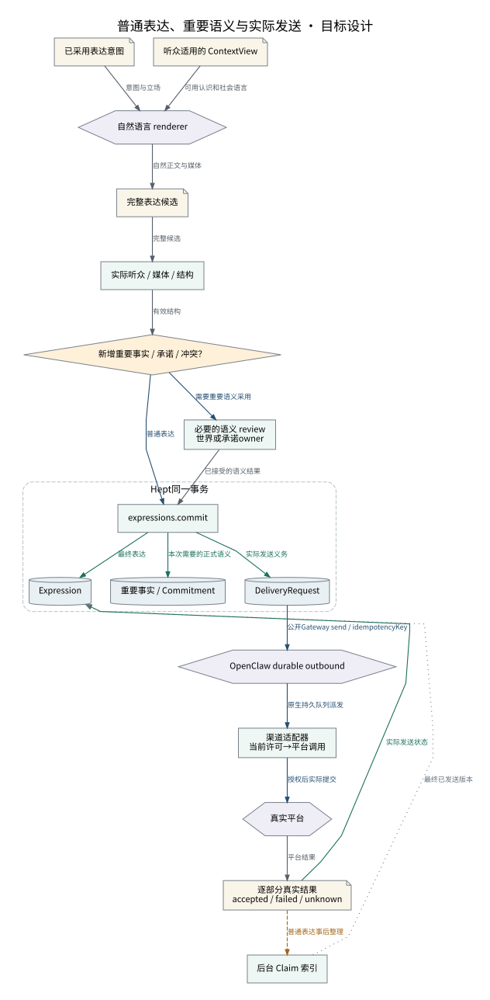

# 普通表达、重要语义与实际发送

普通表达省去模型审查；重要事实和承诺由其owner采用；平台效果统一交给原生队列。

设计来源：[表达陈述与外部效果](../设计/表达陈述与外部效果.md#普通表达的短路径)。

## 关系说明

| 来源 | 目标 | 关系 | 实际含义 |
|---|---|---|---|
| 已采用表达意图 | 自然语言 renderer | 数据 | 意图与立场 |
| 听众适用的 ContextView | 自然语言 renderer | 数据 | 可用认识和社会语言 |
| 自然语言 renderer | 完整表达候选 | 数据 | 自然正文与媒体 |
| 完整表达候选 | 实际听众 / 媒体 / 结构 | 数据 | 完整候选 |
| 实际听众 / 媒体 / 结构 | 新增重要事实 / 承诺 / 冲突？ | 数据 | 有效结构 |
| 新增重要事实 / 承诺 / 冲突？ | expressions.commit | 调用 | 普通表达 |
| 新增重要事实 / 承诺 / 冲突？ | 必要的语义 review / 世界或承诺owner | 调用 | 需要重要语义采用 |
| 必要的语义 review / 世界或承诺owner | expressions.commit | 数据 | 已接受的语义结果 |
| expressions.commit | Expression | 提交 | 最终表达 |
| expressions.commit | 重要事实 / Commitment | 提交 | 本次需要的正式语义 |
| expressions.commit | DeliveryRequest | 提交 | 实际发送义务 |
| DeliveryRequest | OpenClaw durable outbound | 调用 | 公开Gateway send / idempotencyKey |
| OpenClaw durable outbound | 渠道适配器 / 当前许可→平台调用 | 调用 | 原生持久队列派发 |
| 渠道适配器 / 当前许可→平台调用 | 真实平台 | 调用 | 授权后实际提交 |
| 真实平台 | 逐部分真实结果 / accepted / failed / unknown | 数据 | 平台结果 |
| 逐部分真实结果 / accepted / failed / unknown | Expression | 提交 | 实际发送状态 |
| 逐部分真实结果 / accepted / failed / unknown | 后台 Claim 索引 | 交接 | 普通表达事后整理 |
| 后台 Claim 索引 | Expression | 引用 | 最终已发送版本 |

图中节点和箭头按本包目标设计定义。相应旧实现见来源归档，实际施工状态由代码仓库维护。
