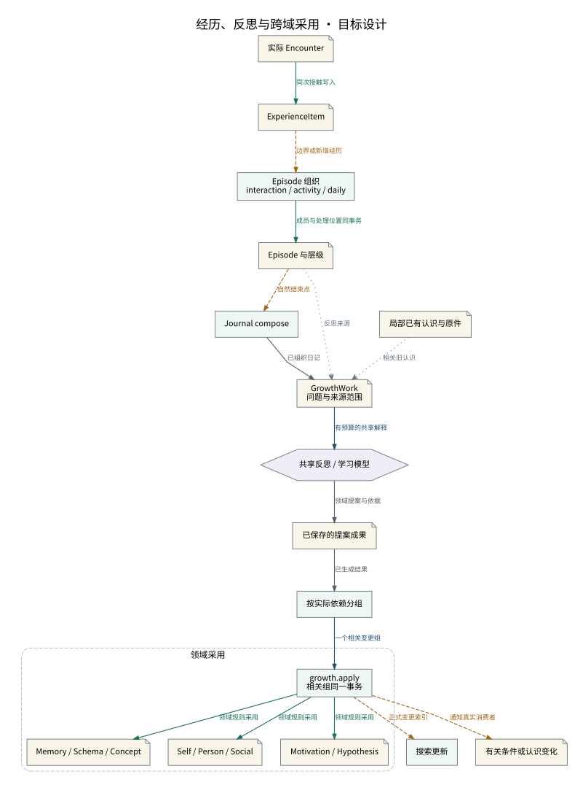

# 经历、反思与跨域采用

自动组织和模型反思共享正式来源，互相依赖的认知变更在一个事务组采用。

设计来源：[成长学习与离线认知](../设计/成长学习与离线认知.md#共享反思操作)。

## 关系说明

| 来源 | 目标 | 关系 | 实际含义 |
|---|---|---|---|
| 实际 Encounter | ExperienceItem | 提交 | 同次接触写入 |
| ExperienceItem | Episode 组织 / interaction / activity / daily | 交接 | 边界或新增经历 |
| Episode 组织 / interaction / activity / daily | Episode 与层级 | 提交 | 成员与处理位置同事务 |
| Episode 与层级 | Journal compose | 交接 | 自然结束点 |
| Episode 与层级 | GrowthWork / 问题与来源范围 | 引用 | 反思来源 |
| Journal compose | GrowthWork / 问题与来源范围 | 数据 | 已组织日记 |
| 局部已有认识与原件 | GrowthWork / 问题与来源范围 | 引用 | 相关旧认识 |
| GrowthWork / 问题与来源范围 | 共享反思 / 学习模型 | 调用 | 有预算的共享解释 |
| 共享反思 / 学习模型 | 已保存的提案成果 | 数据 | 领域提案与依据 |
| 已保存的提案成果 | 按实际依赖分组 | 数据 | 已生成结果 |
| 按实际依赖分组 | growth.apply / 相关组同一事务 | 调用 | 一个相关变更组 |
| growth.apply / 相关组同一事务 | Memory / Schema / Concept | 提交 | 领域规则采用 |
| growth.apply / 相关组同一事务 | Self / Person / Social | 提交 | 领域规则采用 |
| growth.apply / 相关组同一事务 | Motivation / Hypothesis | 提交 | 领域规则采用 |
| growth.apply / 相关组同一事务 | 搜索更新 | 交接 | 正式变更索引 |
| growth.apply / 相关组同一事务 | 有关条件或认识变化 | 交接 | 通知真实消费者 |

图中节点和箭头按本包目标设计定义。相应旧实现见来源归档，实际施工状态由代码仓库维护。
