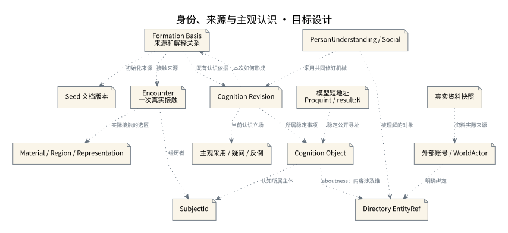

# 身份、来源与主观认识

本图的虚线引用表示数据关系，没有隐含的模型执行或自动真实性提升。

设计来源：[身份来源权限与时间](../设计/身份来源权限与时间.md#稳定身份)。

## 关系说明

| 来源 | 目标 | 关系 | 实际含义 |
|---|---|---|---|
| 外部账号 / WorldActor | Directory EntityRef | 引用 | 明确绑定 |
| 真实资料快照 | 外部账号 / WorldActor | 引用 | 资料实际来源 |
| PersonUnderstanding / Social | Directory EntityRef | 引用 | 被理解的对象 |
| Encounter / 一次真实接触 | Material / Region / Representation | 引用 | 实际接触的选区 |
| Encounter / 一次真实接触 | SubjectId | 引用 | 经历者 |
| Cognition Revision | Cognition Object | 引用 | 所属稳定事项 |
| Cognition Object | SubjectId | 引用 | 认知所属主体 |
| Formation Basis / 来源和解释关系 | Encounter / 一次真实接触 | 引用 | 接触来源 |
| Formation Basis / 来源和解释关系 | Seed 文档版本 | 引用 | 初始化来源 |
| Formation Basis / 来源和解释关系 | Cognition Revision | 引用 | 既有认识依据 |
| Cognition Revision | Formation Basis / 来源和解释关系 | 引用 | 本次如何形成 |
| Cognition Revision | 主观采用 / 疑问 / 反例 | 引用 | 当前认识立场 |
| PersonUnderstanding / Social | Cognition Revision | 引用 | 采用共同修订机械 |
| 模型短地址 / Proquint / result:N | Cognition Object | 引用 | 稳定公开寻址 |
| Cognition Object | Directory EntityRef | 引用 | aboutness：内容涉及谁 |

图中节点和箭头按本包目标设计定义。相应旧实现见来源归档，实际施工状态由代码仓库维护。
