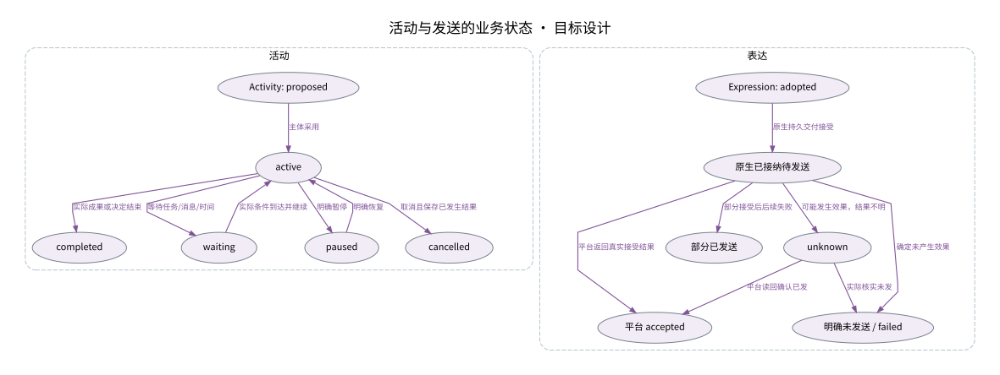

# 活动与发送的业务状态

椭圆是业务状态；箭头只表示标注条件触发的状态变化。

设计来源：[公开操作与数据模型](../设计/公开操作与数据模型.md#操作结果)。

## 关系说明

| 来源 | 目标 | 关系 | 实际含义 |
|---|---|---|---|
| Activity: proposed | active | 状态 | 主体采用 |
| active | waiting | 状态 | 等待任务/消息/时间 |
| waiting | active | 状态 | 实际条件到达并继续 |
| active | paused | 状态 | 明确暂停 |
| paused | active | 状态 | 明确恢复 |
| active | completed | 状态 | 实际成果或决定结束 |
| active | cancelled | 状态 | 取消且保存已发生结果 |
| Expression: adopted | 原生已接纳待发送 | 状态 | 原生持久交付接受 |
| 原生已接纳待发送 | 平台 accepted | 状态 | 平台返回真实接受结果 |
| 原生已接纳待发送 | 部分已发送 | 状态 | 部分接受后后续失败 |
| 原生已接纳待发送 | unknown | 状态 | 可能发生效果，结果不明 |
| 原生已接纳待发送 | 明确未发送 / failed | 状态 | 确定未产生效果 |
| unknown | 平台 accepted | 状态 | 平台读回确认已发 |
| unknown | 明确未发送 / failed | 状态 | 实际核实未发 |

图中节点和箭头按本包目标设计定义。相应旧实现见来源归档，实际施工状态由代码仓库维护。
