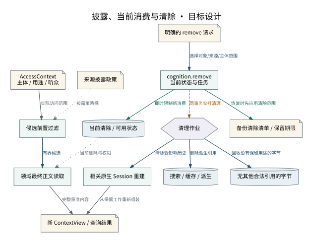

# 披露、当前消费与清除

当前可见性在事务中立即改变，后台完成派生与历史的物理清理。

设计来源：[部署可移植性与清除](../设计/部署可移植性与清除.md#清除的完整操作)。

## 关系说明

| 来源 | 目标 | 关系 | 实际含义 |
|---|---|---|---|
| AccessContext / 主体 / 用途 / 听众 | 候选前置过滤 | 数据 | 实际访问范围 |
| 来源披露政策 | 候选前置过滤 | 引用 | 披露策略桶 |
| 候选前置过滤 | 领域最终正文读取 | 调用 | 有界候选 |
| 当前清除 / 可用状态 | 领域最终正文读取 | 引用 | 当前删除与权限 |
| 领域最终正文读取 | 新 ContextView / 查询结果 | 数据 | 完整获准内容 |
| 明确的 remove 请求 | cognition.remove / 当前状态与任务 | 调用 | 选择对象/来源/主体范围 |
| cognition.remove / 当前状态与任务 | 当前清除 / 可用状态 | 提交 | 即时限制新消费 |
| cognition.remove / 当前状态与任务 | 清理作业 | 交接 | 同事务安排清理 |
| 清理作业 | 搜索 / 缓存 / 派生 | 调用 | 删除派生引用 |
| 清理作业 | 无其他合法引用的字节 | 调用 | 回收没有保留用途的字节 |
| 清理作业 | 相关原生 Session 重建 | 调用 | 清除受影响历史 |
| cognition.remove / 当前状态与任务 | 备份清除清单 / 保留期限 | 提交 | 恢复时先应用清除范围 |
| 相关原生 Session 重建 | 新 ContextView / 查询结果 | 数据 | 从保留工作重新组装 |

图中节点和箭头按本包目标设计定义。相应旧实现见来源归档，实际施工状态由代码仓库维护。
