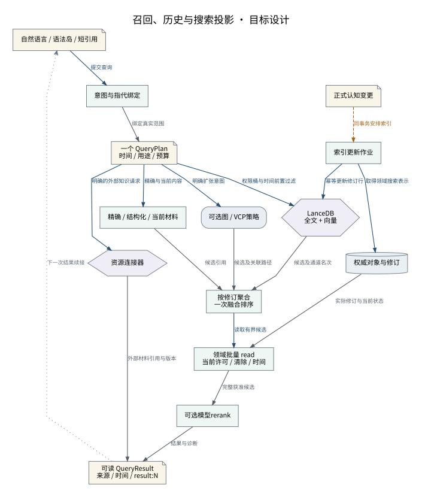

# 召回、历史与搜索投影

多个检索来源在一次计划中竞争，最终正文始终由领域按当前许可读取。

设计来源：[召回与NousQL](../设计/召回与NousQL.md#候选与排序)。

## 关系说明

| 来源 | 目标 | 关系 | 实际含义 |
|---|---|---|---|
| 自然语言 / 语法岛 / 短引用 | 意图与指代绑定 | 调用 | 提交查询 |
| 意图与指代绑定 | 一个 QueryPlan / 时间 / 用途 / 预算 | 数据 | 绑定真实范围 |
| 一个 QueryPlan / 时间 / 用途 / 预算 | 精确 / 结构化 / 当前材料 | 调用 | 精确与当前内容 |
| 一个 QueryPlan / 时间 / 用途 / 预算 | LanceDB / 全文 + 向量 | 调用 | 权限桶与时间前置过滤 |
| 一个 QueryPlan / 时间 / 用途 / 预算 | 可选图 / VCP策略 | 调用 | 明确扩张意图 |
| 精确 / 结构化 / 当前材料 | 按修订聚合 / 一次融合排序 | 数据 | 候选引用 |
| LanceDB / 全文 + 向量 | 按修订聚合 / 一次融合排序 | 数据 | 候选及通道名次 |
| 可选图 / VCP策略 | 按修订聚合 / 一次融合排序 | 数据 | 候选及关联路径 |
| 按修订聚合 / 一次融合排序 | 领域批量 read / 当前许可 / 清除 / 时间 | 调用 | 读取有界候选 |
| 权威对象与修订 | 领域批量 read / 当前许可 / 清除 / 时间 | 数据 | 实际修订与当前状态 |
| 领域批量 read / 当前许可 / 清除 / 时间 | 可选模型rerank | 数据 | 完整获准候选 |
| 可选模型rerank | 可读 QueryResult / 来源 / 时间 / result:N | 数据 | 结果与诊断 |
| 正式认知变更 | 索引更新作业 | 交接 | 同事务安排索引 |
| 索引更新作业 | 权威对象与修订 | 调用 | 取得领域搜索表示 |
| 索引更新作业 | LanceDB / 全文 + 向量 | 调用 | 幂等更新修订行 |
| 一个 QueryPlan / 时间 / 用途 / 预算 | 资源连接器 | 调用 | 明确的外部知识请求 |
| 资源连接器 | 可读 QueryResult / 来源 / 时间 / result:N | 数据 | 外部材料引用与版本 |
| 可读 QueryResult / 来源 / 时间 / result:N | 自然语言 / 语法岛 / 短引用 | 引用 | 下一次结果续接 |

图中节点和箭头按本包目标设计定义。相应旧实现见来源归档，实际施工状态由代码仓库维护。
