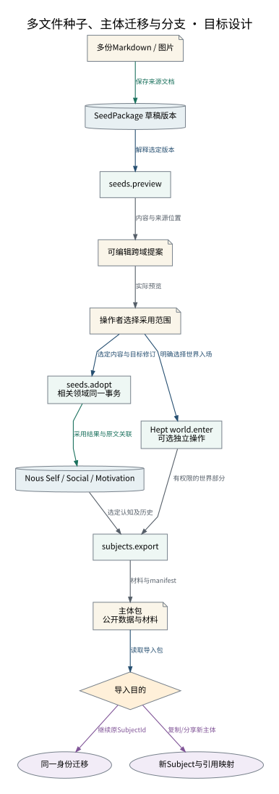

# 多文件种子、主体迁移与分支

编辑、预览、采用分别发生；恢复同一身份和创建分支是两个明确目的。

设计来源：[种子主体包与分支](../设计/种子主体包与分支.md#预览与采用)。

## 关系说明

| 来源 | 目标 | 关系 | 实际含义 |
|---|---|---|---|
| 多份Markdown / 图片 | SeedPackage 草稿版本 | 提交 | 保存来源文档 |
| SeedPackage 草稿版本 | seeds.preview | 调用 | 解释选定版本 |
| seeds.preview | 可编辑跨域提案 | 数据 | 内容与来源位置 |
| 可编辑跨域提案 | 操作者选择采用范围 | 数据 | 实际预览 |
| 操作者选择采用范围 | seeds.adopt / 相关领域同一事务 | 调用 | 选定内容与目标修订 |
| seeds.adopt / 相关领域同一事务 | Nous Self / Social / Motivation | 提交 | 采用结果与原文关联 |
| 操作者选择采用范围 | Hept world.enter / 可选独立操作 | 调用 | 明确选择世界入场 |
| Nous Self / Social / Motivation | subjects.export | 数据 | 选定认知及历史 |
| Hept world.enter / 可选独立操作 | subjects.export | 数据 | 有权限的世界部分 |
| subjects.export | 主体包 / 公开数据与材料 | 数据 | 材料与manifest |
| 主体包 / 公开数据与材料 | 导入目的 | 调用 | 读取导入包 |
| 导入目的 | 同一身份迁移 | 状态 | 继续原SubjectId |
| 导入目的 | 新Subject与引用映射 | 状态 | 复制/分享新主体 |

图中节点和箭头按本包目标设计定义。相应旧实现见来源归档，实际施工状态由代码仓库维护。
