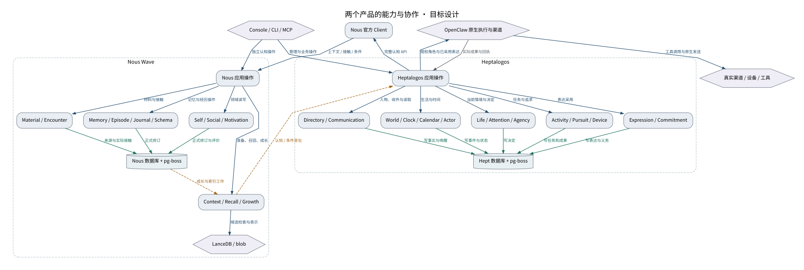

# 两个产品的能力与协作

模块提供完整能力；箭头表示调用、业务交接或正式数据写入。

设计来源：[整体架构](../设计/整体架构.md#目标与结构)。

## 关系说明

| 来源 | 目标 | 关系 | 实际含义 |
|---|---|---|---|
| Console / CLI / MCP | Heptalogos 应用操作 | 调用 | 管理与业务操作 |
| Console / CLI / MCP | Nous 应用操作 | 调用 | 独立认知操作 |
| Heptalogos 应用操作 | Directory / Communication | 调用 | 人物、收件与读取 |
| Heptalogos 应用操作 | World / Clock / Calendar / Actor | 调用 | 生活与时间 |
| Heptalogos 应用操作 | Life / Attention / Agency | 调用 | 当前情境与决定 |
| Heptalogos 应用操作 | Activity / Pursuit / Device | 调用 | 任务与追求 |
| Heptalogos 应用操作 | Expression / Commitment | 调用 | 表达采用 |
| Directory / Communication | Hept 数据库 + pg-boss | 提交 | 写事实与唤醒 |
| World / Clock / Calendar / Actor | Hept 数据库 + pg-boss | 提交 | 写事件与状态 |
| Life / Attention / Agency | Hept 数据库 + pg-boss | 提交 | 写决定 |
| Activity / Pursuit / Device | Hept 数据库 + pg-boss | 提交 | 写任务和成果 |
| Expression / Commitment | Hept 数据库 + pg-boss | 提交 | 写表达与义务 |
| Heptalogos 应用操作 | Nous 官方 Client | 调用 | 完整认知 API |
| Nous 官方 Client | Nous 应用操作 | 调用 | 上下文 / 接触 / 条件 |
| Nous 应用操作 | Material / Encounter | 调用 | 材料与接触 |
| Nous 应用操作 | Memory / Episode / Journal / Schema | 调用 | 记忆与经历操作 |
| Nous 应用操作 | Self / Social / Motivation | 调用 | 领域读写 |
| Nous 应用操作 | Context / Recall / Growth | 调用 | 准备、召回、成长 |
| Material / Encounter | Nous 数据库 + pg-boss | 提交 | 来源与实际接触 |
| Memory / Episode / Journal / Schema | Nous 数据库 + pg-boss | 提交 | 正式修订 |
| Self / Social / Motivation | Nous 数据库 + pg-boss | 提交 | 正式修订与评价 |
| Context / Recall / Growth | LanceDB / blob | 调用 | 候选检索与表示 |
| Nous 数据库 + pg-boss | Context / Recall / Growth | 交接 | 成长与索引工作 |
| Heptalogos 应用操作 | OpenClaw 原生执行与渠道 | 调用 | 授权角色与已采用表达 |
| OpenClaw 原生执行与渠道 | 真实渠道 / 设备 / 工具 | 调用 | 工具调用与原生发送 |
| OpenClaw 原生执行与渠道 | Heptalogos 应用操作 | 数据 | 实际成果与回执 |
| Context / Recall / Growth | Heptalogos 应用操作 | 交接 | 认知 / 条件变化 |

图中节点和箭头按本包目标设计定义。相应旧实现见来源归档，实际施工状态由代码仓库维护。
