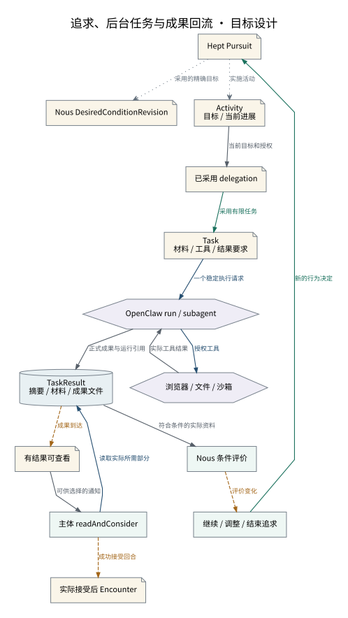

# 追求、后台任务与成果回流

长期目标、一次任务、原生运行与实际读取有独立生命周期。

设计来源：[活动任务与计算环境](../设计/活动任务与计算环境.md#委派与成果交付)。

## 关系说明

| 来源 | 目标 | 关系 | 实际含义 |
|---|---|---|---|
| Hept Pursuit | Nous DesiredConditionRevision | 引用 | 采用的精确目标 |
| Hept Pursuit | Activity / 目标 / 当前进展 | 引用 | 实施活动 |
| Activity / 目标 / 当前进展 | 已采用 delegation | 数据 | 当前目标和授权 |
| 已采用 delegation | Task / 材料 / 工具 / 结果要求 | 提交 | 采用有限任务 |
| Task / 材料 / 工具 / 结果要求 | OpenClaw run / subagent | 调用 | 一个稳定执行请求 |
| OpenClaw run / subagent | 浏览器 / 文件 / 沙箱 | 调用 | 授权工具 |
| 浏览器 / 文件 / 沙箱 | OpenClaw run / subagent | 数据 | 实际工具结果 |
| OpenClaw run / subagent | TaskResult / 摘要 / 材料 / 成果文件 | 数据 | 正式成果与运行引用 |
| TaskResult / 摘要 / 材料 / 成果文件 | 有结果可查看 | 交接 | 成果到达 |
| 有结果可查看 | 主体 readAndConsider | 数据 | 可供选择的通知 |
| 主体 readAndConsider | TaskResult / 摘要 / 材料 / 成果文件 | 调用 | 读取实际所需部分 |
| 主体 readAndConsider | 实际接受后 Encounter | 交接 | 成功接受回合 |
| TaskResult / 摘要 / 材料 / 成果文件 | Nous 条件评价 | 数据 | 符合条件的实际资料 |
| Nous 条件评价 | 继续 / 调整 / 结束追求 | 交接 | 评价变化 |
| 继续 / 调整 / 结束追求 | Hept Pursuit | 提交 | 新的行为决定 |

图中节点和箭头按本包目标设计定义。相应旧实现见来源归档，实际施工状态由代码仓库维护。
