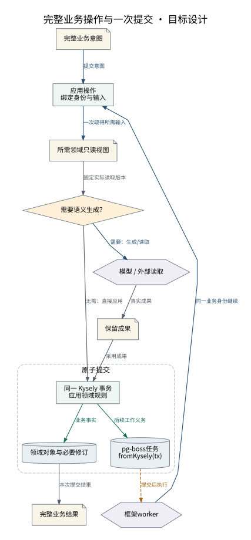

# 完整业务操作与一次提交

模型计算在事务外；业务写入与后续作业在一笔 Kysely 事务提交。

设计来源：[业务操作与事务中心](../设计/业务操作与事务中心.md#一次业务意图一处提交)。

## 关系说明

| 来源 | 目标 | 关系 | 实际含义 |
|---|---|---|---|
| 完整业务意图 | 应用操作 / 绑定身份与输入 | 调用 | 提交意图 |
| 应用操作 / 绑定身份与输入 | 所需领域只读视图 | 调用 | 一次取得所需输入 |
| 所需领域只读视图 | 需要语义生成？ | 数据 | 固定实际读取版本 |
| 需要语义生成？ | 模型 / 外部读取 | 调用 | 需要：生成/读取 |
| 模型 / 外部读取 | 保留成果 | 数据 | 真实成果 |
| 保留成果 | 同一 Kysely 事务 / 应用领域规则 | 数据 | 采用成果 |
| 需要语义生成？ | 同一 Kysely 事务 / 应用领域规则 | 数据 | 无需：直接应用 |
| 同一 Kysely 事务 / 应用领域规则 | 领域对象与必要修订 | 提交 | 业务事实 |
| 同一 Kysely 事务 / 应用领域规则 | pg-boss任务 / fromKysely(tx) | 提交 | 后续工作义务 |
| 领域对象与必要修订 | 完整业务结果 | 数据 | 本次提交结果 |
| pg-boss任务 / fromKysely(tx) | 框架worker | 交接 | 提交后执行 |
| 框架worker | 应用操作 / 绑定身份与输入 | 调用 | 同一业务身份继续 |

图中节点和箭头按本包目标设计定义。相应旧实现见来源归档，实际施工状态由代码仓库维护。
