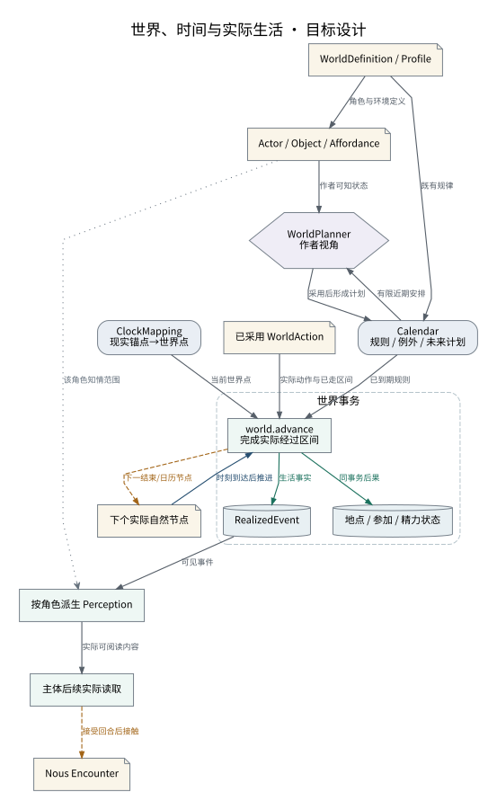

# 世界、时间与实际生活

计划、发生与感知分别维护；时钟只决定目前可实现的区间。

设计来源：[世界日历与人物](../设计/世界日历与人物.md#从长期设定到具体生活)。

## 关系说明

| 来源 | 目标 | 关系 | 实际含义 |
|---|---|---|---|
| WorldDefinition / Profile | Calendar / 规则 / 例外 / 未来计划 | 数据 | 既有规律 |
| WorldDefinition / Profile | Actor / Object / Affordance | 数据 | 角色与环境定义 |
| Calendar / 规则 / 例外 / 未来计划 | WorldPlanner / 作者视角 | 数据 | 有限近期安排 |
| Actor / Object / Affordance | WorldPlanner / 作者视角 | 数据 | 作者可知状态 |
| WorldPlanner / 作者视角 | Calendar / 规则 / 例外 / 未来计划 | 数据 | 采用后形成计划 |
| ClockMapping / 现实锚点→世界点 | world.advance / 完成实际经过区间 | 数据 | 当前世界点 |
| Calendar / 规则 / 例外 / 未来计划 | world.advance / 完成实际经过区间 | 数据 | 已到期规则 |
| 已采用 WorldAction | world.advance / 完成实际经过区间 | 数据 | 实际动作与已走区间 |
| world.advance / 完成实际经过区间 | RealizedEvent | 提交 | 生活事实 |
| world.advance / 完成实际经过区间 | 地点 / 参加 / 精力状态 | 提交 | 同事务后果 |
| RealizedEvent | 按角色派生 Perception | 数据 | 可见事件 |
| Actor / Object / Affordance | 按角色派生 Perception | 引用 | 该角色知情范围 |
| 按角色派生 Perception | 主体后续实际读取 | 数据 | 实际可阅读内容 |
| 主体后续实际读取 | Nous Encounter | 交接 | 接受回合后接触 |
| world.advance / 完成实际经过区间 | 下个实际自然节点 | 交接 | 下一结束/日历节点 |
| 下个实际自然节点 | world.advance / 完成实际经过区间 | 调用 | 时刻到达后推进 |

图中节点和箭头按本包目标设计定义。相应旧实现见来源归档，实际施工状态由代码仓库维护。
