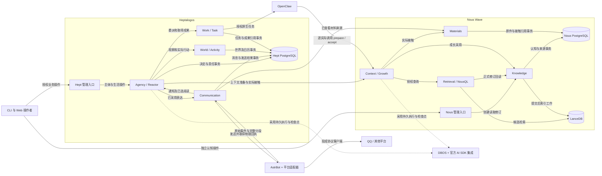
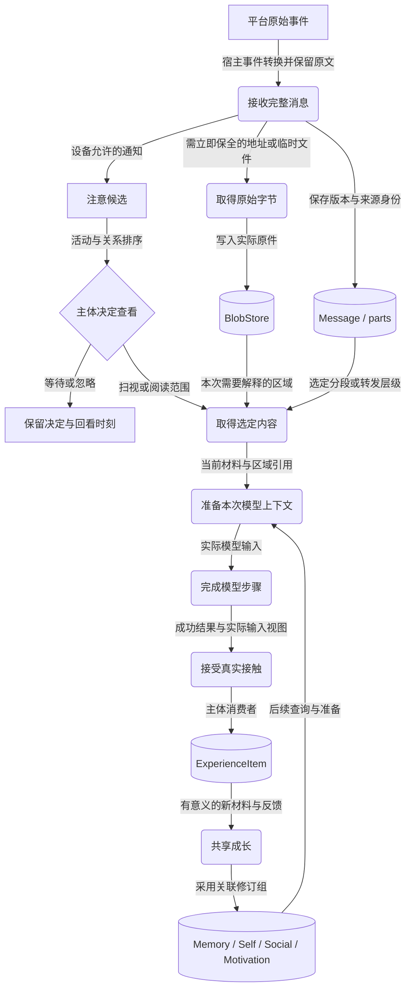
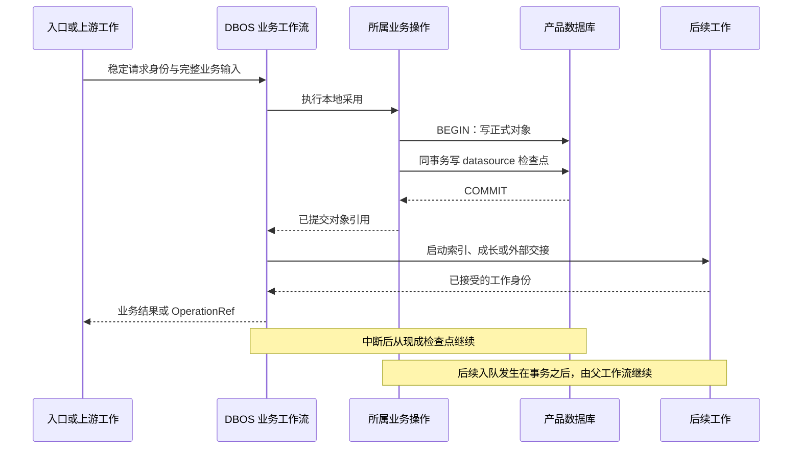
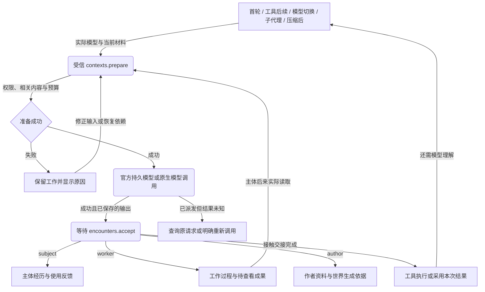
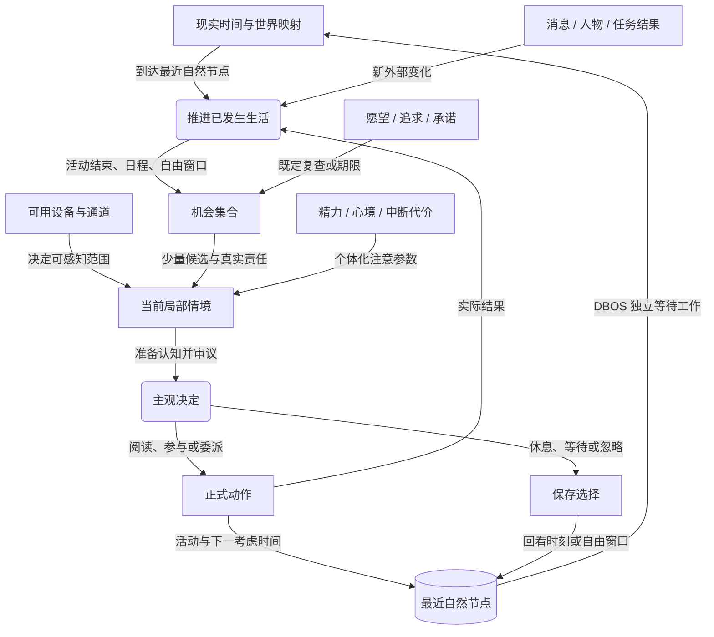
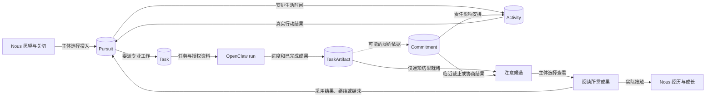
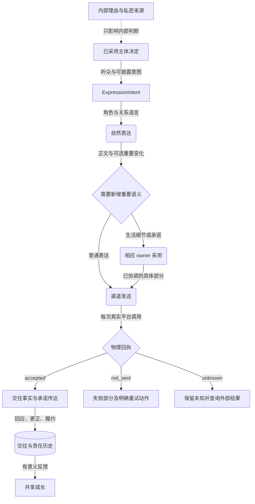
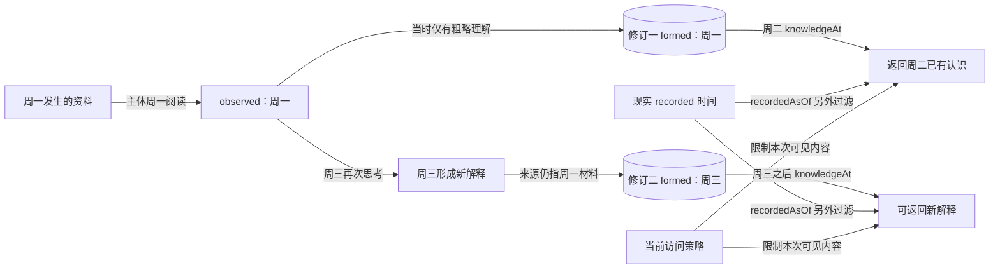
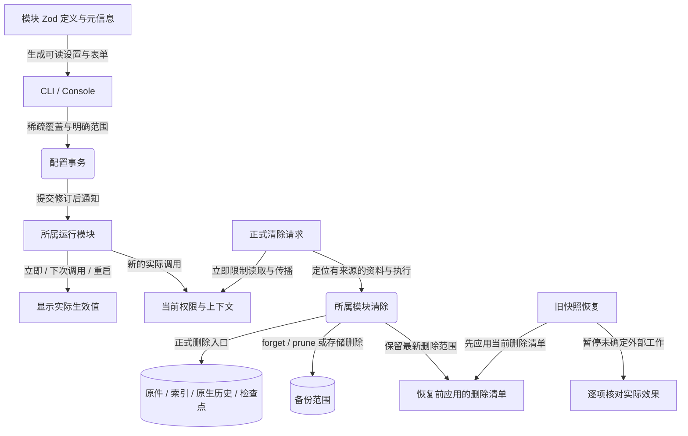

# 系统与流程图谱

## 图例与阅读

本文件是图谱的唯一维护源，使用 Mermaid。矩形表示模块、资料或一个操作，圆角节点表示一个完整工作过程，菱形表示有明确条件的分支，圆柱表示持久存储。流程图的实线箭头表示所标注的调用、提交或内容传递，虚线表示模块依赖、资料引用、观测或配置关联；时序图的实线表示请求，虚线表示返回结果。子图表示实际产品或执行边界。箭头上的文字是关系含义，位置和颜色不编码业务状态。

图中 `prepare/accept` 指正式上下文与实际接触操作；DBOS 指其现成执行机械。图谱与正文中的正式对象相同，图中的分组不新增服务、数据库或协议。

## 产品、宿主与正式状态

见[架构与仓库](设计/架构与仓库.md#两个模块化服务)和[第三方接入](设计/第三方接入与源码复用.md#astrbot-渠道宿主)。两个产品不共享业务表，OpenClaw 和 AstrBot 分别承担其原生能力。

## 收件、选择阅读与认知形成

保全原件与实际阅读走不同分支。worker 或 author 接触留在其工作资料，进入主体经历的分支由受信消费者身份决定。见[材料消息](设计/材料消息与来源.md)与[成长](设计/成长与认知维护.md#成长入口)。

## 业务事务与后续工作

这里没有跨产品事务，也没有额外 outbox 队列。变更导航按实际对象事务保存，用于消费者读取当前修订。见[事务与并发](设计/契约与数据事务.md#dbos-的使用范围)。

## 每次模型调用与接触责任

AI SDK 路径使用正式 middleware 与 DBOS 检查点；原生路径在 OpenClaw 所属调用边界增加公共扩展合同。中途失败保留此前完成步骤。见[模型接线](设计/上下文模型与原生执行.md#ai-sdk-与-dbos-接线)。

## 世界推进、自发机会与全局注意

没有消息时，自由窗口仍能产生机会；等待节点不占据主体前台。见[自主性](设计/注意自主性与主观执行.md#机会来源)与[世界节点](设计/世界日历与生活实现.md#下一自然节点)。

## 追求、任务与结果使用

任务的专业能力与主体学习通过实际阅读和使用相连。成果始终保留原目标与 TaskId。见[专业任务](设计/追求任务承诺与表达.md#专业任务与工作空间)。

## 表达、重要采用与实际发送

private 节点没有通往 renderer 的内容传递箭头。内部理由和对外意图是不同输入。见[意图与表达](设计/追求任务承诺与表达.md#表达意图与自然语言)及[权限](设计/身份时间与权限.md#来源用途与受众)。

## 知识形成与历史截面

valid 说明认识适用的时间，不把后来形成的结论提前写进知情截面。见[两种历史视图](设计/身份时间与权限.md#两种历史视图)。

## 配置、运行与清除

配置与清除分别由实际 owner 完成；界面读取已保存值及真实运行状态。见[配置生效](设计/配置模型资源与预算.md#保存生效与历史)及[清除](设计/部署更新导出与清除.md#限制遗忘与物理清除)。
