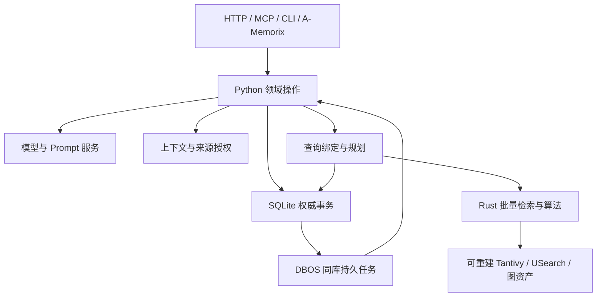

# 语言、模块与所有权

## 一条正式应用路径

Python 主应用拥有认知与产品语义。Rust 拥有计算算法和派生索引的操作细节。SQLite 保存权威状态。外部 HTTP、MCP、CLI 及 A-Memorix 协议进入同一套 Python 操作。默认一个实例由一个服务进程持有写入与后台执行；不同实例可以使用不同进程和目录。



箭头分别表示实际调用或持久写入：APP→DB 是领域写入/读取，DB→JOB 是同事务的任务接纳；JOB→APP 是恢复后的用例执行；PLAN→DB 是读取权威候选和最终物化。Rust 不调用 Python 的数据库、Provider 或授权函数。

## 发行结构与模块结构

```text
pyproject.toml / uv.lock / .python-version
src/nous/
  bootstrap.py          # 资源创建、注册、生命周期
  application.py        # 显式组装；不放领域规则
  identity/             # Namespace、Subject、授权、能力供给
  material/             # 原件、区域、派生、Contact/Import
  cognition/
    memory/             # 修订、生命周期、形成与使用
    episode/            # 分段轨道、成员与重分段
    journal/            # 写作时视角与叙述
    schema/             # 图式、支持、反证
    concept/            # Tag/Concept、别名、合并拆分
    association/        # 关联证据与来源独立性
    self_model/         # 人格、知识范围、叙事身份
    social/             # 人物、关系、语言惯例
    motivation/         # Desire、Concern、期望条件
  retrieval/            # 查询绑定、计划、资产准备、结果物化
  context/              # Active/Resident/Work/Managed Context、Steward
  imports/              # 输入、Catalog、Unit、Output、文件接纳
  data_management/      # Bundle、来源生命周期、导入导出
  platform/
    persistence/        # Engine、事务与迁移设施
    execution/          # DBOS 接入、任务控制
    models/             # Provider、Role、调用账本与预算
    prompts/            # 资源、渲染、激活、历史
    configuration/      # 类型化配置、继承与生效
    network/            # 受管客户端与访问策略
    content/            # 流式原件、不可变文件、内容引用
    media/              # 探测、区域、采样、解释输入
    time/               # 时间域、精度、五轴与宿主时钟输入
    observability/      # logging / OTel 接线
    security/           # SecretRef、凭据及身份解析机制
    instance/           # 路径、锁、启停、OS 服务
    localization/       # 文案、语言偏好、区域显示
  transports/
    http/               # FastAPI 参数、身份、状态码
    mcp/                # 官方 SDK 工具和资源
    cli/                # Typer、默认可读输出、--json
  integrations/amemorix/ # 已有真实消费者的外部协议
resources/prompts/ / locales/
sdk/python/src/nous_wave/ # 已有 Python 客户端，补充类型化公开合同
native/
  Cargo.toml / Cargo.lock
  vcp/                  # 沿用 nous-vcp 的纯计算
  retrieval/            # Tantivy/USearch/中文 tokenizer
  nousql-syntax/        # 从现有 parser 提取纯语法
  python/               # 唯一 PyO3 边界、Python stub
```

目录描述职责，不要求为每个目录立即生成空文件、基类或服务。一个 owner 内可以把命令、读取、存储细节放在少量高内聚模块；复杂到独立变化时再拆。禁止把所有调用聚集到一个具有几百方法的 App，也不为每个函数添加 interface/implementation/repository/adapter 四层。

### 公共合同的唯一维护位置

公共命令和结果的 Pydantic 定义放在 `sdk/python/src/nous_wave/contracts/`，按实际领域分组，由该领域 owner 维护；只依赖标准库和 Pydantic。SDK 的包初始化保持轻量，导入合同不会创建 HTTP 客户端、读取配置或启动服务。Python 服务直接使用这些合同，CLI/MCP/HTTP 不分别定义相同 payload。

内部计算临时对象留在所属模块，SQLAlchemy Table 是持久化描述，native 数值结构是计算边界，二者不成为第二套可变领域状态。数据库行在拥有者内构造公开记录，调用者不接触 Session、RowMapping 或 ORM 懒加载。真正需要外部结构差异的 A-Memorix 转换集中在协议入口。

SDK 不依赖应用、数据库、DBOS 或 native wheel。TypeScript 仅用于确需的 Web 管理视图与对应客户端；不重新加入 Node 后端、第二个查询中心或私有 RPC Kernel。

## Rust 的准确范围

| 保留或提取 | 输入与职责 | 明确排除 |
|---|---|---|
| `nous-vcp` | 不可变数值资产、查询向量、参数；AGS/EPA/Pyramid/Sense/RiverMemo/DTSC/Thinking 等 | 主体权限、资料接纳、模型网络、作业、认知提交 |
| 原生检索 | Tantivy 中文词项、USearch 向量、索引代际、批量候选计算 | 权威数据库、业务回执、API、Namespace 管理 |
| NousQL syntax | 使用现有 winnow/parser；返回语法节点、源码位置、语法错误 | 名称绑定、权限、时钟选择、数据库查询与执行计划 |
| 数学公共部件 | 原有可靠数值算法、矩阵/CSR 与必要计算类型 | 通用异步运行、配置服务、模型 Provider、应用生命周期 |

保留 parser 的理由是已有语言实现和正确行为值得复用，计算耗时不是唯一标准。与 QueryRequest、CognitiveRef 业务状态耦合的 Rust 类型应从 parser 中移除或改为纯语法值；不要让新的 native crate 依赖整个旧 `nous-domain`。

原生索引的文档 id 使用不透明稳定引用。Python 决定其实际含义、修订、可见性和来源；Rust 只按明确输入计算。模型身份、向量维数和空间配置通过正式资产描述进入，不能靠“同维数”就混用不同模型空间。

## 事务与领域协作

完整业务操作确定提交范围。例如 `imports.adopt_unit` 创建/引用 Material 和 Import、采纳认知、保存 UnitOutput、安排向量工作；它是一次应用协调操作，持有唯一事务。参与模块提供 `_in(tx, ...)` 或同等私有能力，在同一事务写入自己的表，不自行提交。

顶层操作在身份/参数准备后进入 `Authority.write`。查询使用 `Authority.read` 返回稳定视图。普通读取不写回执、不推进时钟、不启动隐藏模型工作。跨 owner 写入需要完整业务理由，不把所有模块的写权限开放给一个“万能 Repository”。

调用例形：

```python
async def adopt_unit(ctx: CallContext, command: AdoptUnit) -> AdoptionResult:
    # 模型结果已在事务外取得；此处只完成授权、版本和正式采纳。
    async with authority.write(ctx, command.operation_id) as tx:
        source = await materials.require_import_in(tx, command.observation)
        accepted = await memory.adopt_in(tx, source, command.proposal)
        output = await imports.record_output_in(tx, command.unit_id, accepted)
        await jobs.enqueue_in(tx, EmbedAccepted(output_ref=output.ref))
        return tx.result(output)
```

此例表达目标业务合同，不规定未来函数名必须逐字相同。关键是一个提交、实际 Observation、真正的输出身份和原子后续工作。

## 取消、时间与错误贯穿调用

CallContext 由入口认证构成，包含 caller、namespace、可选 subject、用途/消费者、来源与听众授权、trace/operation、deadline、locale。模型参数不填写授权字段。服务只取得需要的依赖，生命周期由 bootstrap 的 AsyncExitStack/TaskGroup 统一拥有。

错误使用有限公共类别和领域 code；上下文保留真实原因，HTTP、MCP、CLI 各自映射。失败日志在负责执行的边界记录一次，内部原样传播 cause。原生异常携带计算错误位置和字段，Python 将其映射到所属查询操作。

Native 工作不长期占住 GIL，也不在事件循环线程同步执行。await 取消通过原生 cancellation token 传播，等待实际工作释放锁和文件引用后再关闭服务。详细规则见 [原生边界](native-boundary.md)。
