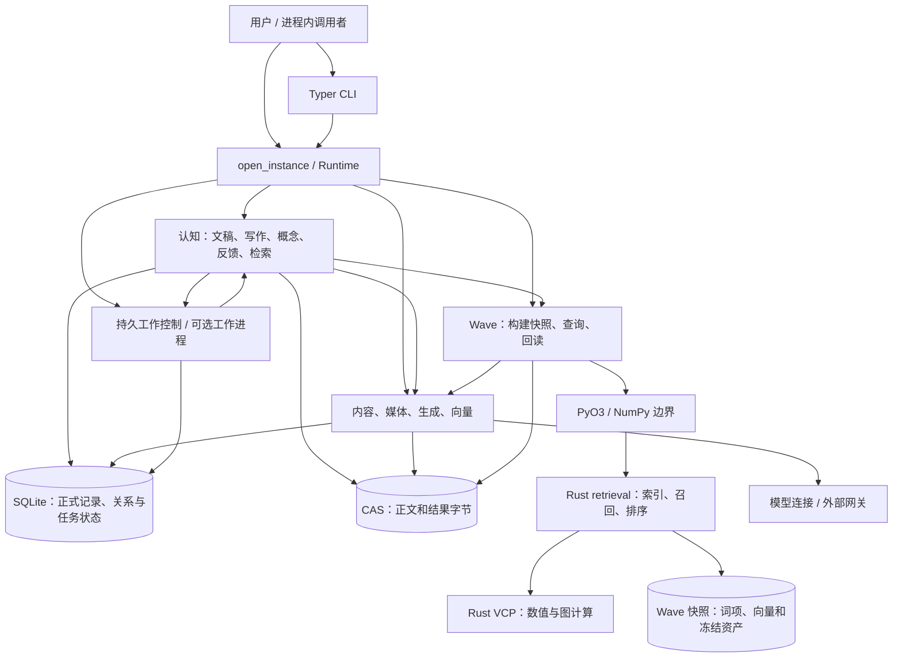
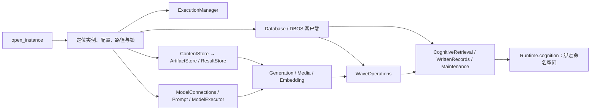
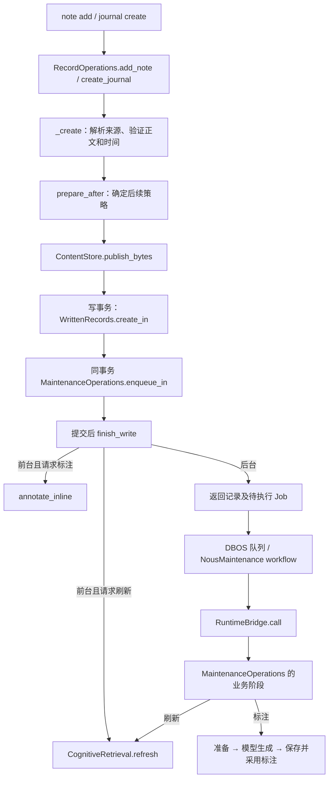
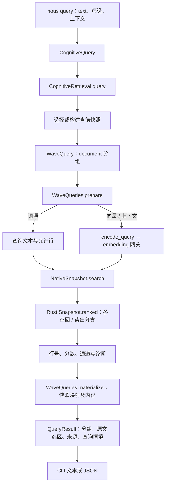
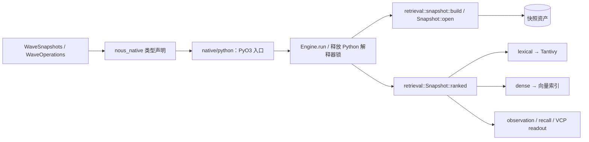
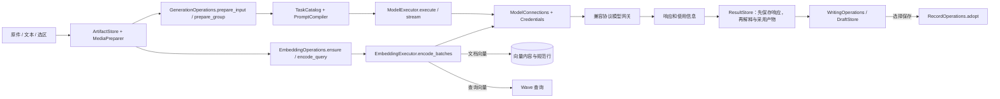

# Nous 调用链与数据流拓扑

本图对应提交 `f724bc9` 的现行 Python 和 Rust 运行代码。箭头表示所示条件下的实际调用或数据交接；图中列出主要业务链和所有入口组，细到单个方法的图可用文末命令查询。类型声明、静态图中的推测边和运行时观察分别说明。

## 总览



`JOBS → COG` 是后台调度返回业务运行循环，不是保存事务内递归执行。Wave 索引是可重建投影；正式文稿、来源和结果关系在 SQLite，内容字节由 CAS 保存。入口和装配分别见 [CLI](../../src/nous/transports/cli/__init__.py) 和 [Runtime](../../src/nous/runtime/bootstrap.py)。

### 入口与责任

| 入口 | 实际去向 |
| --- | --- |
| `nous init`、`instance`、`config`、`runtime`、`time` | 实例初始化与定位、配置操作、运行状态和时间解析；部分配置与时间命令无需打开完整 Runtime。见 [CLI 主入口](../../src/nous/transports/cli/__init__.py)。 |
| `note`、`journal`、`read`、`namespace` | 绑定命名空间，调用记录、读取或命名空间操作。见 [cognition CLI](../../src/nous/transports/cli/cognition.py)。 |
| `journalize`、`journal/note revise`、`journal rewrite/reflect`、`journal draft` | `WritingOperations` 生成草稿；请求保存时进入 `RecordOperations.adopt`。见 [写作 CLI](../../src/nous/transports/cli/journalize.py) 和 [写作操作](../../src/nous/cognition/writing/generation.py)。 |
| `query`、`journal refresh` | `CognitiveRetrieval.query/refresh`，再进入 Wave。见 [检索 CLI](../../src/nous/transports/cli/retrieval.py)。 |
| `concept`、`journal/note annotate`、`journal annotation` | 概念、标注与维护操作。见 [概念和标注 CLI](../../src/nous/transports/cli/concepts.py)。 |
| `feedback` | 对记录或查询结果记录反馈、读取与处理。见 [反馈 CLI](../../src/nous/transports/cli/feedback.py) 和 [反馈操作](../../src/nous/cognition/feedback.py)。 |
| `tools model/prompt/content/media/result/embedding/wave` | 分别调用模型、模板、内容、媒体、结果、向量和 Wave 操作。Wave 的独立清单构建与查询见 [Wave CLI](../../src/nous/transports/cli/wave.py)；其余见 [工具 CLI](../../src/nous/transports/cli/tools.py)。 |
| `job`、`runtime run` | 查询和控制 DBOS 工作；`job run --until-idle` 或长期宿主显式启动工作进程。见 [工作 CLI](../../src/nous/transports/cli/jobs.py)。 |
| `open_instance` 进程内 API | 调用者直接使用 Runtime 上的操作；`runtime.cognition(namespace)` 返回绑定命名空间的服务集合。 |

包入口 `nous` 指向 `nous.transports.cli:main`。当前源码还没有把设计中后续的 HTTP、远程 SDK 或产品 MCP 当作已接入入口。见 [项目入口配置](../../pyproject.toml)。

## 运行期装配与共享资源



装配顺序和依赖见 [open_instance](../../src/nous/runtime/bootstrap.py#L400)，命名空间服务缓存见 [Runtime.cognition](../../src/nous/runtime/bootstrap.py#L128)。`workers=True` 才启动 DBOS 工作进程；普通 Runtime 仍可登记和查询工作。`ExecutionManager` 承接操作上下文、配置快照、期限、阻塞任务与关闭；数据库和模型连接由 Runtime 生命周期释放。

| 数据或资源 | 持有者 / 接口 |
| --- | --- |
| 配置的来源、有效值及修改 | [Configuration](../../src/nous/configuration/service.py)、[ConfigurationOperations](../../src/nous/application/configuration.py)；操作在执行上下文中读取快照。 |
| 不可变字节、引用及事务 | [ContentStore](../../src/nous/storage/content.py)、[Database](../../src/nous/storage/database.py)；先发布字节，再在写事务中附着引用。 |
| 原件、输入选区、处理结果与血缘 | [ArtifactStore](../../src/nous/content/artifacts.py)、[ResultStore](../../src/nous/content/results.py)、[来源映射](../../src/nous/content/mappings.py)。 |
| 记录、精确修订、来源和召回成员状态 | [WrittenRecords](../../src/nous/cognition/writing/records.py)、[RecordReader](../../src/nous/cognition/writing/reading.py)，完整写用例由 [RecordOperations](../../src/nous/cognition/writing/operations.py) 组合。 |
| 检索当前代次和快照 | [CorpusCapture](../../src/nous/cognition/retrieval/capture.py)、[CognitiveRetrieval](../../src/nous/cognition/retrieval/operations.py)、[WaveSnapshots](../../src/nous/wave/snapshots.py)。 |
| 工作状态与业务执行 | [JobOperations](../../src/nous/jobs/operations.py)、[JobRuntime](../../src/nous/jobs/runtime.py)、[MaintenanceOperations](../../src/nous/cognition/maintenance/operations.py)。 |

## 保存、后续维护与后台任务



保存入口和事务位于 [RecordOperations._create](../../src/nous/cognition/writing/operations.py#L241)。`prepare_after` 冻结后台执行策略；`enqueue_in` 只在相应后台策略需要工作时登记，并复用调用者的写事务。`finish_write` 在提交后报告标注和刷新结果；后续阶段失败时已提交的记录仍保留。见 [保存后处理](../../src/nous/cognition/writing/operations.py#L93)、[维护策略与入队](../../src/nous/cognition/maintenance/operations.py#L92)、[JobOperations.enqueue_in](../../src/nous/jobs/operations.py#L114)。

后台工作由两个 [DBOS workflow](../../src/nous/jobs/maintenance.py#L85) 承担：标注依次执行准备、生成、采用；刷新执行构建阶段。各步骤经 [RuntimeBridge](../../src/nous/jobs/bridge.py) 回到业务循环，再调用 `MaintenanceOperations`。标注采用后可按策略在事务内登记刷新，见 [adopt_annotation](../../src/nous/cognition/maintenance/operations.py#L299)。前台 `annotate_inline` 复用相同的业务阶段。

## 当前知识投影与快照构建

```mermaid
flowchart LR
    Q["query 或 refresh"] --> CUR["CognitiveRetrieval._current_view"]
    CUR -->|"代次和配置匹配"| OLD["复用当前快照"]
    CUR -->|"需要构建"| READ["单次读事务：CorpusCapture.capture_in"]
    READ --> CAP["当前召回正文、来源祖先、有效标注"]
    CAP --> PROJ["ProjectionBuilder.build → CorpusView"]
    PROJ --> WB["WaveOperations.build_view"]
    WB --> FREEZE["freeze_inputs：正文选区、候选、概念、来源"]
    FREEZE -->|"配置了向量空间"| EMB["EmbeddingOperations.ensure"]
    FREEZE --> BUNDLE["冻结数组与映射"]
    EMB --> BUNDLE
    BUNDLE --> ENG["NativeEngine.build → Rust snapshot.build"]
    ENG --> FILES[("暂存目录 → 快照目录")]
    FILES --> OPEN["NativeEngine.open 校验"]
    OPEN --> TX["写事务：快照、引用、映射"]
    TX -->|"内容代次仍一致"| CURRENT["更新 collection 当前快照"]
```



[CognitiveRetrieval._current_view](../../src/nous/cognition/retrieval/operations.py#L138) 先比较命名空间代次与配置签名；失配时在读事务内调用 [CorpusCapture.capture_in](../../src/nous/cognition/retrieval/capture.py#L56)，再由 [ProjectionBuilder](../../src/nous/cognition/retrieval/projection.py#L104) 创建 `CorpusView`。[freeze_inputs](../../src/nous/wave/assets.py#L347) 处理候选正文、来源根、标注与概念路径，需要向量时调用 Embedding。向量缺失与复用由 [EmbeddingOperations.ensure](../../src/nous/application/embedding.py#L223) 处理。

[WaveSnapshots.build](../../src/nous/wave/snapshots.py#L290) 在事务外准备和构建、发布目录并重开快照，然后在写事务中登记。`publish_if` 在同一事务再次检查捕获代次，只有通过才更新当前指针；已构建的快照描述与“当前”是两个不同结果。手工 `tools wave build` 从清单进入同一 Wave 构建路径，见 [WaveOperations.build](../../src/nous/wave/operations.py#L127)。

## 查询：从用户文本到原文选区



[CLI 查询](../../src/nous/transports/cli/retrieval.py#L19) 创建 `CognitiveQuery`；[CognitiveRetrieval.query](../../src/nous/cognition/retrieval/operations.py#L292) 选择快照，构造文档分组的 `WaveQuery`，再把 Wave 命中转换为记录修订、来源和 `QueryContext`。显式指定快照时会核对命名空间归属。

[WaveOperations.query](../../src/nous/wave/operations.py#L182) 依次解析快照、准备查询、打开 Native 快照、运行 `snapshot.search`、物化结果。[WaveQueries._query_inputs](../../src/nous/wave/query.py#L118) 在词项模式直接保留查询文本；其他模式按空间和输入条件读取或生成查询向量，可结合上下文、概念和临时线索。`prepare` 将过滤条件转换为允许的行和原生选项；[materialize](../../src/nous/wave/query.py#L450) 将结果行映射回候选内容与来源。返回对象保留选区、命名空间、快照、代次、通道和覆盖信息。

### Python → Rust 边界



自动图能找到 [NativeSnapshot.search 声明](../../src/nous_native/_core.pyi)，此处的跨语言连接由源码确认：[PyO3 注册](../../native/python/src/lib.rs)、[NativeEngine.build/open](../../native/python/src/engine.rs#L33)、[NativeSnapshot.search](../../native/python/src/query.rs#L151) 分别进入 Rust 的 [snapshot::build](../../native/retrieval/src/snapshot.rs#L887)、`Snapshot::open` 和 [ranked](../../native/retrieval/src/query.rs#L569)。`search` 先转换 NumPy 数组、允许行、选项与取消令牌，再由 `execute` 脱离 Python 解释器执行。

`ranked` 根据模式选择分支：词项模式调用词项索引，稠密模式调用向量召回；VCP 资产存在时的 `hybrid` 进入 observation、候选召回及 RiverMemo 读出，缺少该资产时进入词项/向量混合分支。各通道和分组行为见 [ranked 的分支](../../native/retrieval/src/query.rs#L630) 与 [召回实现](../../native/retrieval/src/query/recall.rs#L153)。结果返回 Python 后才与持久映射和内容选区结合；Rust 不直接写入认知记录。

## 生成、媒体与向量



生成路径见 [GenerationOperations](../../src/nous/models/operations.py#L122)：准备输入及任务、调用 [ModelExecutor](../../src/nous/models/executor.py#L642)，再通过 [ResultStore](../../src/nous/content/results.py) 采用输出。`produce_prepared` 可以复用已保存的响应；首次执行时先保存响应和计算描述，再解释产物，见 [produce_prepared](../../src/nous/models/operations.py#L938)。语言模型通过 Pydantic AI 和配置的 OpenAI 兼容客户端发送；转写与向量使用客户端对应接口，连接与凭据集中在 [ModelConnections](../../src/nous/network/__init__.py)。

写作的 `journalize/revise/rewrite/reflect` 均组织来源及任务，调用共同生成路径。成功产物先由 [DraftStore.save_produced](../../src/nous/cognition/writing/drafts.py#L56) 保存；选择正式保存时由 [WritingOperations._complete_inner](../../src/nous/cognition/writing/generation.py#L269) 调用记录采用。草稿及正式文稿是不同状态。

文档向量的 `ensure` 查找已有规范行，只对缺失输入编码并采用；查询向量 `encode_query` 走同一个 [EmbeddingExecutor.encode_batches](../../src/nous/models/embeddings.py#L84)，供当前查询使用。媒体检查、图片/PDF 和音视频准备分别见 [MediaAnalysis](../../src/nous/media/analysis.py)、[文档媒体](../../src/nous/media/documents.py)、[音视频](../../src/nous/media/audiovisual.py)。

## 反馈与写作回路

`FeedbackOperations.record` 接收记录修订和选区；`record_query` 接收实际 `QueryResult`，核对其中的快照、候选及命名空间，再保存目标和查询情境。反馈之后可以被读取、处理，也可作为编辑输入；[WritingOperations._feedback](../../src/nous/cognition/writing/generation.py#L183) 调用 `select_for_edit`，记录采用时可在同一事务内处理相关反馈。见 [反馈实现](../../src/nous/cognition/feedback.py#L215) 和 [记录采用](../../src/nous/cognition/writing/operations.py#L728)。

## 方法级实测：前台标注

下面是一次真实 `note annotate` 的调用和数据转变。`→` 为调用关系，缩进表示所示方法的调用点；产物写入和重新读取分别标出。具体实现见 [AnnotationOperations](../../src/nous/cognition/annotations.py) 和 [GenerationOperations](../../src/nous/models/operations.py)。

```text
CLI annotate → AnnotationOperations.annotate
  → propose
    → RecordReader.resolve_in / revision_ref       确定精确正文版本
    → GenerationOperations.freeze_language_task   持久化冻结的任务和模板
    → prepare_annotation                          冻结正文、已有概念候选和活动标注
    → generate_annotation
      → load_language_task → prepare_input
      → produce → prepare_group → produce_prepared
        → ResultStore.find_producer                按业务键检查已有响应
        → ModelExecutor.execute → 模型网关        本次真实请求一次
        → ResultStore.adopt                       保存响应及计算描述
        → _interpret_response                     校验、解释为标注产物
      → publish_computation → ResultStore.adopt   保存输出与计算描述符
    → save_computation
      → load_computation                          从描述符和 CAS 重新读取产物
      → adopt_produced → ResultStore.adopt_in     采用提案处理结果
      → read_proposal                             从结果读取提案
  → adopt → read_proposal                         再次读取提案并校验正文、候选
    → ConceptOperations.create_in                 本次创建所需概念
    → NamespaceOperations.advance_in              事务内更新当前代次
    → read                                         返回已采用标注
```

本次输出为活动标注、1 个概念绑定、1 个出现位置和 1 条路径。跟踪器在这一进程中记录到 `ModelExecutor.execute` 1 次、`ResultStore.adopt` 3 次、`ResultStore.adopt_in` 4 次、`ContentStore.publish_bytes` 10 次、`ContentStore.read_bytes` 7 次，以及 `read_proposal` 2 次；计数包括被上层调用的内部操作，不能相加当作独立用户操作。

这条链的具体复杂处是：前台同步请求也经过冻结任务、发布可恢复计算、重新加载计算和持久提案，再进入正式标注事务。中间产物承担失败恢复、幂等与可单独采用的职责；其中前台紧接着再次读取提案及重复准备输出，是可结合恢复语义测量和重构的具体位置。当前轨迹显示存在往返，是否删减应由保存后的恢复与重试合同决定。

## 方法级实测：后台标注和刷新

```text
CLI note annotate --background --refresh
  → MaintenanceOperations.request_annotation
    → prepare_after → GenerationOperations.freeze_language_task
    → JobOperations.enqueue_in                  同业务事务登记 annotation

CLI job run --until-idle → open_instance(workers=True)
  → JobRuntime.start → DBOS NousMaintenance.annotation
    → prepare_annotation → RuntimeBridge.call → perform
      → MaintenanceOperations.prepare_annotation → AnnotationOperations.prepare_annotation
    → generate_annotation → RuntimeBridge.call → perform
      → MaintenanceOperations.generate_annotation → AnnotationOperations.generate_annotation
    → adopt_annotation → RuntimeBridge.call → perform
      → MaintenanceOperations.adopt_annotation
        → AnnotationOperations.save_computation → AnnotationOperations.adopt
        → on_activation → JobOperations.enqueue_in   按请求同事务登记 refresh
  → DBOS NousMaintenance.refresh → build_refresh → RuntimeBridge.call → perform
    → MaintenanceOperations.refresh → CognitiveRetrieval.refresh
      → _current_view → WaveOperations.build_view → WaveSnapshots.build
```

本次两个 Job 最终均为 `SUCCESS`，后台日志记录到一次真实标注模型请求和刷新期间两次向量请求。`RuntimeBridge.call` 内部的 `perform` 是回调调度接点；原静态图漏掉了它分别调用四个 `MaintenanceOperations` 业务阶段的边，运行轨迹已将四条边加入当前图。见 [RuntimeBridge](../../src/nous/jobs/bridge.py#L45)、[DBOS workflow](../../src/nous/jobs/maintenance.py#L85) 和 [标注采用时入队](../../src/nous/cognition/maintenance/operations.py#L299)。

## 方法级实测：生成、向量和检索

一次 `journalize --save` 经真实网关成功生成并采用 Journal：

```text
WritingOperations.journalize
  → _freeze → SourceResolver.prepare
  → _produce → ModelExecutor.freeze → GenerationOperations.prepare_input
    → GenerationOperations.produce → prepare_group → produce_prepared
      → ModelExecutor.execute → ModelConnections.client → 外部网关
      → ResultStore.adopt → _interpret_response
  → _complete → _complete_inner
    → _attach_origins → _actual_bindings → _normalize_links
    → DraftStore.save_produced → ResultStore.prepare_outputs
      → 写事务：validate_sources_in → ResultStore.adopt_in → 写入草稿描述
    → RecordOperations.adopt → DraftStore.read → SourceResolver.prepare
      → ContentStore.publish_bytes → 写事务内 WrittenRecords.create_in
      → MaintenanceOperations.enqueue_in → finish_write
```

本次返回的状态为 `adopted`，同时具有草稿和正式记录。单独的 `tools model run` 也通过真实网关返回了 1 个处理结果。上图中 `_complete` 与其内部方法、事务内子调用的具体关系见 [写作实现](../../src/nous/cognition/writing/generation.py#L197)、[草稿保存](../../src/nous/cognition/writing/drafts.py#L56) 和 [记录采用](../../src/nous/cognition/writing/operations.py#L728)。路由重试、失败恢复和流式输出是独立分支，此次成功请求没有执行这些分支。

一次真实的文档向量入口执行了以下方法：

```text
EmbeddingOperations.run → _inputs → ensure
  → ArtifactStore.read_selection → _digests → EmbeddingSpaceRegistry.find_rows
  → EmbeddingExecutor.encode_batches → _execute
    → ModelConnections.client → embeddings.create → 校验返回序号和维度
  → _adopt_encoded → ResultStore.prepare_outputs
    → 写事务：EmbeddingSpaceRegistry.bind_in → ResultStore.adopt_in → attach_in
```

本次返回 1 条向量行。查询路径从 `WaveQueries._query_inputs` 进入 `EmbeddingOperations.encode_query`，再调用同一 `encode_batches/_execute`；词项模式跳过查询向量。见 [EmbeddingOperations](../../src/nous/application/embedding.py#L223)、[EmbeddingExecutor](../../src/nous/models/embeddings.py#L84) 和 [Wave 查询输入](../../src/nous/wave/query.py#L118)。

同一 Note 的六次真实查询均返回 1 组结果。以下是各次实际返回的通道；首次词项查询和首次稠密查询分别构建了快照，其余查询复用了已存在的相应快照。

| 模式 | 本次 `used_lanes` | 分数类型 |
| --- | --- | --- |
| `lexical` | `lexical` | `bm25` |
| `dense` | `dense` | `cosine` |
| `tagmemo` | `tagmemo` | `tagmemo_cosine` |
| `rivermemo` | `bm25`、四个向量场通道、`direct_anchor`、`rivermemo` | `rivermemo_quality` |
| `hybrid` | `bm25`、四个向量场通道、`direct_anchor`、`rivermemo` | `rivermemo_quality` |
| `dtsc` | `bm25`、四个向量场通道、`direct_anchor`、`dtsc` | `dtsc` |

四个向量场通道是 `query_knn`、`local_field_knn`、`transfer_field_knn`、`denoised_field_knn`。首次稠密查询的日志有 3 次成功向量请求，涵盖快照准备和查询；其后各语义模式查询各记录 1 次成功向量请求。词项模式没有网关请求。另一次 `auto` 查询携带一条上下文和一个临时线索，实际选择 `hybrid`，返回情境中保留了该上下文。以上是小样本功能和路径验证，不用于比较检索质量。

## 实际验证与逐方法展开

在隔离实例中执行保存、同步及后台刷新、模型生成与正式采用、向量、前台及后台模型标注，以及上表六种检索模式。运行时使用真实网关、正式数据库和原生扩展。CodeQL 另外在 `WaveOperations.query` 内确认 `request` 流入 `prepare` 的局部数据流。

基于 Code-Graph-RAG 的 Jedi 静态图，将 14 个真实工作负载的 Python 方法跟踪合并导入。原始跟踪包含 11,271 条按调用对和工作负载聚合的记录；导入器将其中记录归并为 848 条可解析的关系，另有 6,793 条记录未能解析。逐帧核对发现，其中 5,572 条的首个未解析端点是已索引类的定义体：导入器只将函数、方法和模块作为调用端点；1,179 条是闭包、生成器等合成帧；其余 42 条是 Python 生成的 `__annotate__` 或临时跟踪入口。这些是记录数，不是互不相同的方法数。原始跟踪保留全部记录，Python 跟踪也不进入 Rust 或第三方库内部。

与导入前的快照比较，当前索引新增了 67 个不同调用对，包括上面的后台动态分发。人工对照源码后，从当前 Code-Graph-RAG 索引移除 18 条误边：

| 调用者 | 已移除的误边 | 实际语义 |
| --- | --- | --- |
| `WaveOperations.query` | 2 条：`PreparedText.text`、`ContextResult.vector` | `plan.text`、`plan.vector` 是 `QueryPlan` 字段。 |
| `AnnotationOperations.generate_annotation` | 1 条：`MediaPreparer.batches` | `prepared.batches` 是 `PreparedRun` 的元组字段。 |
| `EmbeddingOperations.ensure` | 3 条：`SegmentResult.vectors`，以及两个 `ConfigurationOperations.update` | 前者是 `EmbeddingResult.vectors` 字段，后两处是字典或集合的 `update`。 |
| `CognitiveRetrieval.query` | 3 条：`PreparedText.text`、`DocumentCandidates.content`、`ConfigurationOperations.snapshot` | 分别是请求文本、结果片段内容，以及 `wave.describe` 的返回值。 |
| `WaveQueries._query_inputs` | 8 条：错误的文本、内容、键、向量、标识符属性及 `ConfigurationOperations.update` | 实际为 `ContextFragment`、`VectorRef` 等数据字段，或本地字典的 `update`。 |
| `GenerationOperations.produce_prepared` | 1 条：`scripts.temp.manage.snapshot` | `prepared.snapshot` 是生成请求中的配置快照字段。 |

这些修正作用于当前本地图，重新索引时上游解析器可能再次产生；原始静态图、修正后的图和逐条差异均保留。其他尚未逐边核对的静态关系继续按其来源和置信度使用。

symgraph 原先把同一方法的 `prepare`、`materialize` 和 `operation` 连到其他同名函数；当前 Python 索引已将三条边改到 [WaveQueries](../../src/nous/wave/query.py) 和 [ExecutionManager.operation](../../src/nous/runtime/execution.py#L108)。修正前的目录图将 20 个目录归入一个循环，边中混有名称推断；使用该图定位热点时应逐边对照源码。与 Code-Graph-RAG 相同，symgraph 重建索引时也可能重新产生这些误边。

本地材料：

- `temp/test-materials/Results/nous-code-topology-f724bc9.json`：导入轨迹前的静态图。
- `temp/test-materials/Results/nous-code-topology-observed-f724bc9.json`：加入运行边并移除上述 18 条误边后的图，共 6,650 个节点、22,989 条关系；关系中的 `dynamic`、`dynamic_workloads` 标明实际观察。
- `temp/test-materials/Results/nous-code-topology-corrections-f724bc9.csv`：67 个新增调用对和 18 条移除误边，包含调用者、被调用者及位置。
- `temp/test-materials/Results/nous-code-traces-f724bc9.jsonl`：保留每条原始调用记录和工作负载，供追踪未解析记录。

构建、查询和更新方法见[代码调用与数据流工具](../development/code-topology-tools.md)。

在设置好该文档中的环境变量后，可从名称定位，再用完整限定名展开：

```powershell
& $cgr graph resolve 'WaveOperations.query' --repo-path .
& $cgr graph callers '<resolve 返回的完整限定名>' --repo-path .
& $cgr graph callees '<resolve 返回的完整限定名>' --repo-path .
```

对动态分发、装饰器、回调、外部库和 PyO3 边界，继续查看对应实现及实际调用点；此处只把已经通过源码或执行路径核对的主要边画入分层图。
