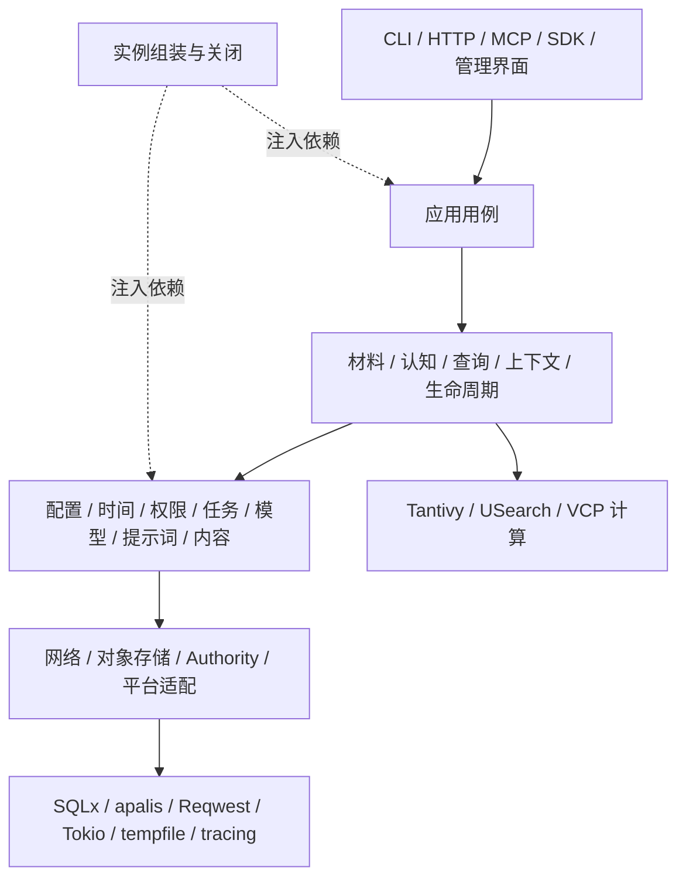

# Nous Wave 基础服务与系统分工

## Objective

以统一、可直接依赖的基础服务支撑 Nous Wave 的完整认知产品。需求以《项目宪纲》及用户给出的十六项基础服务职责为准。认知、媒体、查询、managed context、steward 和 A-Memorix 消费者调用相同公共服务；底层能力有明确的数据所有者与生命周期。

本文规定目标接口与实施次序。当前已接通通用任务、模型调用账本、内容存储、角色资源、提示词渲染和统一认知查询；编译与现有行为验证通过。配置管理、完整资源目录、媒体执行和上下文服务继续按下列合同实施。实际完成状态集中在《首批开发任务》，功能范围集中在《能力续接清单》。

## Decisions

- 保持 Rust 模块化单体。进程内直接调用类型化服务；HTTP、MCP、CLI、SDK 和管理界面进入相同应用用例。
- 一项状态由一个所有者修改。配置、提示词、作业、调用账本、材料、接触、认知、向量和上下文分别拥有权威数据。
- 公共服务同时承担资源生命周期、失败语义和执行策略。业务只提交本领域的输入、决策与采纳条件。
- 模块由实例组装器显式创建并注入依赖。业务构造器只取得所需句柄；初始化集中在 bootstrap，关闭按依赖逆序执行。
- 未发布内部结构保持一个当前模型和一份当前 SQL schema，生产者与消费者同时修改。配置、提示词和认知的用户可管理历史修订继续保存。
- 每个手写代码文件最多 600 行，按共同变化的职责组织目录。产品源码与测试分开。成熟依赖承担通用机械，保留复制来源和许可。

## 源码研究得出的边界

研究对象已在本地：MaiBot `c602a2780f4f4dda4a6be46d67abc1cfb1ad420c`，旧 Nous `412b062082afb75ccfae4c3f69fc606d3e3cc862`。本轮沿业务调用一直读到数据库、SDK、文件与资源关闭，具体记录见 [源码复用记录](../research/reuse.md#基础服务的实际消费链)。

MaiBot 的有效公共入口包括 `LLMServiceClient`、`EmbeddingServiceClient`、`message_repository`、`get_db_session`、`common.paths`、`run_sync_work`、`PromptManager` 和 `I18nManager`。它们分别收拢模型调度、数据访问、实例位置、取消收尾、模板和语言处理。Nous 采用这些职责划分，并使用现有 Rust 依赖实现相应机械。

旧 Nous 已有可直接改编的 `ConfigurationService/ConfigRegistryBuilder`、`MutationEnvelope`、`CognitiveClock`、`PromptRegistry`、模型资源关系、流式 `ObjectStore` 与 managed binding。配置的 active/desired、单事务时间捕获、对象发布与引用保护、实际模型输入快照继续承接。

Nous 的边界还需要处理三件事：数据库故障返回明确错误；付费调用执行前持久预约；配置、权限和模型资源在一次操作内冻结。业务获得的 API 不暴露 ORM session、SDK client 或可变全局配置。

## 依赖方向与组装



算法组件接收已获准的不可变输入，返回候选与诊断。它们不加载配置、不查业务数据库、不创建网络客户端。基础服务不反向读取具体认知领域；任务通过注册的处理器运行，资源通过已注册的适配器执行。

`RequestContext` 携带调用身份、作用域、operation/trace、deadline、取消信号和 locale。配置服务返回不可变 `ConfigSnapshot`；时间服务为一次提交提供 `OperationTime`。后台任务保存授权引用与所用资源快照，恢复时重新检查仍有效的执行权限。

接口使用下列共同合同，业务读取字段时不自行推导来源或状态：

| 合同 | 必须保留的内容 | 产生它的所有者 |
| --- | --- | --- |
| `RequestContext` | principal、scope、授权引用、operation/trace、deadline、取消信号、locale | Identity 与入口适配器 |
| `ConfigSnapshot` | effective typed values、逐项来源、所用修订、active/desired 与生效状态 | Configuration |
| `OperationTime` | recorded UTC、monotonic 起点、Subject 的具名语义时间及映射依据 | Clock |
| `JobRecord` | task kind、scope、输入引用、state/wait condition、checkpoint、结果、授权和时间 | Tasks；领域拥有输入和结果正文 |
| `ResolvedModel` | 角色、实际路线、能力、参数、资源修订、预算与价格快照、网络策略引用 | ModelResources |
| `PromptSnapshot` | Prompt 身份/产品修订、语言、变量来源、实际文本及摘要 | Prompts |
| `ModelInput` | 文本/工具/媒体部分、来源精确引用、实际访问通道、预算与裁剪信息 | 输入构建与 Contexts |
| `ModelCall` | 稳定步骤键、每次外呼尝试、预约、实际请求/结果、usage/cost、错误和 uncertain | ModelCalls |
| `PublishedObject` | 内容摘要、实际长度、受管对象引用；引用保护租约 | Objects |
| `QueryView` | 权限与来源范围、种类/时间条件、权威截点、精确对象和表示空间 | QueryService |

`JobRecord` 面向形成、导入、维护、备份和媒体等实际工作。任务处理器在启动时注册；新增业务任务提交自身输入并实现执行/采纳，不扩展基础执行器中的领域分支。模型调用是一种可被这些处理器调用的公共能力。

启动顺序：解析实例与程序资源路径 → 读取最小启动配置 → 建日志与实例锁 → 打开 Authority/对象存储 → 建配置与身份服务 → 建网络、提示词和模型资源 → 注册能力及任务处理器 → 建业务服务与入口 → 恢复持久工作。停止时先停止接纳新工作，再取消并等待在途工作收尾，最后关闭索引、网络和数据库。

## 十六项服务合同

下列名称是实施合同。调用者通过服务 API 使用能力；具体库类型留在适配器内部。

| 服务与数据所有者 | 公共操作与结果 | 所有者承担的机制 |
| --- | --- | --- |
| Instance / Platform | `initialize`, `start`, `stop`, `paths`, `relocate`, `update`；返回实例状态和明确路径 | 程序资源与实例目录、系统服务、进程锁、操作系统差异、启动关闭及更新交接 |
| Configuration | `register`, `snapshot(scope)`, `change(expected_revision)`, `history`, `activate`, `watch`；返回有效值、来源和生效状态 | typed key、默认值、继承、修改权限、校验、desired/active 修订、热应用及待重启状态 |
| ModelResources / ModelCalls | `resolve(role, requirements)`, `readiness`, `prepare`, `invoke`, `read_call`；返回冻结资源与实际调用结果 | provider、协议、模态/工具能力、角色、参数、路线、客户端、预算、费用、调用预约和恢复 |
| Prompts | `list`, `read`, `edit`, `history`, `activate`, `render`, `preview`；返回 `PromptSnapshot` | 随包/用户资源、语言、变量合同、模板解析、历史修订、活动绑定、缓存失效 |
| Contexts / ModelInput | `prepare`, `admit`, `report`, `read_work_context`；返回 `ContextView/ModelInput` | 动态贡献、认知投影、预算、压缩、实际使用记录、连续工作与独立消费者游标 |
| Network | `client(policy)`, `request`, `download`；返回受管响应或流式对象 | 连接池、代理、TLS、连接/总体超时、重定向、响应限额、取消和目标策略 |
| Authority / Objects / Indexes | `read_view`, `operation`, `publish`, `read_range`, `lease`, `publish_index` | 单库连接、当前 schema、事务、幂等回执、提交序号、内容寻址、暂存、缓存和索引发布 |
| Clock / Scheduler | `utc_now`, `monotonic_now`, `capture(scope)`, `convert`, `schedule`, `wake` | 真实时间、具名时间域、映射、日历基础、定时唤醒；返回已知或无法转换的结果 |
| Tasks / Execution | `register`, `submit`, `read`, `cancel`, `checkpoint`, `wait`, `resume` | 持久排队、领取/租约、执行资源、等待条件、取消收尾、恢复、结果交接与隔离 |
| Identity / Secrets | `authenticate`, `authorize`, `delegate`, `resolve_secret`, `rotate`, `revoke` | 调用者和 scope、能力授权、访问凭据、密钥位置及跨服务身份 |
| Capabilities / Extensions | `register`, `describe`, `resolve`, `enable`, `disable`, `health` | 能力描述、依赖、配置定义、处理器装配、运行范围、扩展加载和关闭 |
| Content / Media | `inspect`, `capture`, `select_region`, `derive`, `read_representation` | 文件识别、流式原件、图像/音视频处理、区域、采样、模型输入通道与派生材料 |
| Observability | `span`, `event`, `metric`, `diagnose`, `history` | operation/job/call/source 关联、统一日志、阶段耗时、用量视图、告警与运行历史 |
| DataLifecycle | `preview`, `import`, `export`, `backup`, `restore`, `retain`, `purge`, `relocate_subject` | 跨所有者生命周期协调、保留策略、依赖清理、备份引用、对象 GC 和主体可移植性 |
| Interfaces / Clients | 类型化 command/query、流式内容入口、任务观察接口 | 协议编码、鉴权接入、错误展示、SDK/类型生成、CLI 和管理界面 |
| Locale | `resolve`, `text(code, parameters)`, `plural`, `format_time` | 请求语言、翻译目录、缺项处理、区域格式与帮助资源 |

## 数据与事务边界

Authority 提供一个 `Operation`：幂等身份、作用域、请求摘要、提交序号、领域写入、后续任务与完整回执在同一短事务中提交。领域仓储绑定这个操作，不自行开启连接或提交。只读接口使用同一个 `ReadView` 冻结 scope、历史截点和可见身份。

领域拥有规则：Memory 决定生命周期；Concept 决定合并/拆分；Episode 决定轨道与重分段；Journal 决定知情截面；Schema 决定支持和反例。仓储负责表达并保存这些规则的结果、引用约束和原子性。通用事务设施只处理提交机械。

原始字节由 Objects 流式发布到内容寻址位置，返回 `PublishedObject { digest, byte_len, object_ref }`。材料事务登记此引用。发布到登记期间持有引用保护；GC 只能回收没有权威引用、备份引用和活跃租约的对象。下载、采样、安装和编译暂存均从受管 `temp` 获取位置。

文件写入和原生索引调用属于阻塞工作边界。取消等待必须与实际写入完成、锁释放和暂存清理协调；业务调用方不各自实现 `spawn_blocking`、锁及清理流程。模型和网络等待在数据库事务外执行。

## 作业、模型调用与领域采纳

持久作业和外部调用分别记录。一个作业可以包含媒体描述、结构化等多个调用步骤；每个步骤有稳定调用键。任务服务拥有作业状态与等待条件，模型调用服务拥有真实外呼尝试、预算预约、结果和不确定性。领域处理器拥有输入准备、步骤衔接和结果采纳。

```text
领域用例.operation
  → 验证 scope 与精确来源
  → 保存领域输入 + Tasks.submit_in(operation)
  → commit 回执
Tasks 执行已注册的处理器
  → 冻结配置、时间、授权与源输入
  → ModelResources.resolve(role, requirements)
  → Prompts.render(binding, arguments)
  → Contexts.prepare / ModelInput 构建
  → ModelCalls.invoke(step_key, resolved, input, prompt)
  → 领域 adoption.operation 复核引用和 expected_revision
  → 提交认知结果 + job checkpoint/result
```

`ModelCalls.invoke` 先在 Authority 中预约预算和尝试记录，再进行网络调用，最后持久保存实际响应。相同调用键已有成功结果时返回该结果。一次未确认的远程执行保留 uncertain；是否重试由调用策略决定并记录新尝试。SDK 与 HTTP 不再叠加模型重试。

任务重投恢复处理器步骤；模型调用的幂等键使它复用已保存结果。模型失败、配置等待、预算等待、取消、源退役和领域冲突都返回明确结果。日志不替代账本，角色表不复制公共作业状态。

结构化组采纳依赖任务和调用服务，但由认知所有者处理组依赖、精确引用和事务冲突。来源永久清除时，生命周期操作取消相关未完成工作并清理需要清除的正文副本；迟到响应只能补记调用事实与用量。

## 配置、模型资源与提示词

配置继承为：内置默认 → 实例 → Namespace → Subject → 本次获准覆盖。配置 key 声明类型、默认值、作用域、可见程度、修改权限、生效方式和所属模块。业务提交定义与校验函数，统一服务处理存取、继承、历史和通知。

一次修改得到 `ConfigChange { revision, effective_sources, apply_state, affected_capabilities }`。配置通知只用于刷新缓存和唤醒工作；必须可靠执行的重建操作在提交时进入持久任务。正在运行的调用继续使用已冻结的快照。

模型资源分三层：Provider/Endpoint/Credential；Model/Capabilities/Price；RoleBinding/Routes/InvocationParameters。角色只声明需要的能力和政策，资源服务决定满足要求的实际路线。模型别名、实际返回模型和实际向量空间分别记录。配置的本机网关是正式受信端点；来自资料的任意 URL 使用外部下载策略。

`PromptSnapshot` 包含资源身份、产品修订、语言、原模板摘要、实际渲染文本与摘要、变量来源。模板业务变量由领域或上下文服务提供，Prompt 服务不回查认知数据库或推测调用栈。编辑通过 expected revision 原子写入并激活；preview 与实际调用共用渲染入口。

模型调用者提交 SDK 无关的 `ModelInput`，包含文本、工具内容、实际媒体引用与访问通道。协议适配器只把这个合同转换为供应商请求，并规范化结果、usage、费用和错误。连接、凭据和 provider 特有字段不传给业务模块。

## 认知、查询、媒体与上下文的分工

材料 owner 拥有原件和来源身份；Observation owner 保存主体实际接触。内容服务的文件读取和模型访问通道不自动创造主体接触。区域和派生表示沿同一来源图回到原件；直接输入、描述和二次转述分别记录实际输入。

所有认知使用 `CognitiveRef { kind, id, revision }`。向量目标为 `Cognition(ref)`、`Tag` 或 `Query`；输入身份与摘要从这一模型计算。Memory 与 Concept/Episode/Journal/Schema/Association 使用同一向量任务和空间规则，保留各自的领域正文。

查询服务先从授权、来源、时间和对象种类形成不可变 `QueryView`，再构造词项、向量和图候选。Tantivy、USearch、VCP 只消费这个视图导出的输入。服务负责融合、实际覆盖、来源展开和返回前权威检查。历史查询使用精确历史正文和来源状态。

同一原件派生出的多条认知共用来源根。VCP 的候选曲线与独立来源根分开；多来源 Schema 保留全部根，计算独立支持时排除其自身的全部来源。派生对象不增加原图的证据次数。

ContextService 组织已授权贡献、当前材料、认知投影、工具结果和 WorkContext；它向 QueryService 请求认知，并按模型能力与预算编译输入。Steward 是此服务的一种选取/压缩策略：只从允许目录选择，摘要保存来源；长期认知变化继续走认知领域命令。

managed context 的 `prepare/admit/report` 分别表示准备的 ContextView、实际采用的输入、实际调用和结果。首轮、工具续轮、模型切换、压缩及独立执行者使用相同合同，各自保存游标和工作连续性。

数据生命周期服务协调导入、包安装/卸载、删除预览、保留和主体迁移。每个领域声明自己的引用与清理动作；协调器把需要一起提交的动作放入同一 Operation。A-Memorix 兼容只存在于其真实公开接口边界，内部使用当前 Nous 类型和用例。

## 业务代码实际取得什么

以记忆形成为例，构造器只接收 `Authority`、`MaterialReader`、`TaskSubmitter`、`Clock` 和 `Authorization`。它验证实际接触并创建形成输入，通过同一 Operation 接受任务。模型处理器取得 `ModelCalls`、`PromptReader`、`SourceReader` 和领域 writer，使用稳定步骤键执行和采纳。

```rust
// 入口只做协议解析与身份建立。
memory.form(&ctx, FormMemory { operation_id, subject, observation }).await

// 领域用例：来源、任务和回执共用一次提交。
let mut op = authority.operation(&ctx, operation_id, "memory.form").await?;
let source = materials.require_contact(&mut op, subject, observation).await?;
let job = tasks.submit_in(&mut op, formation_input(source)).await?;
op.commit(job).await

// 处理器：基础服务完成资源选择、预算、调用记录和恢复。
let resource = models.resolve(&ctx, role, requirements).await?;
let prompt = prompts.render(&ctx, binding, arguments).await?;
let result = calls.invoke(&ctx, step_key, resource, input, prompt).await?;
cognition.adopt(&ctx, expected_revisions, result).await
```

同样，媒体处理调用 `content.derive`，不创建自己的下载客户端、FFmpeg 临时目录和模型重试器；配置消费者调用 `configuration.snapshot`，不各自读 TOML、环境变量或查覆盖顺序；检索消费者调用 `queries.execute`，不自行组合 SQL、向量和来源权限。

公共错误具有稳定 code、context 与处理条件，例如 conflict 携带当前修订，等待配置携带职责绑定，预算等待携带资源和下一可执行条件。Locale 在展示端处理人类文本；业务判断不依赖翻译后的字符串。

## 实施目录与访问边界

```text
crates/nous-domain/src/       纯合同、身份、时间及领域规则
  model/ embedding/ structured/ media/ query/
crates/nous-storage/src/      SQL与持久化机械、各owner仓储
  authority/ repositories/ objects/
crates/nous-app/src/
  composition/               显式组装、启动、关闭、处理器注册
  common/
    paths/ config/ identity/ clock/ network/
    tasks/ models/ prompts/ content/ telemetry/ locale/ capabilities/
  materials/                 原件、区域、接触、派生谱系
  cognition/                 Memory、Concept、Episode、Journal、Schema、Association
  retrieval/                 QueryView、向量投影、候选组合、结果展开
  contexts/                  WorkContext、managed binding、projection、steward
  lifecycle/                 导入、导出、备份、恢复、清理、迁移
crates/nous-retrieval/        词项与向量引擎、服务资产适配
crates/nous-vcp/              已复制算法，按计算阶段分模块
crates/nous/src/
  bootstrap/ cli/ http/ mcp/  程序入口和协议适配
```

目录按实际职责形成，不为转发一个调用增加文件。`common` 的每个 owner 暴露明确合同；共同基础类型放纯合同模块。业务不通过整个 App 访问任意底层字段，也不在模块导入时启动资源。

仓储的 SQLx 连接和 SQL 限于 storage；业务取得 `ReadView` 或事务绑定仓储。模型业务不构造 SDK/Reqwest 客户端。所有者之间的调用使用公开类型；跨业务状态协调由应用用例发起。

## 三条必须能够直接依赖的业务链

**修改配置后继续形成。** 管理入口提交配置修改 → Configuration 原子保存与生效 → ModelResources 刷新角色解析 → Tasks 唤醒等待中的形成 → ModelCalls 使用冻结配置执行 → 认知 owner 采纳。形成代码不实现配置轮询、客户端重建、预算日期判断和日志路径。

**导入视频后形成与检索。** Content 流式发布原件 → Materials 登记原件与实际接触 → Tasks 执行受管采样/描述 → Media owner 保存派生表示和覆盖 → 第二阶段读取已提交描述 → 认知形成 → 统一向量服务 → QueryView/VCP → 原件区域和调用追溯。各阶段共用网络、临时空间、模型、任务和来源合同。

**任务中断后恢复上下文。** Tasks 恢复接受的工作 → WorkContext 恢复目标、未决事项和引用 → ContextService 生成 ContextView → Steward 按预算压缩 → ModelCalls 复用已成功步骤或保存新尝试 → admit/report 记录实际输入与使用结果。恢复逻辑由基础服务提供，业务只恢复自身步骤。

## 实施次序与当前工作

1. 按本文统一现有合同和所有权，消除内部双身份、状态副本、兼容代际与重复入口；恢复可编译的唯一当前结构。保留全部功能目标和来源资料。
2. 完成实例、配置快照、身份、时间、网络、对象发布和观测的公共入口，接入一个真实材料接纳用例；用同一服务处理启动和关闭。
3. 完成任务、模型资源、调用账本与 Prompt 资源合同，材料形成和结构化形成作为实际消费者接入；处理配置变更、取消、来源清除与重启。
4. 用统一 CognitiveRef/QueryView 接通 Memory 和结构化对象的词项、Dense、VCP、来源及历史；随后接媒体三策略、原生多模态和 managed context/steward。
5. 通过同一基础体系完成 A-Memorix 合同中的图、经历、画像、维护、调优、导入包、导出/卸载与管理入口，并改善 CLI/SDK/界面。安装更新、扩展和多语言继续按上述所有者完成。

验证跟随实际消费链。保留事务回滚、权限隔离、真正中断恢复、媒体来源和复杂算法的有判别力用例；删除围绕废弃内部结构、重复序列化和模拟实现的测试。现有 VCP 上游数值语料仍用于确认算法改编。生产结构不为私有测试额外开放接口。

### 下一批：配置与资源成为共同依靠

当前 `InstanceConfig` 提供启动配置和来源，`ModelResources` 仍按三个具体角色读取配置。下一批把作用域解析、修改、生效与通知落实到 `common/configuration`，模型资源、提示词、查询和后续媒体通过这一服务取得配置。

| 负责模块 | 本批交付 | 直接改编的源码 |
| --- | --- | --- |
| Configuration | typed key 注册、默认/实例/Namespace/Subject 继承、冻结快照、逐项来源、CAS 修改、active/desired、历史与通知 | 旧 Nous `crates/configuration/src/{key,registry,snapshot,service}.rs` |
| Authority 的配置仓储 | 在现有 Operation 保存配置修改、历史和可靠后续任务；ReadView 提供同截点配置 | 旧配置服务的解析与状态变化规则，持久化使用当前事务及回执 |
| ModelResources | Provider/Model/RoleBinding 资源关系、能力匹配、路线与调用参数冻结 | 旧 Nous `apps/nous-core/src/model/configuration.ts`、`execution/binding.ts`、`routes.ts`；MaiBot Orchestrator 和 client registry |
| Prompts | 资源身份、正文修订、活动绑定、编辑与预览；实际调用保存渲染快照 | 旧 Nous PromptRegistry；MaiBot PromptManager 与语言资源；现有 MiniJinja 渲染器 |
| 业务消费者与组装 | Memory/结构化/向量改用通用角色解析；配置变化唤醒现有 Tasks；移出模型公共层的具体业务准备分支 | 当前三个形成消费者及 composition 注册点 |

配置注册通过 `register<T>(ConfigKey<T>, definition, validator)` 声明所属模块、允许作用域、默认值、暴露策略与生效方式。`snapshot(scope, read_view)` 返回不可变 `ConfigSnapshot`；调用者通过 typed key 读取，摘要可按实际依赖的 key 集计算。`change_in(operation, scope, key, expected_revision, value)` 和 `activate_in` 只在调用方的现有事务中写入。`history` 返回用户可管理的修改记录；`watch` 用于刷新缓存和唤醒，可靠重建任务在修改事务内登记。

启动所需的文件配置由 Configuration 注册为部署项，明确要求重启；在线可管理配置由 Authority 持有。一个 key 的权威位置在定义中固定。管理入口展示 desired、实际 active 与差异，业务读取已生效快照。已经执行的模型步骤保存当次解析结果；重新派发的工作按其明确的资源绑定规则取得快照。

`ModelResources.resolve(snapshot, role, requirements)` 返回冻结 `ResolvedModel`。角色绑定只引用资源与 Prompt；业务模块提交输入和输出合同，公共层负责协议转换、连接、凭据与路线。每次外呼仍由 ModelCalls 预约并记录，不在协议适配器内叠加重试。新增媒体描述或 steward 角色通过注册和绑定接入。

这批以“在线修改角色绑定后，等待中的形成任务恢复，已开始调用保持其原快照”为实际消费链。随后补齐同事务 `OperationTime`、流式对象/引用租约和受管阻塞执行，供媒体与 Contexts 使用。managed `prepare/admit/report` 继续采用旧客户端的实际输入登记和独立消费者游标；上下文、模型输入和领域采纳的所有权保持分开。
